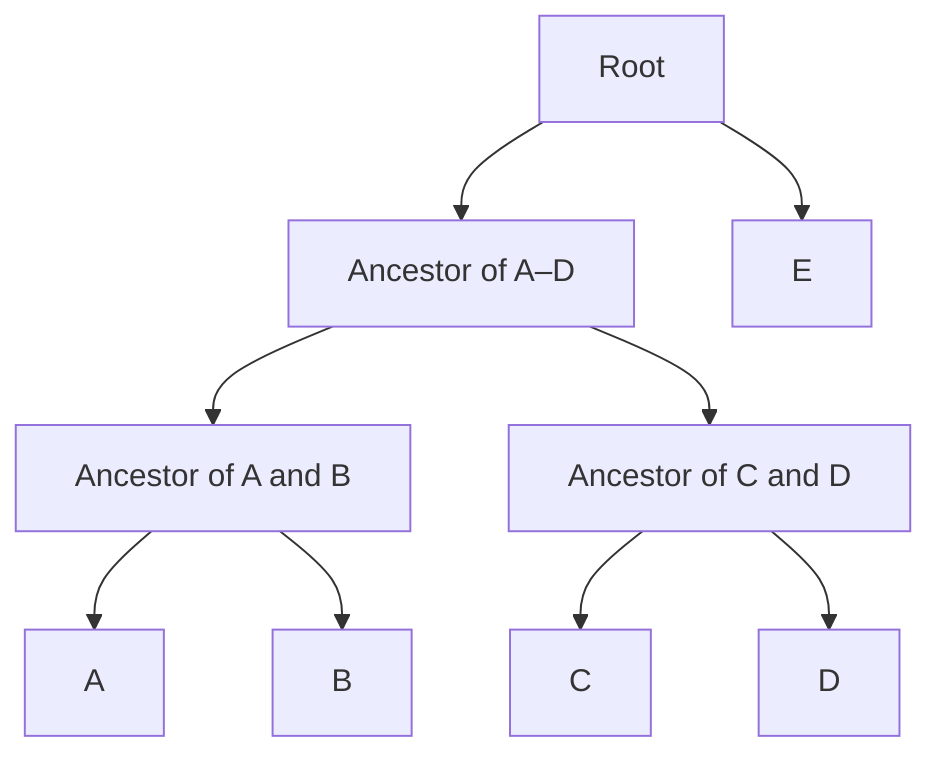

A phylogenetic tree is a statistical hypothesis about evolutionary relationships. It can describe the history of a gene, summarize the branching history of species, or provide the framework for asking how traits evolved. These uses are connected, but they do not all involve the same tree or the same assumptions.

The central task is to connect three levels of reasoning: how sequence data support a tree, how biological processes generate disagreement among trees, and how shared history affects comparisons among living organisms.

## Reading trees as hypotheses about ancestry {#tree-thinking}

The **tips** of a tree represent sampled entities, such as species or gene copies. Internal nodes represent inferred ancestral branching events, and branches connect those events. A **topology** describes the branching relationships independently of branch lengths.

Branch lengths require a scale. In a phylogram they commonly represent expected substitutions per site; in a chronogram they represent time. A cladogram may show only relationships. A long branch therefore does not automatically mean a lineage is old, and a short branch does not automatically indicate a recent speciation event.

Consider this Newick representation:

```text
(((A,B),(C,D)),E);
```

When interpreted as a rooted tree, A and B are sister taxa, as are C and D. The clade containing A–D is sister to E. A clade contains an ancestor and all its descendants: A–D form a clade, whereas a selection such as A, B, and C does not.



The left-to-right order of tips is arbitrary. Rotating branches around an internal node leaves the relationships unchanged. Relatedness is determined by the most recent common ancestor, rather than by the visual distance between labels. All sampled living species have been evolving since their common ancestor; a tip near the root is not an unevolved ancestor of the other tips.

### Rooting and the direction of evolution {#rooting}

An **unrooted tree** specifies connections and splits without identifying the ancestral direction. A root adds that direction. Many standard sequence analyses using time-reversible substitution models estimate an unrooted tree because the likelihood does not identify a root under those models.

An **outgroup** is a lineage known from independent evidence to lie outside the ingroup. It helps place the root, but a very distant outgroup can introduce alignment problems and reconstruction artifacts. **Midpoint rooting** places the root halfway along the longest tip-to-tip path and is most defensible when rates are approximately clocklike. Clock models and suitable non-reversible models provide other approaches, each with additional assumptions.

An unresolved node, or **polytomy**, can represent inadequate information rather than a demonstrated simultaneous radiation. The drawing alone does not distinguish these interpretations.

## From homologous sequences to a phylogeny {#inference-workflow}

Tree inference usually begins by identifying homologous sequences, aligning corresponding positions, choosing an evolutionary model, searching for trees, and assessing uncertainty.

Each step can change the result. Aligning unrelated regions creates false character correspondences. Combining paralogs as if they were orthologs can mix duplication history with speciation history. Poorly aligned positions, compositional bias, missing taxa, and unrecognized recombination can all affect the inferred tree.

**Homology** means common evolutionary origin. Orthologs diverged through speciation, whereas paralogs diverged through gene duplication. Similarity is evidence that may support homology, but it is not its definition.

::: table align="center" title="Major approaches to phylogenetic inference"

| Approach | What it uses or optimizes | Main strength | Main limitation |
| --- | --- | --- | --- |
| Distance methods | Pairwise evolutionary distances | Fast summaries and useful starting trees | Compress site patterns into pairwise summaries |
| Maximum parsimony | Minimum total character changes | Direct interpretation of character transformations | Can be inconsistent under some rate patterns |
| Maximum likelihood | Probability of the data under a tree and model | Explicit substitution process and parameter estimation | Depends on model adequacy and tree search |
| Bayesian inference | Posterior distribution over trees and parameters | Integrates uncertainty under a specified model and priors | Requires adequate sampling and convergence |

:::

Neighbor joining builds a tree from distances without requiring a strict molecular clock. UPGMA assumes an ultrametric structure and is sensitive to violations of that assumption. Neither method makes an uncorrected percentage of mismatches a reliable evolutionary distance when repeated substitutions are common.

Maximum parsimony searches for the tree requiring the fewest changes. A shared derived character, or **synapomorphy**, can support a clade. However, repeated origins and reversals produce **homoplasy**, so the shortest explanation is not always the true historical explanation.

## Substitution models and hidden changes {#substitution-models}

Observed differences underestimate the number of substitutions when a site changes more than once. Substitution models describe these unobserved events probabilistically.

For a continuous-time Markov model with rate matrix $Q$, transition probabilities along a branch of length $t$ are

$$
P(t)=e^{Qt}.
$$

The off-diagonal entries of $Q$ are instantaneous substitution rates, and each row sums to zero.

::: table align="center" title="Common nucleotide model assumptions"

| Model | Equilibrium frequencies | Exchangeability structure |
| --- | --- | --- |
| JC69 | Equal | All nucleotide substitutions equivalent |
| HKY | Unequal | Transitions distinguished from transversions |
| GTR | Unequal | Six reversible exchangeability classes |

:::

For GTR, an off-diagonal element can be written as $q_{ij}=r_{ij}\pi_j$, where $r_{ij}=r_{ji}$ is an exchangeability and $\pi_j$ is the equilibrium frequency of the destination nucleotide. A normalization fixes the overall rate scale.

Under JC69, the corrected distance corresponding to an observed mismatch fraction $p$ is

$$
d=-\frac{3}{4}\ln\left(1-\frac{4p}{3}\right).
$$

For $p=0.10$, this gives approximately $0.107$ substitutions per site. As $p$ approaches $0.75$, the correction diverges: the data become saturated and provide little information about the total number of historical changes.

Sites also evolve at different rates. **$+\Gamma$** models rate variation across sites, usually through a discrete approximation to a gamma distribution. **$+I$** adds a class of invariant sites. These components can be difficult to distinguish because very slow sites can resemble invariant ones.

### Model selection is relative to the candidates {#model-selection}

Two common criteria are

$$
\mathrm{AIC}=2k-2\ln\hat L,
\qquad
\mathrm{BIC}=k\ln n-2\ln\hat L,
$$

where $k$ is the number of estimated parameters and $n$ is the sample size used in the comparison, commonly the number of alignment sites. Lower values indicate a preferred tradeoff between fit and complexity within the candidate set.

A selected model can still be inadequate. For example, comparing several stationary models does not establish that nucleotide composition is stationary across lineages. Partitioning can accommodate different processes across genes or codon positions, but adds parameters and requires enough information to estimate them.

## Likelihood, tree search, and support {#likelihood}

Let $D$ be an alignment, $T$ a topology, $\mathbf b$ its branch lengths, and $\theta$ the substitution-model parameters. Maximum likelihood estimates

$$
(\hat T,\hat{\mathbf b},\hat\theta)
=\arg\max_{T,\mathbf b,\theta}P(D\mid T,\mathbf b,\theta).
$$

Under conditional independence of sites,

$$
L=\prod_{s=1}^{m}P(D_s\mid T,\mathbf b,\theta),
\qquad
\ell=\sum_{s=1}^{m}\ln P(D_s\mid T,\mathbf b,\theta).
$$

For each site, the likelihood sums over possible ancestral states. Felsenstein's pruning recursion makes this calculation efficient. If $L_v(i)$ is the conditional likelihood of the observations below node $v$ given state $i$, then for children $a$ and $b$,

$$
L_v(i)=
\left[\sum_j P_{ij}(t_a)L_a(j)\right]
\left[\sum_k P_{ik}(t_b)L_b(k)\right].
$$

At the root, summing $\pi_iL_{\mathrm{root}}(i)$ over states gives the site likelihood. Unknown ancestral sequences are integrated out; they do not need to be fixed to one guessed sequence before comparing trees.

### Why heuristic searches are necessary {#tree-search}

The number of unrooted, fully bifurcating trees with $n$ labeled tips is

$$
N_{\mathrm{unrooted}}=(2n-5)!!.
$$

For rooted trees it is $(2n-3)!!$. Ten tips already allow 2,027,025 unrooted binary topologies. Optimizing branch lengths and model parameters for every topology quickly becomes impractical.

Heuristic searches therefore explore rearrangements such as nearest-neighbor interchange and subtree pruning and regrafting. Multiple starting trees can reduce dependence on a local optimum. A reported best tree is the best found by the search under its model and settings.

### Bootstrap and Bayesian support answer different questions {#support}

A conventional nonparametric bootstrap resamples alignment columns with replacement, infers a tree for each replicate, and records how often a split reappears. A support value of 95% means that split occurred in 95% of those replicate trees. It is not directly a 95% probability that the evolutionary relationship is true. The original [phylogenetic bootstrap paper](https://doi.org/10.1111/j.1558-5646.1985.tb00420.x) describes the character-resampling framework.

Bayesian inference instead targets

$$
P(T,\mathbf b,\theta\mid D)
\propto P(D\mid T,\mathbf b,\theta)P(T,\mathbf b,\theta).
$$

Posterior clade probabilities summarize sampled trees conditional on the data, model, and priors. They require adequate exploration of the posterior. Bootstrap support and posterior probability are therefore not interchangeable scales.

Neither kind of support corrects systematic error. A very large alignment can give high support to an incorrect relationship if the model consistently misinterprets the data.

## Gene trees and species trees describe different histories {#gene-species-trees}

A gene tree traces ancestry at a locus. A species tree describes population or species divergences. Their branching orders can differ for biological reasons, even if both are estimated accurately.

::: table align="center" title="Sources of gene-tree discordance"

| Process | Why histories differ |
| --- | --- |
| Incomplete lineage sorting (ILS) | Ancestral lineages coalesce deeper than the intervening species split |
| Gene duplication and loss | Sampled copies retain a history of duplication and differential survival |
| Horizontal gene transfer | A gene moves between lineages outside the species branching history |
| Hybridization or introgression | Genomic regions have ancestry crossing species boundaries |
| Estimation error | Limited or biased data yield an incorrect gene tree |

:::

### Incomplete lineage sorting {#ils}

Suppose the species tree is $((H,C),G)$, representing humans, chimpanzees, and gorillas. Backwards in time, the human and chimpanzee lineages enter their shared ancestral population. They may fail to coalesce before reaching the deeper population ancestral to all three species. Any pair can then coalesce first, producing a discordant gene tree without gene flow.

Under the standard three-lineage multispecies coalescent, for an internal branch of length $t$ in coalescent units,

$$
P(\text{matching gene tree})=1-\frac{2}{3}e^{-t},
$$

$$
P(\text{each alternative})=\frac{1}{3}e^{-t}.
$$

Short internal branches increase discordance. For a constant diploid autosomal ancestral population, the interval in coalescent units is $t=\Delta\tau/(2N_e)$ when $\Delta\tau$ is measured in generations.

The [gorilla genome study](https://doi.org/10.1038/nature10842) reported discordant genealogical relationships across approximately 30% of the genome. This concerns local genealogies; it does not mean that humans and chimpanzees cease to be sister species for 30% of their evolutionary history.

### Concatenation and the multispecies coalescent {#concatenation-msc}

**Concatenation** joins loci into a supermatrix and estimates a shared topology, often allowing separate substitution parameters across partitions. It can provide strong signal, but substitution-model partitioning does not explicitly model different locus genealogies caused by ILS.

The **multispecies coalescent (MSC)** instead models gene genealogies within a species tree. Summary approaches first estimate gene trees and then combine them, while joint approaches infer gene and species histories together. Summary methods are scalable but inherit errors in their input gene trees.

There is no universal rule that concatenation always fails or that an MSC analysis always succeeds. The relevant questions are how much genealogical discordance exists, how accurately loci are estimated, and whether the assumed discordance process matches the biology.

### ASTRAL-III and quartet information {#astral}

ASTRAL estimates a species topology by maximizing agreement with four-taxon subtrees, or **quartets**, induced by input gene trees. In its usual constrained search, candidate splits restrict the space in which the optimization is solved. [ASTRAL-III](https://pubmed.ncbi.nlm.nih.gov/29745866/) improves scalability and handles partially resolved input trees.

In an **anomaly zone**, the most probable complete gene-tree topology can differ from the species topology. Simply voting for the most frequent full gene tree can therefore fail. Unrooted four-taxon gene trees avoid this particular anomaly under the standard MSC, providing the basis for quartet methods; see the [original ASTRAL paper](https://doi.org/10.1093/bioinformatics/btu462).

ASTRAL analyses can report local support and internal branch lengths in coalescent units. Those lengths are not substitutions per site or calendar time. ASTRAL estimates an unrooted species topology; rooting requires additional information.

Its consistency result assumes the MSC and accurate gene genealogies. Introgression, paralog contamination, recombination within loci, and gene-tree error require separate consideration. High local support does not establish that ILS is the only source of discordance.

## Comparing trees and recognizing artifacts {#tree-comparison}

The **Robinson–Foulds (RF) distance** counts splits found in one tree but not the other:

$$
d_{\mathrm{RF}}(T_1,T_2)=|S_1\setminus S_2|+|S_2\setminus S_1|.
$$

For two unrooted binary trees on the same $n$ tips, the maximum is $2(n-3)$ when considering nontrivial splits. Software may use normalized forms, so the convention matters. RF distance measures topological disagreement and ignores branch lengths; trees must have a comparable tip set.

**Long-branch attraction** occurs when accumulated changes lead an inference method to group rapidly evolving lineages incorrectly. It is a classic problem for parsimony, although likelihood analyses can also be misled under model misspecification. More appropriate models, additional taxa that subdivide long branches, and attention to alignment quality can help. Removing fast sites or taxa is not automatically a valid solution because it can also discard genuine information.

## Reconstructing ancestral states {#ancestral-states}

Once a tree has been inferred, traits can be mapped onto it to ask what ancestors may have been like. **Ancestral state reconstruction (ASR)** is conditional on the tree, branch lengths, observations, and model of trait evolution.

Likelihood-based reconstruction evaluates

$$
P(D_{\mathrm{trait}}\mid T,M,\theta),
$$

and estimates the relative support for ancestral states. Marginal reconstruction summarizes a node separately while accounting for uncertainty elsewhere; joint reconstruction seeks a most-supported configuration across nodes. They need not yield the same assignments.

A node with probabilities 0.52 and 0.48 is uncertain even if a plot colors it entirely by the first state. Stochastic character mapping can represent distributions of possible transition histories, rather than implying that a single sequence of changes is observed.

### Homology and convergence {#homology-convergence}

Similar structures can reflect inheritance from a common ancestor, independent evolution, or a mixture of ancestral retention and subsequent losses. A shared ancestral character does not uniquely diagnose a more recent clade. **Convergence** describes independently evolved similarity; interpreting it requires a phylogenetic framework.

Seadragons illustrate the distinction between conspicuous morphological resemblance and relationships inferred from sequence data. A sequence-based ML tree can provide the framework for mapping appendage characters. The shape of an appendage alone does not establish that all similar-looking species form a clade, and a tree alone does not establish the developmental mechanism behind a resemblance.

### Historical biogeography {#biogeography}

Ancestral geography is a related reconstruction problem, with geographic ranges as states. [BioGeoBEARS](https://github.com/nmatzke/BioGeoBEARS) supports probabilistic ancestral-range inference and comparisons among range-evolution models.

DEC models dispersal, local range extinction, and range inheritance at lineage splitting. DIVALIKE and BAYAREALIKE implement alternative assumptions about range evolution and inheritance in a likelihood framework. Extensions with a founder-event parameter allow a daughter lineage to establish outside the ancestral range at speciation.

The result depends on area definitions, allowed range sizes, geographic constraints, and sampling. Present-day distributions do not uniquely determine ancestral ranges, and a preferred model within one candidate set is not proof that its processes exclusively generated the observed history.

## Models of trait evolution {#trait-models}

The model used to infer DNA relationships need not be the model used to analyze a phenotype. Continuous and discrete traits require different descriptions of change.

### Brownian motion {#brownian-motion}

For a continuous trait, Brownian motion (BM) is

$$
dX_t=\sigma\,dW_t.
$$

Its increments have expectation zero and variance $\sigma^2\Delta t$. Conditional on an initial value $X_0$,

$$
E[X_t]=X_0,\qquad \operatorname{Var}(X_t)=\sigma^2t.
$$

BM is a statistical baseline for accumulated variation. A good fit does not uniquely demonstrate a particular genetic mechanism or the absence of selection.

### Ornstein–Uhlenbeck evolution {#ou}

An Ornstein–Uhlenbeck (OU) model adds attraction toward an optimum $\theta$:

$$
dX_t=\alpha(\theta-X_t)\,dt+\sigma\,dW_t.
$$

For fixed $X_0$,

$$
E[X_t]=\theta+(X_0-\theta)e^{-\alpha t},
$$

$$
\operatorname{Var}(X_t)=\frac{\sigma^2}{2\alpha}(1-e^{-2\alpha t}).
$$

For $\alpha>0$, the long-run variance is $\sigma^2/(2\alpha)$ and the attraction half-life is $\ln 2/\alpha$. As attraction weakens toward zero, the process approaches BM over a fixed interval. Interpreting an OU fit as evidence of stabilizing selection requires biological justification and attention to estimation uncertainty.

### Early-burst evolution {#early-burst}

An early-burst (EB) model allows the diffusion rate to change through time:

$$
\sigma^2(t)=\sigma_0^2e^{rt},\qquad r<0,
$$

where time increases from the root toward the present. It represents rapid early evolution followed by slowing change. The variance accumulated over a branch from $a$ to $b$ is

$$
\int_a^b\sigma_0^2e^{rt}\,dt
=\frac{\sigma_0^2}{r}(e^{rb}-e^{ra}).
$$

At $r=0$, the limiting model is constant-rate BM. The sign interpretation depends on the time convention, which must therefore be specified.

### Discrete characters: Mk, SYM, and ARD {#discrete-traits}

Discrete states can evolve through a continuous-time Markov process. A simple equal-rates **Mk** model uses a common transition rate among $k$ states. More flexible parameterizations include **SYM**, with paired forward and reverse rates constrained to equality, and **ARD**, with all directional transition rates separately estimated.

For a binary trait, ARD has

$$
Q=
\begin{pmatrix}
-q_{01} & q_{01}\\
q_{10} & -q_{10}
\end{pmatrix}.
$$

Equal-rates and symmetric parameterizations coincide for two states; they differ when there are more states. More parameters are useful only when the data contain enough changes to estimate them. A rare state or one inferred origin provides limited information about transition rates.

## Why species are not independent observations {#nonindependence}

Closely related species share evolutionary history and often resemble one another partly for that reason. A standard statistical analysis that treats every species as an independent replicate can overstate the evidence for an association.

Consider this illustrative contingency table:

::: table align="center" title="A strong-looking association between two binary traits"

| | Arboreal | Not arboreal |
| --- | ---: | ---: |
| Nocturnal | 4 | 0 |
| Not nocturnal | 0 | 6 |

:::

An uncorrected Pearson chi-square statistic is 10, corresponding to approximately $p=0.001565$ with one degree of freedom. Expected cell counts are small, so the asymptotic approximation already deserves caution. More fundamentally, the table omits ancestry.

If the four nocturnal, arboreal species inherited both traits from one ancestor, they may represent only one historical association rather than four independent origins. An exact contingency-table test would address small counts, but would still not account for phylogenetic dependence.

A simplified branch-placement example makes the replication problem visible: if two changes independently choose among 18 equally likely branches, then, conditional on the first placement, the chance of sharing its branch is $1/18\approx0.0556$.

::: note What the branch calculation means

The $1/18$ calculation is an illustrative null model, not a corrected p-value for the contingency table. It assumes equally likely branches and fixed event counts. A formal phylogenetic analysis must account for branch lengths, transition processes, and uncertainty about where changes occurred.

:::

## Independent contrasts and phylogenetic regression {#pic-pgls}

[Felsenstein's comparative-method paper](https://doi.org/10.1086/284325) formalized how shared history can be incorporated into comparative analysis. Two closely connected approaches are phylogenetically independent contrasts and phylogenetic generalized least squares.

### Phylogenetically independent contrasts {#pic}

Under BM, sister lineages accumulate independent changes after their divergence. For trait values $x_1$ and $x_2$ with relevant branch lengths $v_1$ and $v_2$, a standardized contrast is

$$
c_x=\frac{x_1-x_2}{\sqrt{v_1+v_2}}.
$$

The denominator standardizes for the expected variance of the difference. Contrasts are computed recursively, using estimated ancestral values and adjusted branch lengths. For a binary tree with $n$ tips, this yields $n-1$ contrasts.

For two traits, corresponding contrasts can be regressed through the origin under the appropriate model assumptions. The question becomes whether evolutionary changes in one trait are associated with changes in the other. The sign convention for each contrast is arbitrary but must be consistent across traits.

PIC relies on the tree, branch lengths, and model. It is not a generic correction that makes arbitrary discrete-character analyses valid.

### The phylogenetic covariance matrix {#covariance}

Under BM with a fixed ancestral value, covariance between species equals the evolutionary variance rate multiplied by their shared root-to-ancestor path length:

$$
\operatorname{Cov}(X_i,X_j)=\sigma^2C_{ij}.
$$

For an illustrative four-species tree with root-to-tip length 3, with A/B and C/D each sharing 2 units of history within their pairs,

$$
C=
\begin{pmatrix}
3&2&0&0\\
2&3&0&0\\
0&0&3&2\\
0&0&2&3
\end{pmatrix}.
$$

The diagonal entries give total root-to-tip lengths. Off-diagonal entries represent shared evolution, rather than pairwise evolutionary distance. With this root convention the two pairs share no positive-length ancestral branch; adding a shared stem would add covariance across all tips.

### Phylogenetic generalized least squares {#pgls}

PGLS models a response as

$$
\mathbf y=X\boldsymbol\beta+\boldsymbol\varepsilon,
\qquad
\boldsymbol\varepsilon\sim N(\mathbf0,\sigma^2C).
$$

For a known, nonsingular covariance structure,

$$
\hat{\boldsymbol\beta}
=(X^\top C^{-1}X)^{-1}X^\top C^{-1}\mathbf y.
$$

The phylogeny enters through residual covariance. Ordinary least squares assumes residual independence; PGLS allows residual correlations to reflect shared ancestry. Appropriate covariance transformations or alternative evolutionary models can relax a strict BM assumption.

Under corresponding BM assumptions, PIC regression and PGLS are closely related formulations. PGLS also provides a familiar regression framework for intercepts and multiple predictors. The relevant phylogenetic structure is in the residuals conditional on predictors, so an unconditional resemblance among species is not by itself a complete regression diagnosis.

These Gaussian methods should not be applied mechanically to binary outcomes. Discrete-trait questions may require correlated-transition models or phylogenetic generalized models appropriate to the response.

## Carrying uncertainty through the analysis {#interpretation}

A tree estimate supports further inference only through its assumptions and uncertainty. Strong bootstrap support does not guarantee an adequate substitution model. Accurate gene trees do not necessarily share the species topology. A preferred trait model does not uniquely identify an evolutionary mechanism, and a phylogenetic regression does not establish causation.

The useful discipline is to keep each inferential step explicit: which entities the tree represents, what branch lengths measure, which process generates discordance, and how many independent evolutionary changes support a trait association. When plausible trees or models lead to different conclusions, that sensitivity is part of the biological result.
