::: note 英文版
分析和调查均由 Codex 完成并由人工核对，相关结论仅供参考。

本文原始版本由英文撰写，见 [Reverse Engineering HyperOS NFC Anti-Fraud Checks](/blog/hyperos-nfc-anti-fraud-en/)。
:::

在我运行 HyperOS 4、Android 17 的小米手机上，一款 NFC 读卡应用可以正常读取一张 MasterCard 银行卡，但读取银联卡时却失败了。系统提示：

> 此应用来自不可信来源，无法使用 NFC 读卡功能

通过 ADB 更改应用记录的安装来源后，银联卡恢复了正常读取。安装来源因此成了最直接的调查线索，但限制究竟在哪一层生效，仍不清楚：是安全中心拒绝了请求，还是 NFC 服务拦截了指令？抑或这条提示只是对其他故障的描述？

对两个系统 APK 的静态分析串起了这条链路：**安全中心根据安装来源元数据和签名规则计算允许列表；NFC 服务读取这份列表，在某些支付应用选择指令发送到卡片之前将其拒绝。** Toast 提示则是拒绝操作后异步触发的结果。

## 调查的起点：设备上的现象 {#observations}

以下测试使用的是同一部手机和同一款读卡应用：

::: table align="center" title="设备测试现象"

| 配置 | 非银联测试卡 | 银联测试卡 | Toast 警告 |
| --- | --- | --- | --- |
| 普通第三方安装来源 | 读取成功 | 读取失败 | 出现 |
| 暂停整个 `com.android.nfc` 包 | 读取成功 | 读取失败 | 消失 |
| 通过 ADB 安装，并指定受信任的安装器包名 | 读取成功 | 读取成功 | 消失 |

:::

最后一项结果将限制与安装来源元数据联系了起来。暂停应用包的结果则需要更谨慎地解释：包的可见行为受到抑制，既不能证明已有的 NFC 服务进程已经停止，也不能证明警告本身承担了访问控制。

因此，我把调查重点放在安装元数据与 NFC 通信之间的链路上，而不只是显示警告的那段代码。

## 分析范围与证据 {#scope}

本次分析使用了以下样本：

::: table align="center" title="分析使用的 APK 样本"

| 文件 | 包名 | 版本号 | 路径 |
| --- | --- | --- | --- |
| `XMNfcNci.apk` | `com.android.nfc` | `37` | `/system/app/XMNfcNci/XMNfcNci.apk` |
| `MIUISecurityCenter.apk` | `com.miui.securitycenter` | `40001358` | `/product/priv-app/MIUISecurityCenter/MIUISecurityCenter.apk` |

:::

以下 SHA-256 哈希用于标识实际分析的文件内容：

```text
XMNfcNci.apk
58cbb295b7ab3e0f5776e43c49fa3a4e9c2cb193c79e3f3191a1acd9242a8b52

MIUISecurityCenter.apk
9b6c7a3ed636d43d8a279744caacca549f9743ec59f128f6c3e802de72e4816e
```

分析使用了ChatGPT Work 的自定义 DEX 解析器、Androguard 反汇编和 DAD 反编译，并解码了清单文件与资源。对 255 个包含代码的相关方法，两套解码器识别出的指令边界一致。

这种一致性验证的是指令解码结果，而不是生成的 Java 代码中每一行的正确性。部分 DAD 输出存在变量类型错误或控制流不完整的问题。下文的 Java 是结合 DEX 分支核对后**重建的伪代码**，并非原始源码，也不是可以直接编译的反编译结果。

::: note
这些结论仅针对本次提供的 APK。分析没有检查当前的服务端策略、手机上的实时数据库，也没有检查框架层暂停应用包的具体实现。代码中确认的分支与设备上观察到的结果，仍属于不同类型的证据。
:::

## 安全中心决定哪些应用可以访问 {#security-center}

策略代码位于 `MIUISecurityCenter.apk` 的 `classes3.dex` 中，对应类为 `com.miui.nfcaccess.NfcAccessManager`。虽然混淆后的方法名很短，但仍可根据指令还原各自的作用：

::: table align="center" title="还原出的策略方法"

| 方法 | 作用 |
| --- | --- |
| `t(String)` | 读取安装器包名 |
| `y(String)` | 将该包名与受信任安装器常量比较 |
| `j(PackageInfo, List, Map, Map)` | 判断应用是否允许访问 |
| `k(Map, String, List)` | 匹配包名及其签名证书哈希 |
| `v(PackageInfo)` | 收集签名证书哈希 |
| `M(ConfigData)` | 重新生成并保存允许列表 |

:::

### 安装来源检查 {#installer-check}

在 Android 17 上，安装来源查询使用较新的 API：

```java
String t(String packageName) {
  PackageManager pm = app.getPackageManager();
  if (Build.VERSION.SDK_INT < 30) {
    return pm.getInstallerPackageName(packageName);
  }
  return pm.getInstallSourceInfo(packageName).getInstallingPackageName();
}

boolean y(String packageName) {
  return Objects.equals(t(packageName), "com.xiaomi.market"); // [!code highlight]
}
```

对较新 API 的调用经过了编译器生成的桥接类 `com.miui.nfcaccess.h` 和 `com.miui.nfcaccess.i`。这两个类的实现直接调用 `getInstallSourceInfo()` 和 `getInstallingPackageName()`。

因此，受信任的安装器包名**硬编码为 `com.xiaomi.market`**。这一分支不会额外验证安装器的证书，也不会检查发起安装的包，更不能证明应用确实从商店下载。

这一区别解释了 ADB 测试的结果：改变记录中的安装器包名，就可能满足字符串比较，而无需改变读卡应用自身的证书。这并不意味着普通应用可以随意修改安装来源元数据；Android 对写入这些信息的 API 另有权限控制。

### 完整规则不只检查安装来源 {#rule-priority}

`j()` 按以下顺序决定是否允许访问：

```java
boolean allowed(PackageInfo app, List<String> certificateHashes,
  Map whitelist, Map blacklist) {
  if (certificateHashes == null || certificateHashes.isEmpty()) return false;
  if (!declaresNfcPermission(app)) return false;

  if (matchesPackageAndAnyCertificate(blacklist, app.packageName, // [!code highlight]
    certificateHashes)) return false; // [!code highlight]

  if ((app.applicationInfo.flags & ApplicationInfo.FLAG_SYSTEM) != 0)
    return true;

  if (y(app.packageName)) return true;

  return matchesPackageAndAnyCertificate(whitelist, app.packageName,
    certificateHashes);
}
```

远程下发的黑名单和白名单都同时匹配包名**与**签名证书的 SHA-256 哈希。只要任意一个证书哈希匹配，就视为命中。哈希采用大写十六进制编码。

黑名单的优先级高于系统应用豁免、受信任安装器分支和白名单。进入这些分支之前，应用还必须具有签名信息，并声明 `android.permission.NFC` 权限。

所以，将安装器设为 `com.xiaomi.market` 并不等于无条件放行。在其他条件满足的情况下，它可以解释我的测试结果；但命中黑名单的应用仍会被拒绝。

## 规则从哪里来 {#configuration}

`NfcAccessHttpUtil.a(int)` 中包含以下配置端点：

```text
https://fraud-detection.engine.miui.com/nfc/antifraud/config
```

请求参数包括来自 `Build.DEVICE` 的 `deviceModel`，以及 `appDataVersion`。响应模型包含 `enable`、`whiteList`、`blackList` 和 `dataVersion`。

`NfcAccessManager.N()` 负责获取配置。成功响应中的数据版本发生变化时，它会保存配置，并调用 `M()` 重新计算允许访问的应用。获取任务由 `NfcAccessWorker` 调度。

我使用本机参数，以及根据安全中心 APK 逆向结果重建的请求签名函数，向该端点获取了一份响应。此次取得的配置中，`enable=true`，`blackList` 为空，`whiteList` 包含 125 个唯一包名。白名单中有许多常用应用，包括微信、抖音、QQ、支付宝、快手、企业微信、美团、京东、百度、WPS Office、滴滴、爱奇艺、云闪付和 Google Play 服务；此外还有大量银行、支付、公共交通及城市卡应用。

该文件记录的是这一次请求返回的配置，不能据此认定所有设备、地区或后续请求都会收到相同策略。白名单中的每一项都同时包含包名和签名证书的 SHA-256 哈希，因此，仅有相同包名的任意构建并不会自动获得授权。

<LinkCard
  icon="material-symbols:data-object"
  title="查看获取到的 NFC 反诈配置（JSON）"
  href="/assets/miui_nfc_antifraud_config.json"
/>

SQLite 辅助类 `com.miui.nfcaccess.b` 创建 `NfcAccess.db`，其中包含三张表：

```sql
CREATE TABLE blacklist (
  packageName TEXT PRIMARY KEY, sign TEXT NOT NULL
);
CREATE TABLE whitelist (
  packageName TEXT PRIMARY KEY, sign TEXT NOT NULL
);
CREATE TABLE nfc_access_app_list (
  packageName TEXT PRIMARY KEY, sign TEXT NOT NULL
);
```

证书哈希以逗号分隔的字符串形式存储在数据库中。配置版本和启用标志则分别使用持久化键 `nfc_access_data_version` 和 `nfc_access_enable`。

由此可以区分三类策略信息：

- 受信任的安装器包名是本地代码中的常量。
- 启用标志，以及基于证书的黑白名单，由配置下发并保存在本地。
- 允许列表是根据已安装应用计算得到的快照。

**单次 NFC 请求不会访问远程服务器，也不会重新读取调用方的安装来源。** 它使用的是已经生成的策略快照。

## Provider 返回的是 JSON，而不是 Cursor {#provider}

安全中心通过以下 authority 暴露 `com.miui.nfcaccess.NfcAccessProvider`：

```text
content://com.miui.securitycenter.NfcAccessProvider
```

清单将其注册在 `com.miui.securitycenter.remote` 进程中，设置 `exported=true`，并要求 `com.miui.securitycenter.permission.NFC_READER_ACCESS` 权限。NFC APK 声明了对该权限的请求。

相关入口返回一个 Bundle，其 `accessValue` 字段包含 JSON 字符串。以下标签页分别展示重建的 Provider 方法，以及策略已启用且成功获取列表时的 JSON 结构。

::: code-tabs

@tab provider.java

```java
Bundle call(String method, String arg, Bundle extras) {
  if (!method.equals("get_nfc_reader_access")) return null;

  Bundle result = new Bundle();
  result.putString("accessValue", NfcAccessManager.p());
  return result;
}
```

@tab response.json

```json
{
  "version": 1,
  "isEnable": true,
  "allowedPkgs": ["com.example.reader"]
}
```

:::

这里的 JSON 只是结构示例，并非从设备上捕获的输出。策略禁用时，模型中的列表可能为 null，因此不能假定每个响应都包含数组。

Provider 的 `query()` 方法会抛出 `SecurityException`，这里并不存在基于 Cursor 的查询协议。NFC 侧的 `com.android.nfc.AccessRuleManager` 使用 `ContentResolver.call()`，从返回的 Bundle 中读取 `accessValue`。

它解析 `isEnable` 和 `allowedPkgs`，更新运行时策略，并且只有在完成解析流程后才设置 `mDataFetchedOnce=true`。当安全中心通知该 URI 发生变化时，ContentObserver 会触发后续刷新。

## 哪些 APDU 被视为敏感操作 {#payment-apdus}

**应用协议数据单元（application protocol data unit，APDU）**承载与智能卡交换的命令或响应。**应用标识符（application identifier，AID）**用于标识卡片上的应用。在这一实现中，敏感操作是选择 AID 以以下两个常量之一开头的支付应用：

::: table align="center" title="支付应用的 AID 前缀"

| `com.android.nfc.ApduUtils` 中的常量 | 十六进制字节 |
| --- | --- |
| `PBOC_DEBIT_AID` | `A000000333010101` |
| `PBOC_CREDIT_AID` | `A000000333010102` |

:::

实际判断逻辑内联在以下方法中：

```text
com.android.nfc.NfcService$TagService
transceive(int handle, byte[] data, boolean raw)
  → android.nfc.TransceiveResult
```

重建后的逻辑如下：

```java
boolean paymentSelect(byte[] apdu) {
  if (apdu.length < 5) return false;
  if ((apdu[1] & 0xff) != 0xA4) return false;

  int end = 5 + (apdu[4] & 0xff);
  if (apdu.length < end) return false;

  byte[] data = Arrays.copyOfRange(apdu, 5, end);
  return startsWith(data, hex("A000000333010101")) // [!code highlight]
    || startsWith(data, hex("A000000333010102")); // [!code highlight]
}
```

它检查 SELECT 指令字节，将第五个字节解释为短格式的数据长度，然后比较数据字段的前八个字节。这一分支没有要求 CLA、P1 或 P2 取特定值，也不是完整的扩展长度 APDU 解析器。

`ApduUtils` 初始化时还会出现其他支付相关常量，包括其他卡组织标识和 `2PAY.SYS.DDF01`。但实际判断条件只使用上面的两个前缀，其他常量的存在不能作为这一分支还匹配其他值的证据。

这解释了为什么其他卡片仍可能正常读取，也限定了“拦截银联卡”这一说法的范围：**代码拦截的是满足条件的指令，而不是统一识别并阻止所有银联卡。** 由于测试时没有捕获 APDU，究竟是哪条指令失败，仍只能根据现有机制推断。

## NFC 服务在通信之前拒绝指令 {#enforcement}

对满足条件的 APDU，NFC 服务先检查是否可以跳过检查。如果仍需检查，它会通过 `Binder.getCallingPid()` 获取调用方 PID，在 ActivityManager 中查找对应的运行进程，并取 `RunningAppProcessInfo.pkgList[0]`。

这条路径是根据 PID 查找进程所属包，而不是直接调用 `getPackagesForUid()`。外层服务方法仍会执行常规的 NFC 权限检查。访问记录中跟踪的活跃包，也不能与这里从 Binder 调用方进程中选出的包混为一谈。

如果调用方拥有缓存中的特殊豁免，或出现在安全中心的允许包名数组中，就会被放行。否则，该方法会将警告消息加入队列，并返回：

```java
Message message = tagFlare.uiHandler.obtainMessage();
message.what = 1;
message.obj = "forbidden";
tagFlare.uiHandler.sendMessage(message);

return new TransceiveResult(1, null); // [!code highlight]
```

DEX 中的返回指令位于相对于方法起点的代码单元偏移 `0x02e6`。底层通信调用则出现在更后面的 `0x0330`：

```java
tagEndpoint.transceive(data, raw, status);
```

被拒绝的路径不会执行到这一步。服务向应用返回错误，不会向卡片发送“拒绝 APDU”，也不会关闭 NFC 控制器。

要确定这个错误结果最终在框架层引发哪一种异常，还需要检查该 ROM 的 `TransceiveResult` 和卡片技术相关框架实现。这些类不在本次分析的两个 APK 中。

`isSensitiveAccessAllowed`、`isPaymentApdu` 和 `shouldBypassSecurityChecks` 等名称以日志字符串的形式保留下来，但在提取出的实现中，它们并不是独立的方法。因此，如果运行时 Hook 以这些名称为目标，假定存在对应方法，就会错过真正执行判断的代码。

## 两条策略通道，两种不同协议 {#policy-channels}

此外还存在一个特殊豁免缓存：

```text
content://com.android.nfc/access_rules_of_taginfomonitor
```

`AccessControlEnforcer` 初始化 `AccessRuleCache`，后者查询这个 URI，并从 Cursor 中读取 `package_name` 和 `allowed` 两列。`allowed` 为非零值时授予豁免。ContentObserver 会更新一个由 AtomicReference 持有的不可变映射。

条目缺失或值为 false，本身并不意味着拒绝访问；它只表示调用方没有这项特殊豁免，仍需继续接受安全中心允许列表的检查。

在两个 APK 的已分析代码和清单注册信息中，都没有找到对应的 Provider 实现。它究竟属于哪个包，以及设备上的实际规则是什么，仍不清楚。不能仅因为两者都提供 NFC 策略，就将它与安全中心的 JSON Provider 混为一谈。

## 为什么缺少策略时可能放行 {#fail-open}

敏感指令路径中，用于跳过检查的表达式可重建为：

```java
boolean bypass = !tagFlare.mTagFlareEnabled // [!code highlight]
  || !AccessRuleManager.getInstance().mDataFetchedOnce // [!code highlight]
  || TagInfoHelper.ROOT_PRIVILEGES_FULL_ACCESS; // [!code highlight]
```

如果安全中心从未成功向当前 NFC 进程提供策略，即使缓存中的功能设置显示保护已启用，也会允许访问。内嵌日志明确将这一功能描述为选择性启用（opt-in），并将这种行为称为失败时放行（fail-open）。

这种初始的 fail-open 行为，可以避免策略来源不可用时阻断通信。后续 Provider 故障会如何影响已有的允许列表，以及之前获取的策略是否仍然有效，需要另行验证。

## 为什么 Toast 消失后仍然无法访问 {#toast}

`com.android.nfc.TagFlare$1.handleMessage(Message)` 在 `what == 1` 时显示警告，对应资源为：

```text
nfc_anti_fraud_alert_message
0x7f1101cf = 2131821007
```

处理器调用 `Toast.makeText(..., Toast.LENGTH_SHORT).show()`，并抑制五秒内重复出现的警告。

消息在拒绝分支中进入队列，但显示消息并不是返回失败的 `TransceiveResult` 的前提。因此，限制 Toast 显示频率或取消 Toast，都不能撤销访问拒绝。

这种分离与暂停应用包的实验现象相符，但该 ROM 为什么会抑制被暂停包的 Toast，仍未确定。要解释相关日志 `Toast already killed. pkg=com.android.nfc`，还需要对应版本的通知与包管理框架代码。

## 完整流程 {#flow}

### 策略生成与刷新 {#policy-generation-steps}

::: steps

1. **获取配置。** `NfcAccessWorker` 调度 `NfcAccessManager.N()` 获取配置。成功响应中的数据版本发生变化时，保存配置并触发 `M()`。
2. **重新计算允许列表。** 安全中心检查签名信息和 NFC 权限声明，优先应用黑名单，然后依次检查系统应用、受信任安装器和白名单分支。
3. **提供策略快照。** 计算出的列表保存在本地，安全中心通过 `NfcAccessProvider` 以 JSON 形式提供策略。
4. **刷新 NFC 运行时策略。** `AccessRuleManager` 使用 `ContentResolver.call()` 读取 Provider 响应。URI 发生变化时，ContentObserver 会触发后续刷新。

:::

### 请求判定 {#request-evaluation-steps}

::: steps

1. **识别敏感指令。** 服务检查 APDU 是否选择了与任一支付 AID 前缀匹配的应用。其他指令继续正常通信。
2. **检查是否跳过检查。** 功能未启用、尚未获取策略，或全访问标志已启用时，允许指令继续执行。
3. **识别并检查调用方。** 如果仍需检查，服务根据 PID 确定调用方包名，并检查特殊豁免缓存和安全中心允许列表。
4. **通信或拒绝。** 允许的调用方执行 `TagEndpoint.transceive()`；否则，服务将警告 Toast 加入队列，并在与卡片通信之前返回失败的 `TransceiveResult`。

:::

### 策略与请求之间的依赖关系 {#flow-dependencies}

```mermaid
flowchart TD
  I["安装来源元数据与应用证书"] --> S["安全中心计算允许列表"]
  C["远程启用标志与证书名单"] --> S
  S --> R["Provider JSON 更新 NFC 策略"]
  A["应用发起 transceive 请求"] --> D{"匹配支付 SELECT 指令？"}
  D -- 否 --> H["TagEndpoint 通信"]
  D -- 是 --> B{"未启用、尚无策略或全访问标志已开启？"}
  B -- 是 --> H
  B -- 否 --> K["根据 PID 确定调用方包名"]
  K --> E{"具有特殊豁免或命中允许列表？"}
  R --> E
  E -- 是 --> H
  E -- 否 --> F["返回失败的 TransceiveResult"]
  E -- 否 --> T["将警告 Toast 加入队列"]
```



策略生成路径与请求路径在不同时间运行。这张图展示的是它们之间的依赖关系，并不意味着每条 APDU 都会同步查询服务器。

## Shizuku 与安装来源元数据 {#shizuku}

[Shizuku](https://shizuku.rikka.app/introduction/) 让应用通过具有 ADB 或 root 权限的进程调用系统 API。在非 root 模式下，它提供 shell 级别的能力；启动 Shizuku 本身不会自动改变 NFC 策略，也不会向 NFC 进程注入代码。

针对这一限制，如果使用 Shizuku 的安装器支持指定安装来源，且 ROM 允许执行相应安装操作，那么它可能复现已观察到的安装时来源变更。这是根据机制得出的推断，并不是对某款 Shizuku 应用的实测结论。

安装时明确指定安装器包名，与修改已有的安装器关联，是两种不同操作：

```bash
# 成功实验中使用的安装时指定来源方式。
adb install -i com.xiaomi.market reader.apk
```

不能将 `pm set-installer` 描述成等价且不受限制的捷径。[Android API 文档](<https://developer.android.com/reference/android/content/pm/PackageManager#setInstallerPackageName(java.lang.String,%20java.lang.String)>) 描述了涉及调用方、拟指定的安装器和已有安装器的证书检查。目标读卡应用本身并不是这组证书比较的核心对象。

Shizuku 的 shell 身份不会让这些检查自动消失。这里有实验支持的非 root 路径，是在安装时指定来源，再重新计算策略，而不是假定安装后可以任意修改关联。

## 面向 root 或调试版本的内置全访问开关 {#root-switch}

进一步检查代码后，可以找到 `ROOT_PRIVILEGES_FULL_ACCESS` 的切换方式。`TagInfoHelper$1.onReceive()` 处理以下广播：

```text
Action: android.provider.Telephony.SECRET_CODE
Data:   android_secret_code://63283
```

接受广播的条件大致如下：

```java
boolean accepted = Build.isDebuggable();
if (!accepted) {
  accepted = !TextUtils.isEmpty(firstOutputLineOf("which su"));
}

if (accepted) {
  synchronized (TagInfoHelper.mLock) {
    TagInfoHelper.ROOT_PRIVILEGES_FULL_ACCESS ^= true; // [!code highlight]
  }
}
```

正式版本中的检查是在 NFC 进程的命令环境中查找 `su`，并不会实际执行 `su` 来验证是否已获得权限。反过来，即使设备已 root，如果 `su` 被隐藏，或该进程无法访问它，也可能无法通过检查。

接收器在启用 NFC 时动态注册。具有 root 权限的 shell 可能通过以下命令触发它：

```bash
su -c 'am broadcast -a android.provider.Telephony.SECRET_CODE -d android_secret_code://63283 -p com.android.nfc'
```

::: note
该命令根据接收器代码推导而来，没有在设备上实测。成功提交广播，并不能证明接收器已经收到或接受广播。NFC 必须处于启用状态，而且接收器检查的是自身环境，而不是发送方是否具有 root 身份。
:::

代码会显示 Toast，内容为新的 `ROOT_PRIVILEGES_FULL_ACCESS` 值，或 `TagInfoMonitor device is not rooted`。这些是 APK 中找到的字符串，并非成功 root 测试中捕获的输出。

该操作会切换标志值，因此重复执行也可能关闭放行开关。标志保存在进程的静态内存中，初始值为 false；重启 NFC 进程后就会重置。值为 true 时，它会普遍跳过调用方的这一反诈检查，而不是只对某个应用授予例外。

root 还提供了其他可能的干预位置，但本次没有实现或测试任何一种：

::: table align="center" title="尚未测试的 root 干预位置"

| 方式 | 相关位置 | 主要限制 |
| --- | --- | --- |
| 通过运行时 Hook 设置全访问标志 | NFC 进程中的 `TagInfoHelper` | 需要兼容的进程注入方式；豁免范围较广 |
| 覆盖指定应用的安装来源判断 | 安全中心的 `NfcAccessManager.y(String)` | 必须重新计算策略；黑名单仍优先生效 |
| 覆盖指定调用方的允许列表匹配 | NFC `transceive()` 中的内联逻辑 | 必须定位实际编译后的执行路径 |
| 修改计算得到的数据库列表 | `NfcAccess.db`、`nfc_access_app_list` | 重新计算可能覆盖修改；还需考虑缓存和 SQLite WAL |
| 修改 DEX 指令 | 实际比较或拒绝分支 | 系统 APK 签名、优化产物和系统更新都会增加部署难度 |

:::

对于机制调查，内置标志是代码证据最直接支持的线索。要为单个应用提供持久例外，则需要作用范围更小的干预方式，并单独验证。

## 尚未解决的问题 {#limitations}

这两个 APK 足以确认安装来源元数据与支付 SELECT 指令被拒绝之间的核心联系，但不能据此确定每台设备上的实时策略，也无法解释所有可能的 NFC 故障。

剩余问题包括：最初测试中究竟是哪条 APDU 失败；特殊豁免 Provider 属于哪个包；当前数据库和远程配置包含什么；以及该 ROM 的框架如何处理被暂停应用包的 Toast 和失败的 `TransceiveResult` 对象。

理解这一机制，需要区分三个层次：**安全中心生成策略，NFC 服务在通信前执行策略，界面随后报告判定结果。** 修改安装来源元数据影响的是第一层，抑制 Toast 影响的是最后一层。只有前者能够解释安装实验中恢复读卡的现象。

## 法律声明 {#legal}

本研究在我自己的设备上进行，使用的是我自己的测试应用，旨在用于教育和合法的安全研究。讨论绕过机制并不代表认可其使用。用户在操作设备和软件时，应自行确保遵守适用法律及服务条款。

文中涉及的第三方名称、商标、代码片段及其他受版权保护的材料，其权利仍归各自权利人所有。引用这些材料是为了识别、评论、互操作性分析和安全研究。我与小米集团及其子公司、关联公司或相关实体没有任何关联，本研究也未受其委托、赞助或授权。本文不暗示小米集团或任何其他权利人对本研究的认可。

如果您认为本页内容侵犯了您的版权或其他权利，请通过本站公布的联系渠道，善意提交相关通知。请说明受保护的作品、存在争议的材料及其位置、您的联系方式，以及主张权利的依据。我会审查收到的通知，并视情况更正内容、补充署名、限制访问或移除相关材料。明知不实仍提交虚假或误导性主张，可能产生法律后果。
