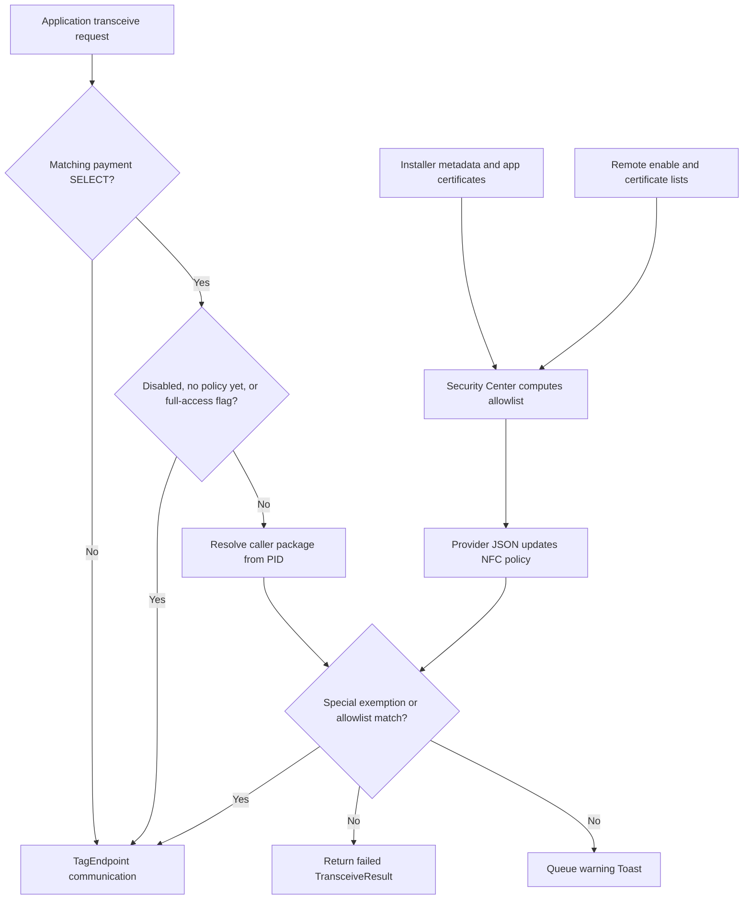

::: note Translation
The analysis and investigation were performed by Codex and manually verified. The conclusions are for reference only.

This is the original English version. The Chinese version, automatically translated by AI, can be found here: [HyperOS 的 NFC 反诈检查机制的逆向分析](/blog/hyperos-nfc-anti-fraud-cn/).
:::

On my Xiaomi phone running HyperOS 4 with Android 17, an NFC reader could read one MasterCard EMV card normally but failed when I tried a UnionPay card. The system displayed:

> This app came from an untrusted source. NFC card reading isn't available.

Changing the app's recorded installer through ADB restored UnionPay reading. That made installation provenance the obvious lead, but it did not reveal where the restriction was enforced. Was Security Center rejecting a request, was the NFC service blocking a command, or was the warning merely describing another failure?

Static analysis of two system APKs established the connection: **Security Center computes an allowed-app list using installer metadata and signature rules; the NFC service consumes that list and rejects certain payment application selection commands before sending them to the card.** The Toast is an asynchronous consequence of that rejection.

## The observations that started the investigation {#observations}

These tests used the same phone and reader application:

::: table align="center" title="Device observations"

| Configuration                                       | Non-UnionPay test card | UnionPay test card | Warning Toast |
| --------------------------------------------------- | ---------------------- | ------------------ | ------------- |
| Ordinary third-party installation source            | Read successfully      | Failed             | Appeared      |
| Entire `com.android.nfc` package suspended          | Read successfully      | Failed             | Disappeared   |
| Installed through ADB with a trusted installer name | Read successfully      | Read successfully  | Disappeared   |

:::

The last result linked the restriction to installer metadata. The suspension result was more subtle: suppressing a package's visible behavior establishes neither that its existing NFC service process has stopped nor that the warning itself performs access control.

I therefore focused on the path between installation metadata and NFC communication, rather than stopping at the code that displays the warning.

## Scope and evidence {#scope}

The analysis covered these exact samples:

::: table align="center" title="Analyzed APK samples"

| File                     | Package                   | Version Code     | Path             |
| ------------------------ | ------------------------- | ---------------- | ---------------- |
| `XMNfcNci.apk`           | `com.android.nfc`         | `37`             | `/system/app/XMNfcNci/XMNfcNci.apk` |
| `MIUISecurityCenter.apk` | `com.miui.securitycenter` | `40001358`       | `/product/priv-app/MIUISecurityCenter/MIUISecurityCenter.apk` |

:::

Their SHA-256 hashes identify the analyzed bytes:

```text
XMNfcNci.apk
58cbb295b7ab3e0f5776e43c49fa3a4e9c2cb193c79e3f3191a1acd9242a8b52

MIUISecurityCenter.apk
9b6c7a3ed636d43d8a279744caacca549f9743ec59f128f6c3e802de72e4816e
```

The work used a custom DEX parser on Codex Cloud, Androguard disassembly and DAD decompilation, and decoded manifests and resources. Instruction boundaries agreed between the two decoders for 255 relevant methods with code.

That agreement validates instruction decoding, not every line of generated Java. Some DAD output contained incorrect variable types and incomplete control flow. The Java below is **reconstructed pseudocode**, checked against DEX branches, rather than original source or directly compilable decompiler output.

::: note
These findings apply to the supplied APKs. The current server-side policy, the phone's live databases, and the framework implementation of package suspension were not inspected. A code-confirmed branch and an observed device outcome remain different kinds of evidence.
:::

## Security Center decides which apps are allowed {#security-center}

The policy code is in `com.miui.nfcaccess.NfcAccessManager`, in `classes3.dex` of `MIUISecurityCenter.apk`. Its obfuscated method names are short, but their roles can be recovered from their instructions:

::: table align="center" title="Recovered policy methods"

| Method                           | Role                                                  |
| -------------------------------- | ----------------------------------------------------- |
| `t(String)`                      | Read the installing package name                      |
| `y(String)`                      | Compare that name with the trusted installer constant |
| `j(PackageInfo, List, Map, Map)` | Decide whether an application is allowed              |
| `k(Map, String, List)`           | Match a package and its signing-certificate hashes    |
| `v(PackageInfo)`                 | Collect signing-certificate hashes                    |
| `M(ConfigData)`                  | Rebuild and save the allowed-app list                 |

:::

### The installer check {#installer-check}

The installer lookup uses the modern API on Android 17:

```java
String t(String packageName) {
  PackageManager pm = app.getPackageManager();
  if (Build.VERSION.SDK_INT < 30) {
    return pm.getInstallerPackageName(packageName);
  }
  return pm.getInstallSourceInfo(packageName).getInstallingPackageName();
}

boolean y(String packageName) {
  return Objects.equals(t(packageName), "com.xiaomi.market"); // [!code highlight]
}
```

The newer API calls pass through synthetic bridge classes `com.miui.nfcaccess.h` and `com.miui.nfcaccess.i`. Their implementations directly invoke `getInstallSourceInfo()` and `getInstallingPackageName()`.

The trusted installer name is therefore **hardcoded as `com.xiaomi.market`**. This branch does not additionally verify the installer's certificate, inspect the initiating package, or prove that the app was downloaded from the store.

That distinction explains the ADB result: changing the recorded installing package can satisfy the string comparison without changing the reader application's own certificate. It does not mean ordinary applications are free to modify installer metadata; Android separately controls the APIs that write it.

### The full rule is broader than installer provenance {#rule-priority}

The allow decision in `j()` follows this order:

```java
boolean allowed(PackageInfo app, List<String> certificateHashes,
  Map whitelist, Map blacklist) {
  if (certificateHashes == null || certificateHashes.isEmpty()) return false;
  if (!declaresNfcPermission(app)) return false;

  if (matchesPackageAndAnyCertificate(blacklist, app.packageName, // [!code highlight]
    certificateHashes)) return false; // [!code highlight]

  if ((app.applicationInfo.flags & ApplicationInfo.FLAG_SYSTEM) != 0)
    return true;

  if (y(app.packageName)) return true;

  return matchesPackageAndAnyCertificate(whitelist, app.packageName,
    certificateHashes);
}
```

Both remote lists match package names **and** signing-certificate SHA-256 hashes. Any matching certificate hash is sufficient for a match. The hashes are encoded in uppercase hexadecimal.

The blacklist takes precedence over the system-app exemption, the trusted-installer branch, and the whitelist. An app also needs signing information and a declared `android.permission.NFC` permission before reaching those branches.

Consequently, setting `com.xiaomi.market` as the installer is not an unconditional exemption. It explains my test under the other applicable conditions, but a blacklisted app would still be rejected.

## Where the rules come from {#configuration}

`NfcAccessHttpUtil.a(int)` contains this configuration endpoint:

```text
https://fraud-detection.engine.miui.com/nfc/antifraud/config
```

Its request parameters include `deviceModel`, derived from `Build.DEVICE`, and `appDataVersion`. The response model contains `enable`, `whiteList`, `blackList`, and `dataVersion`.

`NfcAccessManager.N()` retrieves configuration. When a successful response has a different data version, it saves the configuration and invokes `M()` to recompute allowed applications. `NfcAccessWorker` schedules the retrieval work.

Using parameters from my own device and a request-signing function reconstructed from the Security Center APK, I retrieved one response from this endpoint. The captured configuration has `enable=true`, an empty `blackList`, and 125 unique package entries in `whiteList`. Many are widely used applications, including WeChat, Douyin, QQ, Alipay, Kuaishou, WeCom, Meituan, JD, Baidu, WPS Office, DiDi, iQIYI, UnionPay, and Google Play services. It also includes numerous banking, payment, public-transport, and city-card applications.

This file is evidence of the configuration returned for that particular request, rather than proof that every device, region, or later request receives the same policy. Each whitelist entry pairs a package name with a signing-certificate SHA-256 hash, so the presence of a package name alone does not authorize an arbitrary build using that name.

<LinkCard
  icon="material-symbols:data-object"
  title="View the captured NFC anti-fraud configuration (JSON)"
  href="/assets/miui_nfc_antifraud_config.json"
/>

The SQLite helper `com.miui.nfcaccess.b` creates `NfcAccess.db` with three tables:

```sql
CREATE TABLE blacklist (
  packageName TEXT PRIMARY KEY, sign TEXT NOT NULL
);
CREATE TABLE whitelist (
  packageName TEXT PRIMARY KEY, sign TEXT NOT NULL
);
CREATE TABLE nfc_access_app_list (
  packageName TEXT PRIMARY KEY, sign TEXT NOT NULL
);
```

Certificate hashes are stored as comma-separated strings in the database. The configuration version and enable flag use separate persistence keys, `nfc_access_data_version` and `nfc_access_enable`.

This gives three distinct policy ingredients:

- The trusted installer name is a local code constant.
- The enable flag and certificate-based black/whitelists are supplied through configuration and persisted locally.
- The allowed-app list is a computed snapshot of installed applications.

**An individual NFC request does not contact the remote server or reread its caller's installer.** It uses the resulting policy snapshot.

## The Provider returns JSON, not a Cursor {#provider}

Security Center exposes `com.miui.nfcaccess.NfcAccessProvider` under this authority:

```text
content://com.miui.securitycenter.NfcAccessProvider
```

The manifest registers it in `com.miui.securitycenter.remote`, with `exported=true` and the permission `com.miui.securitycenter.permission.NFC_READER_ACCESS`. The NFC APK requests that permission.

The relevant entry point returns a Bundle whose `accessValue` entry contains a JSON string. The tabs show the reconstructed Provider method and the JSON shape for an enabled policy with a successfully obtained list.

::: code-tabs

@tab provider.java

```java
Bundle call(String method, String arg, Bundle extras) {
  if (!method.equals("get_nfc_reader_access")) return null;

  Bundle result = new Bundle();
  result.putString("accessValue", NfcAccessManager.p());
  return result;
}
```

@tab response.json

```json
{
  "version": 1,
  "isEnable": true,
  "allowedPkgs": ["com.example.reader"]
}
```

:::

The JSON is a schema illustration, not captured device output. The model can contain a null list in disabled cases, so it should not be assumed that every response contains an array.

The Provider's `query()` method throws `SecurityException`. There is no Cursor-based query protocol here. The NFC consumer, `com.android.nfc.AccessRuleManager`, uses `ContentResolver.call()` and reads `accessValue` from the returned Bundle.

It parses `isEnable` and `allowedPkgs`, updates the runtime policy, and marks `mDataFetchedOnce=true` only after completing the parsing path. A ContentObserver triggers subsequent refreshes when Security Center notifies the URI.

## Which APDUs are treated as sensitive? {#payment-apdus}

An **application protocol data unit (APDU)** carries a command or response exchanged with a smart card. An **application identifier (AID)** identifies an application on the card. In this implementation, the sensitive operation is selecting a payment application whose AID begins with one of two constants:

::: table align="center" title="Payment AID prefixes"

| Constant in `com.android.nfc.ApduUtils` | Hexadecimal bytes  |
| --------------------------------------- | ------------------ |
| `PBOC_DEBIT_AID`                        | `A000000333010101` |
| `PBOC_CREDIT_AID`                       | `A000000333010102` |

:::

The actual test is inlined into:

```text
com.android.nfc.NfcService$TagService
transceive(int handle, byte[] data, boolean raw)
  → android.nfc.TransceiveResult
```

The reconstructed logic is:

```java
boolean paymentSelect(byte[] apdu) {
  if (apdu.length < 5) return false;
  if ((apdu[1] & 0xff) != 0xA4) return false;

  int end = 5 + (apdu[4] & 0xff);
  if (apdu.length < end) return false;

  byte[] data = Arrays.copyOfRange(apdu, 5, end);
  return startsWith(data, hex("A000000333010101")) // [!code highlight]
    || startsWith(data, hex("A000000333010102")); // [!code highlight]
}
```

It checks the SELECT instruction byte and interprets the fifth byte as a short-form data length. It then compares the first eight data bytes. It does not enforce specific CLA, P1, or P2 values in this branch, and it is not a complete extended-length APDU parser.

Other payment-related constants appear during `ApduUtils` initialization, including other network identifiers and `2PAY.SYS.DDF01`. The active condition uses only the two prefixes above; the other constants are not evidence of additional matches in this branch.

This explains why an unrelated card can remain readable. It also narrows the UnionPay claim: **the code blocks matching commands, rather than universally classifying and blocking every UnionPay card.** Without an APDU capture from my test, the exact command that failed remains inferred.

## The service rejects the command before communication {#enforcement}

For a matching APDU, the NFC service first evaluates the bypass conditions. If checks remain active, it resolves the caller using `Binder.getCallingPid()`, finds the matching running process through ActivityManager, and takes `RunningAppProcessInfo.pkgList[0]`.

This particular path uses a PID-to-process-package lookup, not a direct `getPackagesForUid()` lookup. The outer service method still performs ordinary NFC permission checks. The active package tracked for access records should not be confused with the package selected from the Binder caller's process.

The caller is allowed if it has a special cached exemption or appears in Security Center's allowed-package array. Otherwise the method queues a warning message and returns:

```java
Message message = tagFlare.uiHandler.obtainMessage();
message.what = 1;
message.obj = "forbidden";
tagFlare.uiHandler.sendMessage(message);

return new TransceiveResult(1, null); // [!code highlight]
```

The DEX return occurs at method-relative code-unit offset `0x02e6`. The lower-level call appears later, at `0x0330`:

```java
tagEndpoint.transceive(data, raw, status);
```

The rejected path never reaches it. The service returns an error to the application; it does not transmit a rejection APDU to the card or disable the NFC controller.

The exact framework exception produced from that error result requires the ROM's `TransceiveResult` and tag-technology framework implementations. Those classes were outside the two input APKs.

Names such as `isSensitiveAccessAllowed`, `isPaymentApdu`, and `shouldBypassSecurityChecks` survive as log strings. They are not separate methods in the extracted implementation, so a runtime hook targeting an imagined method with one of those names would miss the real code.

## Two policy channels, with different protocols {#policy-channels}

There is also a special exemption cache:

```text
content://com.android.nfc/access_rules_of_taginfomonitor
```

`AccessControlEnforcer` initializes `AccessRuleCache`, which queries this URI and expects Cursor columns `package_name` and `allowed`. A nonzero `allowed` value grants an exemption. A ContentObserver updates an immutable map held in an AtomicReference.

Missing or false entries do not independently deny access. They mean the caller lacks this special exemption and must proceed through the Security Center allowlist check.

The corresponding Provider implementation was not found in either APK's analyzed code or manifest registrations. Its actual owning package and live rules remain unknown. It must not be conflated with Security Center's JSON Provider simply because both supply NFC policy.

## Why a missing policy can allow access {#fail-open}

The reconstructed bypass expression for the sensitive-command path is:

```java
boolean bypass = !tagFlare.mTagFlareEnabled // [!code highlight]
  || !AccessRuleManager.getInstance().mDataFetchedOnce // [!code highlight]
  || TagInfoHelper.ROOT_PRIVILEGES_FULL_ACCESS; // [!code highlight]
```

If Security Center has never successfully supplied policy to the current NFC process, access is allowed, even when a cached feature setting says the protection is enabled. The embedded logs explicitly describe the feature as opt-in and the behavior as fail-open.

This initial fail-open behavior protects communication when the policy source is unavailable. How later Provider failures affect an existing allowlist, and whether a previously fetched policy remains current, require separate verification.

## Why the Toast can disappear while access remains blocked {#toast}

`com.android.nfc.TagFlare$1.handleMessage(Message)` displays the warning for `what == 1`. Its resource is:

```text
nfc_anti_fraud_alert_message
0x7f1101cf = 2131821007
```

The handler uses `Toast.makeText(..., Toast.LENGTH_SHORT).show()` and suppresses repeated warnings within five seconds.

The message is queued from the denial branch, but displaying it is not a prerequisite for returning the failed `TransceiveResult`. Toast throttling or cancellation therefore cannot reverse the denial.

This separation fits the suspension experiment, but the reason this ROM suppresses the suspended package's Toast remains unresolved. Interpreting the related log, `Toast already killed. pkg=com.android.nfc`, requires the matching notification and package-management framework code.

## The combined flow {#flow}

### Policy generation and refresh {#policy-generation-steps}

::: steps

1. **Retrieve configuration.** `NfcAccessWorker` schedules retrieval through `NfcAccessManager.N()`. A successful response with a different data version is saved and triggers `M()`.
2. **Recompute allowed applications.** Security Center checks signing information and the declared NFC permission, applies the blacklist first, and then evaluates the system-app, trusted-installer, and whitelist branches.
3. **Publish the policy snapshot.** The computed list is persisted locally. Security Center exposes the policy as JSON through `NfcAccessProvider`.
4. **Refresh the NFC runtime policy.** `AccessRuleManager` reads the Provider response through `ContentResolver.call()`. A ContentObserver triggers subsequent refreshes when the URI changes.

:::

### Request evaluation {#request-evaluation-steps}

::: steps

1. **Identify a sensitive command.** The service checks whether the APDU selects an application matching either payment AID prefix. Other commands continue to normal communication.
2. **Evaluate bypass conditions.** A disabled feature, policy not yet fetched, or the full-access flag lets the command proceed.
3. **Resolve and check the caller.** If checks remain active, the service resolves the caller package from its PID and checks the special exemption cache and Security Center allowlist.
4. **Communicate or reject.** An allowed caller reaches `TagEndpoint.transceive()`. Otherwise, the service queues the warning Toast and returns a failed `TransceiveResult` before card communication.

:::

### Policy and request dependencies {#flow-dependencies}



The policy-generation path and the request path run at different times. The graph shows their dependency, not a synchronous server lookup for every APDU.

## Shizuku and installer metadata {#shizuku}

[Shizuku](https://shizuku.rikka.app/introduction/) lets applications use system APIs through a process running with ADB or root privileges. In non-root mode, it provides shell-level capabilities; starting it does not automatically change the NFC policy or inject code into the NFC process.

For this restriction, a Shizuku-backed installer could potentially reproduce the already observed installation-time provenance change, if it supports specifying the installer and the ROM permits that installation operation. This is an inference from the mechanism, not a tested result for a particular Shizuku application.

Installing with an explicit installer name and changing an existing installer association are separate operations:

```bash
# Installation-time route used in the successful experiment.
adb install -i com.xiaomi.market reader.apk
```

It would be misleading to present `pm set-installer` as an equivalent, unrestricted shortcut. The [Android API documentation](<https://developer.android.com/reference/android/content/pm/PackageManager#setInstallerPackageName(java.lang.String,%20java.lang.String)>) describes certificate checks involving the caller, the proposed installer, and an existing installer. The target reader app itself is not the certificate comparison's central party.

Shizuku's shell identity does not make those checks disappear. The experimentally supported non-root route here is specifying provenance during installation, followed by policy recomputation, rather than assuming arbitrary post-install edits are accepted.

## An embedded full-access switch for root or debug builds {#root-switch}

A further code inspection found how `ROOT_PRIVILEGES_FULL_ACCESS` is toggled. `TagInfoHelper$1.onReceive()` handles:

```text
Action: android.provider.Telephony.SECRET_CODE
Data:   android_secret_code://63283
```

The acceptance condition is approximately:

```java
boolean accepted = Build.isDebuggable();
if (!accepted) {
  accepted = !TextUtils.isEmpty(firstOutputLineOf("which su"));
}

if (accepted) {
  synchronized (TagInfoHelper.mLock) {
    TagInfoHelper.ROOT_PRIVILEGES_FULL_ACCESS ^= true; // [!code highlight]
  }
}
```

The production-build check looks for `su` in the NFC process's command environment. It does not execute `su` to demonstrate that privileges were actually granted. Conversely, a rooted device can fail the check if `su` is hidden or unavailable to that process.

The receiver is dynamically registered during NFC enablement. A possible trigger from a rooted shell is:

```bash
su -c 'am broadcast -a android.provider.Telephony.SECRET_CODE -d android_secret_code://63283 -p com.android.nfc'
```

::: note
This command is derived from the receiver's code and has not been tested on the device. Successful broadcast submission alone does not prove receiver delivery or acceptance. NFC must be enabled, and the receiver evaluates its own environment rather than the sender's root identity.
:::

The code emits a Toast containing either the new `ROOT_PRIVILEGES_FULL_ACCESS` value or `TagInfoMonitor device is not rooted`. These are strings found in the APK, not outputs captured from a successful root test.

The operation toggles the flag: repeating it can turn the bypass off. The flag is static process memory, initially false, so restarting the NFC process resets it. When true, it skips this anti-fraud check for callers generally; it is not a per-application exception.

Root also creates other possible intervention points, but none were implemented or tested here:

::: table align="center" title="Untested root intervention points"

| Approach                                          | Relevant location                             | Main boundary                                                                 |
| ------------------------------------------------- | --------------------------------------------- | ----------------------------------------------------------------------------- |
| Set the full-access flag through a runtime hook   | NFC process, `TagInfoHelper`                  | Requires compatible process injection; broad exemption                        |
| Override provenance for a selected app            | Security Center, `NfcAccessManager.y(String)` | Policy must be recomputed; blacklist takes precedence                         |
| Override allowlist matching for a selected caller | Inlined logic in NFC `transceive()`           | Must target the real compiled path                                            |
| Edit the computed database list                   | `NfcAccess.db`, `nfc_access_app_list`         | Recalculation may overwrite it; cache and SQLite WAL matter                   |
| Patch DEX instructions                            | The actual comparison or rejection branch     | System APK signatures, optimized artifacts, and updates complicate deployment |

:::

For investigating the mechanism, the built-in flag is the most direct code-supported lead. A persistent exception for one application would require a narrower intervention and separate validation.

## What remains unresolved {#limitations}

The two APKs are sufficient to establish the central connection between installer metadata and payment SELECT rejection. They do not establish the live policy on every device or explain every possible NFC failure.

The remaining questions are specific: which APDU failed in the original test, which package owns the special exemption Provider, what the current database and remote configuration contain, and how this ROM's framework handles suspended-package Toasts and failed `TransceiveResult` objects.

The useful distinction is between three layers: **Security Center generates policy, the NFC service enforces it before communication, and the UI reports the decision afterward.** Changing installer metadata affects the first layer. Suppressing the Toast affects the last. Only the former explains the restored card-reading behavior observed in the installation experiment.

## Legal Notice {#legal}

This research was conducted on my own device using my own test applications. It is intended for educational purposes and legitimate security research. The discussion of bypass mechanisms does not imply an endorsement of their use. Users are responsible for complying with applicable laws and terms of service when interacting with devices and software.

Third-party names, trademarks, code excerpts, and other copyrighted materials remain the property of their respective owners. They are referenced for identification, commentary, interoperability analysis, and security research. I have no affiliation with Xiaomi Corporation or its subsidiaries, affiliates, or related entities, and this research was not commissioned, sponsored, or authorized by them. No endorsement by Xiaomi Corporation or any other rights holder is implied.

If you believe that material on this page infringes your copyright or other rights, please send a good-faith notice through the contact channel published on this site. Include the protected work, the material at issue and its location, your contact information, and the basis for your claim. Notices will be reviewed, and material may be corrected, attributed, restricted, or removed as appropriate. Knowingly submitting a false or misleading claim may have legal consequences.
