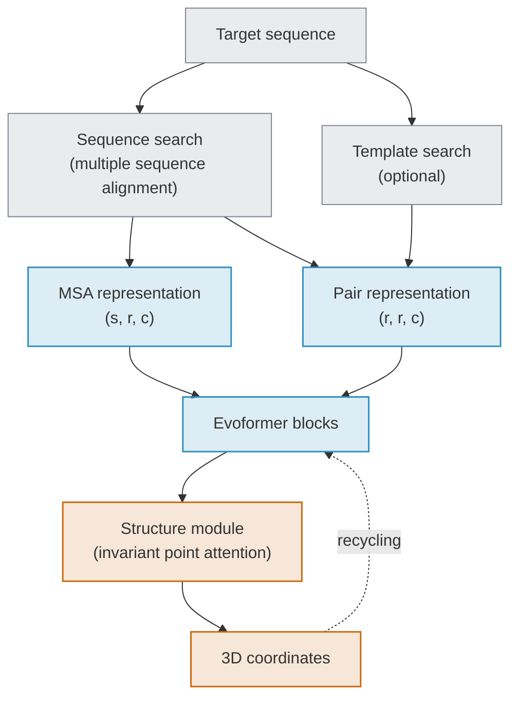

## Where this fits {#where-this-fits}

This post covers the last protein lecture of the course, "3D structure prediction IV + Questions", and an exercise session on Biopython and its `Bio.PDB` module. The lecture brings together the threads of the [previous post](/blog/strubi-potentials-rosetta-coevolution/) (knowledge-based potentials, coevolution, end-to-end networks) in one system.

::: note Source
These are my notes on the final 3D structure prediction lecture of the Structural Bioinformatics course (block 2, 2026–2027) at the University of Copenhagen, written from the lecture slides and the published schedule. The schedule only lists session titles, so the split of the machine-learning deck between this post and the previous one is my own. The notes follow the deck as far as the attention mechanism; the structure module and AlphaFold3 are covered only at the level of the overview slides.
:::

## AlphaFold1 at CASP13 {#alphafold1}

CASP is the blind assessment in which groups predict structures that have been solved but not yet published. At CASP13 in December 2018, with 97 groups competing on 43 hard targets, AlphaFold produced the most accurate prediction for 25 of them. The second-best group managed 3.

DeepMind entered three variants, and the slides stress how much of the first two was established technique.

| Variant | Conformational search | Energy |
| --- | --- | --- |
| 1 | Fragment assembly with simulated annealing; fragments sampled from a generative model of dihedral angles | Distance-prediction network plus a Rosetta score |
| 2 | Same as variant 1 | A network that scores a structure directly |
| 3 | Gradient descent in torsion-angle space | A protein-specific potential built from predicted pairwise distance distributions, combined with torsion-angle probabilities and a Rosetta score |

Variant 3 appears to have worked best. A deep convolutional network, similar in architecture to the contact predictors of the year before, outputs a probability distribution over the distance for every residue pair. These distributions are converted into a potential by dividing by a reference distribution and taking the negative logarithm, and the structure is found by plain energy minimization.

### What it was really doing {#really-doing}

That potential is a potential of mean force with a reference state, the construction examined in the [previous post](/blog/strubi-potentials-rosetta-coevolution/). The lecturer's reading is that ==AlphaFold1 combined a local model of backbone angles with a nonlocal model of distances through Jeffrey conditioning==: Bayesian updating presented as an energy function. The network supplied much better distance information than database statistics could, but the framework into which it was plugged dates from 1990.

## AlphaFold2 at CASP14 {#alphafold2}

Two years later the result was of a different kind. The median GDT_TS over the targets was 92.4, where GDT_TS is roughly the percentage of residues placed correctly (defined in the [post on folding and RMSD](/blog/strubi-folding-rmsd/)).

::: chartjs Accuracy at CASP14 with 95% residue coverage
```json
{
  "type": "bar",
  "data": {
    "labels": ["C-alpha RMSD", "All-atom RMSD"],
    "datasets": [
      {
        "label": "AlphaFold2",
        "data": [0.96, 1.5],
        "backgroundColor": "rgba(47, 143, 191, 0.2)",
        "borderColor": "#2f8fbf",
        "borderWidth": 1.5
      },
      {
        "label": "Next best group",
        "data": [2.8, 3.5],
        "backgroundColor": "rgba(200, 105, 15, 0.2)",
        "borderColor": "#c8690f",
        "borderWidth": 1.5
      }
    ]
  },
  "options": {
    "scales": {
      "y": {"beginAtZero": true, "title": {"display": true, "text": "RMSD (Å)"}},
      "x": {"title": {"display": true, "text": "Atoms compared"}}
    }
  }
}
```
:::

In numbers: a $C_\alpha$ RMSD of 0.96 Å against 2.8 Å for the next best group, and an all-atom RMSD of 1.5 Å against 3.5 Å. For scale, the slides note that a carbon atom is about 1.4 Å wide. The method also handled long proteins without homologous structures (one case had 2,180 residues) and the packing of domains against each other.

Prediction is fast once the alignments exist. On a single 16 GB GPU the slides quote:

| Protein length | Time |
| --- | --- |
| 256 residues | 0.6 minutes |
| 384 residues | 1.1 minutes |
| 2,500 residues | 2.1 hours |

The 2024 Nobel Prize in Chemistry went to David Baker for computational protein design and to Demis Hassabis and John Jumper for structure prediction, which the slides call the Nobel moment of AI in bioinformatics.

## The AlphaFold2 pipeline {#pipeline}



The diagram is a simplification of the published pipeline figure: the representation-learning half is in blue and the geometric half in orange. Here $s$ is the number of sequences in the alignment, $r$ the number of residues and $c$ the number of channels.

### Inputs {#inputs}

The network receives the "raw" multiple sequence alignment, not summary statistics derived from it. Sequences come from UniRef90, BFD and MGnify (the latter two include metagenomic data) and are found with JackHMMER and HHblits. Related template structures, found with HHsearch against a clustered PDB, are an optional second input. The search tools are hidden Markov model methods, so the classical sequence analysis toolbox is still at the front of the pipeline.

### Evoformer {#evoformer}

The Evoformer maintains two representations and lets them inform each other over many blocks.

- The **MSA representation**, of shape $(s, r, c)$, is updated by attention along rows (within one sequence) and along columns (across sequences at one position). Column attention is where coevolution is read off.
- The **pair representation**, of shape $(r, r, c)$, holds what is known about each pair of residues and can be viewed as a graph with residues as nodes. It is updated by triangular multiplicative updates and triangular attention, which process three residues at a time; the usual motivation is that pairwise distances have to be mutually consistent, as in the triangle inequality.
- The two are coupled: an outer product over the MSA representation updates the pair representation, and the pair representation biases the MSA attention.

In the terms of the previous post, the Evoformer replaces both the maximum entropy model of EVfold and the convolutional contact predictors, and it does so without first reducing the alignment to pairwise statistics.

### Structure module and training {#structure-module}

The structure module turns the pair representation into backbone coordinates. Residues start as a "residue gas" of independent rigid bodies, each with a position and an orientation, and are moved by **invariant point attention** (IPA), an attention operation whose result does not change when the whole structure is rotated or translated.

The loss function is the **frame-aligned point error** (FAPE), which compares predicted and true atom positions in the local frame of every residue and therefore penalizes errors in orientation as well as position. The whole system is end-to-end differentiable, the property introduced by AlQuraishi's recurrent geometric network: the error on the final 3D structure trains every component, back to the embedding of the alignment.

Two further items complete the list of innovations in the slides: **recycling**, in which the output is fed back as input for another pass, and distillation.

## The attention mechanism {#attention}

Attention in its transformer form was introduced for language in 2017 and is the mechanism behind large language models, where it answers the question of which words in a text attend to which other words. For proteins the question becomes which residues influence each other.

Each position $i$ has an input feature vector $f_i$. Three small neural networks produce a **query**, a **key** and a **value** from it:

$$
q_i = h_Q(f_i), \qquad k_j = h_K(f_j), \qquad v_j = h_V(f_j)
$$

Queries and keys have the same dimension, so their dot product is defined. The attention weight of position $i$ on position $j$ is a normalized similarity between the query of $i$ and the key of $j$, and the output at $i$ is the weighted sum of all values:

$$
\alpha_{ij} = \frac{\exp(q_i^\top k_j)}{\sum_{j'} \exp(q_i^\top k_{j'})},
\qquad
\text{Attn}_i = \sum_j \alpha_{ij}\, v_j
$$

The output vector at each position therefore incorporates information from every other position, weighted by learned relevance. Stacking the queries, keys and values as matrices $Q$, $K$ and $V$ gives the whole operation as $\text{softmax}(QK^\top)V$ (implementations add a scaling factor), which is a few matrix products and parallelizes well on GPUs.

Two contrasts with earlier architectures explain why this suits proteins. A convolution only sees a fixed local window, and a recurrent network has to pass information along the chain step by step. Attention connects any two positions directly, which is what long-range contacts between residues far apart in sequence require.

## Working with structures in Biopython {#biopython}

The exercise session is on Biopython's `Bio.PDB`, which the take-home exam also uses. The snippet below is not the exercise sheet, only a minimal example of the module on a local copy of the homeodomain structure used throughout the slides.

```python
from Bio.PDB import PDBParser, PPBuilder

structure = PDBParser(QUIET=True).get_structure("1enh", "1enh.pdb")

for polypeptide in PPBuilder().build_peptides(structure):
    print(polypeptide.get_sequence())
    for phi, psi in polypeptide.get_phi_psi_list():
        print(phi, psi)   # radians; None at the chain ends
```

`Bio.PDB` organizes a structure as a hierarchy of structure, model, chain, residue and atom. It also provides a `Superimposer` class that performs the SVD-based superposition from the [post on folding and RMSD](/blog/strubi-folding-rmsd/).

## Open questions and what comes next {#open-questions}

The slides do not present structure prediction as finished. Deep networks are black boxes, they can overfit, and their handling of uncertainty is weak. AlphaFold depends on deep alignments, and prediction from a single sequence is flagged as a current open problem. AlphaFold3 followed in 2024.

After the break the course turns to RNA structure for two weeks, and ends with an invited industry talk and the presentation of the exam. The exam is a take-home assignment with a theoretical part and a practical part using `Bio.PDB` and PyMOL; proteins count for two thirds of the grade and RNA for one third. It is handed out on 22 January 2027 and due on 29 January 2027.

## What to take away {#takeaways}

- AlphaFold1 put a strong learned distance predictor into the existing framework of knowledge-based potentials. AlphaFold2 replaced the framework with one differentiable model.
- The Evoformer works on the raw alignment and a pair representation together; coevolution is learned, not precomputed.
- Attention is a weighted sum of values, with weights from query–key similarity. Everything else in the architecture is a choice about what attends to what.
