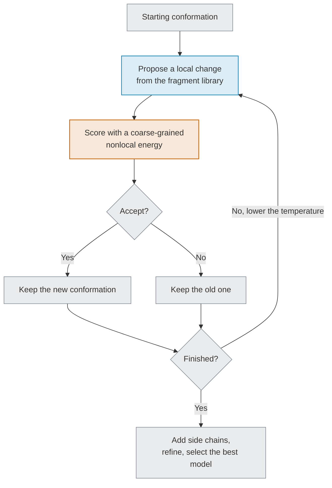

## Where this fits {#where-this-fits}

This post covers two online lectures, "3D structure prediction II" and "III", which have no exercise session. The material moves from prediction with a template (the [previous post](/blog/strubi-solvent-exposure-local-structure/)) to prediction without one. Four ideas carry the material: energy functions learned from known structures, fragment assembly, contacts inferred from coevolution, and neural networks. Each one is an ingredient of AlphaFold, which is the subject of the [AlphaFold post](/blog/strubi-alphafold/).

::: note Source
These are my notes on the second and third 3D structure prediction lectures of the Structural Bioinformatics course (block 2, 2026–2027) at the University of Copenhagen, written from the lecture slides and the published schedule. The schedule only lists session titles, so the split of the prediction and machine-learning decks across the four prediction sessions is my own.
:::

## Knowledge-based potentials {#knowledge-based-potentials}

Fold recognition and de novo prediction both need a function that says how good a conformation is for a sequence. A physical force field is expensive and not accurate enough, so the field turned to statistics: extract an "energy" from the database of known structures.

### The textbook recipe {#textbook-recipe}

Boltzmann's law links the energy $E_i$ of a microstate to its probability, through the partition function $Z$:

$$
p_i = \frac{e^{-E_i/kT}}{Z}
\qquad\Longleftrightarrow\qquad
E_i = -kT \ln p_i - kT \ln Z
$$

Reading it from right to left is the **inverse Boltzmann law**: observed frequencies become energies. Sippl's potentials of mean force (1990) apply this to pairs of residues. The procedure is:

::: steps

1. **Define the system and its states.**

   Take a pair of amino acid types, say His and Glu, and divide their separation into distance bins.

2. **Count.**

   Estimate from the PDB the probability of finding that pair in each bin.

3. **Subtract a reference state.**

   $$
   \Delta E(a_i, a_j, r) = -kT \ln \frac{P(r \mid a_i, a_j)}{P_{\text{ref}}(r \mid a_i, a_j)}
   $$

4. **Sum over all pairs.**

   The total energy of a conformation is the sum of the pair terms, and prediction means searching for the conformation with the lowest total, by simulated annealing or Markov chain Monte Carlo.

:::

### Why the physical justification fails {#why-it-fails}

The recipe is justified by analogy with liquids, where the PMF between two particles is the reversible work needed to bring them from infinity to distance $r$, the pair correlation function can be measured, and the reference state is the ideal gas. The slides list why the analogy does not hold for proteins:

- the probabilities come from many different proteins, not from one system in thermal equilibrium;
- nobody can say what the reference state should be;
- only pairwise terms are considered, so many-body effects are lost;
- even a true PMF would not be the free energy function that the folding postulate calls for.

### What the potentials actually are {#what-they-are}

The potentials work reasonably well, which needs an explanation. The one given in the course is probabilistic (Hamelryck et al., 2010). Start with a model $Q(X)$ of local structure, such as the angle-based models from the [post on local structure](/blog/strubi-solvent-exposure-local-structure/). It is good at short range but implies a poor distribution $Q_R(r)$ over some coarser, nonlocal quantity $r = g(X)$, for example pairwise distances. Suppose better knowledge $P(r)$ about that quantity is available. **Jeffrey conditioning** gives the minimal update of the model, and turning the result into an energy yields

$$
E(X) = -kT \log \frac{P(g(X))}{Q_R(g(X))} - kT \log Q(X)
$$

The first term has exactly the form of a Sippl potential and the second is the local structure term. ==A knowledge-based potential is a step of Bayesian belief updating written in the language of physics==, and the reference state is no longer arbitrary: it is the distribution of $r$ under the model being corrected.

## De novo prediction with Rosetta {#rosetta}

De novo methods can propose a fold that has never been observed. **Ab initio** is the subset that tries to rely on physics alone; in practice the line is blurred. The obstacle is the size of the search space, and the standard answer is to split the problem: local interactions between residues close in sequence determine the backbone shape, and nonlocal interactions determine how secondary-structure elements pack.

Rosetta (Baker group, from 1997) was the leading method in the CASP assessments until AlphaFold in 2018. Its loop looks like this:



The local proposal (blue) inserts a 3–9 residue fragment taken from known structures. The nonlocal evaluation (orange) uses a statistical energy on a model without side chains. Acceptance follows a Monte Carlo rule with decreasing temperature, which is simulated annealing.

### The Bayesian reading {#bayesian-reading}

Rosetta's scoring was derived from Bayes' theorem:

$$
P(\text{Struct} \mid \text{Seq}) \propto P(\text{Seq} \mid \text{Struct})\,P(\text{Struct})
$$

The prior $P(\text{Struct})$ describes what protein-like structures look like in general: compactness, packing of helices and strands, backbone angles. The likelihood $P(\text{Seq} \mid \text{Struct})$ asks how well the sequence fits, and combines two older ideas: each residue in its environment $e_i$ of exposure and secondary structure (the profile method of Bowie et al., 1991), and residue pairs at distance $r_{ij}$ (Sippl):

$$
P(aa_1, \dots, aa_n \mid \text{Struct}) \propto
\prod_{i} P(aa_i \mid e_i)
\prod_{i<j} \frac{P(aa_i, aa_j \mid r_{ij}, e_i, e_j)}{P(aa_i \mid r_{ij}, e_i, e_j)\,P(aa_j \mid r_{ij}, e_i, e_j)}
$$

Taking the negative logarithm of the pair term gives something that resembles a PMF. The slides are explicit that the pairwise factorization is an incorrect assumption and that the resemblance is qualitative; the quantitative account is the Jeffrey conditioning argument above.

### Design and later versions {#design}

Running the method in reverse gives protein design. **Top7** (2003) was the first designed protein with a novel fold: 93 residues, with the crystal structure within 1.2 Å RMSD of the design. Later pipelines replaced the statistical terms with neural networks: trRosetta derives pairwise restraints from a deep convolutional network, and RoseTTAFold (2021) exchanges information between sequence-level, pair-level and 3D representations.

## Contacts from coevolution {#coevolution}

The second source of nonlocal information is the genome databases. If two residues are in contact, a mutation in one is often compensated by a mutation in the other, so the two alignment columns are correlated. EVfold (Marks et al., 2012) turned this into structure prediction.

The naive measure is the **mutual information** between columns $i$ and $j$, computed from amino acid frequencies $f$ in the alignment:

$$
MI_{ij} = \sum_{A_i, A_j} f_{ij}(A_i, A_j) \log \frac{f_{ij}(A_i, A_j)}{f_i(A_i)\,f_j(A_j)}
$$

It fails because correlation is transitive. If A touches B and B touches C, then A and C are correlated without being in contact, and mutual information cannot tell the direct coupling from the indirect one.

The fix is a global model. Among all distributions over whole sequences that reproduce the observed single-column and pairwise frequencies, choose the one with **maximum entropy**, which is the one closest to uniform in the Kullback–Leibler sense and so assumes nothing beyond the constraints. It has the form

$$
P(A_1, \dots, A_n) = \frac{1}{Z} \exp\Big(-\sum_{i<j} e_{ij}(A_i, A_j) + \sum_i h_i(A_i)\Big)
$$

The fitted pair terms $e_{ij}$ account for all pairs at once, so a strong $e_{ij}$ indicates a direct coupling and hence a likely contact. The predicted contacts then serve as restraints for building a 3D model.

::: warning Data requirement
The method needs deep alignments, with thousands of sequences. Many proteins have nothing close to that: the slides cite a giant virus with about 2,500 protein genes, 93% of them without a detectable homologue. Prediction from a single sequence is still presented as an open problem.
:::

AlphaFold rests on the same idea, with attention-based neural networks doing the work of the maximum entropy model and much larger sequence databases behind it.

## Deep learning basics {#deep-learning-basics}

The machine learning deck starts from the beginning, since the course does not assume the background.

### History in three dates {#history}

The **perceptron** (Rosenblatt, 1957) was the first working neural network and could classify simple shapes. Minsky and Papert's 1969 book pointed out the limits of such shallow networks, in the lecturer's words vastly exaggerating them, and the field went through several cycles of boom and "AI winter". The revival dates from **AlexNet** winning the ImageNet challenge in 2012, enabled by deep networks, GPUs, large data sets, and better algorithms and software. The slides also name what remains unsolved in the now dominant paradigm: models are black boxes, they overfit, and they handle uncertainty poorly.

### Building blocks {#building-blocks}

A digital neuron computes a weighted sum of its inputs and applies a nonlinear function. A layer of neurons is a matrix multiplication followed by that nonlinearity, so a network is linear algebra with learnable weights.

Training requires the gradient of a loss with respect to every weight. **Automatic differentiation** provides it: it is neither symbolic differentiation, which produces unmanageably large expressions, nor numerical differentiation, which suffers from round-off error. Frameworks such as PyTorch, TensorFlow and JAX combine it with **tensors** (multidimensional arrays) and GPU support. A minimal illustration of my own:

```python
import torch

x = torch.tensor([1.0, 2.0, 3.0], requires_grad=True)
y = (x ** 2).sum()
y.backward()      # automatic differentiation
print(x.grad)     # tensor([2., 4., 6.])
```

**Convolutional networks** slide small learned filters over the input to detect local features such as edges, and **pooling** reduces resolution by averaging or taking the maximum. They suit images, and a matrix of residue–residue distances is an image.

Two research results are mentioned for intuition about why depth and size help. Networks with ReLU activations appear to work by simplifying the topology of the data layer by layer. And the **lottery ticket hypothesis** observes that a trained network can be pruned to a subnetwork 10–20% of its size that performs as well, which suggests large networks are needed mainly to stumble on such a subnetwork.

### Three precursors of AlphaFold {#precursors}

| Work | Idea | What it contributed |
| --- | --- | --- |
| Xu, 2017 | Very deep convolutional networks predict the contact map from coevolution features | Contact prediction treated as image analysis |
| AlQuraishi, 2018–2019 | A recurrent network maps sequence to torsion angles and then to coordinates, with the loss computed on the 3D structure | End-to-end differentiable prediction, with no separate search step |
| NEMO (Ingraham et al., 2019) | A neural energy function combined with a Langevin dynamics simulator | Learning through a differentiable folding simulation |

The first row is where the two halves of this post meet: coevolution supplies the signal and a deep network extracts it. The second row introduces the end-to-end property that AlphaFold2 later adopted.

## What to take away {#takeaways}

- A knowledge-based potential is a probability ratio. Asking what its reference state is equals asking which model it corrects.
- Rosetta separates local proposals from nonlocal scoring, and both parts were later replaced by learned components.
- Coevolution gives contacts only after indirect correlations are removed, and only when the alignment is deep enough.
