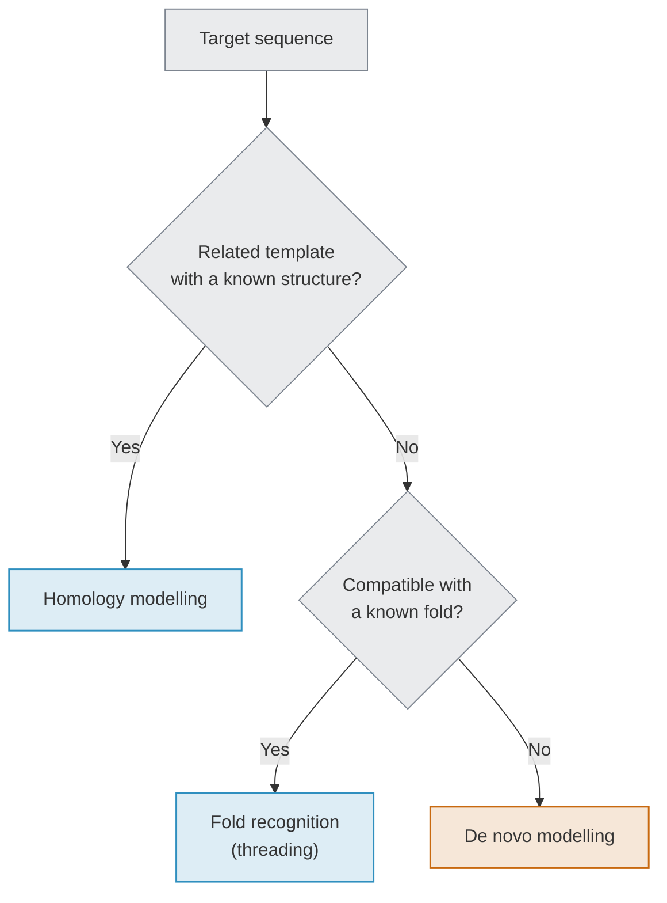

## Where this fits {#where-this-fits}

This post covers the one-dimensional descriptions of a protein, meaning properties assigned to each residue along the chain, and then the template-based methods of 3D structure prediction. The lectures are "Solvent exposure & local structure" and "3D structure prediction I", and the exercise session is on RMSD and superposition (the algorithm from the [post on folding and RMSD](/blog/strubi-folding-rmsd/)).

::: note Source
These are my notes on the "Solvent exposure & local structure" and "3D structure prediction I" lectures of the Structural Bioinformatics course (block 2, 2026–2027) at the University of Copenhagen, written from the lecture slides and the published schedule. The schedule only lists session titles, so the split of the prediction deck across its four sessions is my own: template-based methods here, potentials and de novo methods in the [post on potentials, Rosetta, and coevolution](/blog/strubi-potentials-rosetta-coevolution/).
:::

## Solvent exposure {#solvent-exposure}

The hydrophobic effect drives folding, so how buried a residue is says a lot about its role. Exposure measures are used in folding simulations, structure prediction, analysis, and above all in predicting the stability of mutants.

Stability is the Gibbs free energy difference between the folded and unfolded states, typically −5 to −15 kcal/mol. The effect of a mutation is reported as

$$
\Delta\Delta G = \Delta G_{\text{native}} - \Delta G_{\text{mutant}}
$$

With this sign convention a negative $\Delta\Delta G$ means the mutant is less stable. The standard example is replacing a large buried hydrophobic residue with alanine: it leaves a cavity, and the more buried the residue, the larger the loss.

### Hydrophobicity has two definitions {#hydrophobicity}

A structural definition calls a residue hydrophobic if it tends to be buried in known structures; a chemical definition relies on solubility experiments. Both depend on the measure or technique used, so hydrophobicity scales disagree with each other, and a result should say which scale it used.

### Four measures {#four-measures}

| Measure | Definition | Needs | Strength | Weakness |
| --- | --- | --- | --- | --- |
| Accessible surface area (ASA) | Area of a residue reachable by the centre of a probe sphere of radius 1.4–1.5 Å | Full atomic model | The long-standing standard; resolves degrees of exposure | Most residues count as simply buried; slow; hard to compare residues of different size |
| Contact number (CN) | Number of $C_\alpha$ atoms within a sphere (radius 10–15 Å) around a residue's $C_\alpha$ | $C_\alpha$ trace | Fast, simple, covers a wide range, comparable across residue types | Blind to the direction of the side chain, which is decisive in β-sheets |
| Residue depth (RD) | Mean distance of a residue's atoms to the solvent-accessible surface | Full atomic model and an ASA calculation | Separates buried from deeply buried | Most residues look exposed; slow and complex |
| Half sphere exposure (HSE) | $C_\alpha$ count in the half sphere on the side-chain side (HSEu) and in the opposite half (HSEd), radius about 12 Å | $C_\alpha$ and $C_\beta$, or $C_\alpha$ only | Fast; conserved, sensitive, correlates with stability | Ignores atomic detail, so it says little about some mutants |

ASA is usually reported as **relative ASA**: the area divided by the maximum for that residue type, measured in a Gly-X-Gly tripeptide. That makes a glutamate and a serine comparable.

ASA and RD are complementary in an awkward way. ASA discriminates well among exposed residues but lumps the buried ones together; RD does the reverse. CN and HSE cover the whole range with a coarser, discrete scale.

HSE splits the contact-number sphere in two along the $C_\alpha$–$C_\beta$ vector. A strand residue on the surface of a sheet has the same contact number whether its side chain points into the core or out to the solvent, but very different HSEu values. When $C_\beta$ is missing, its direction can be estimated from the neighbouring $C_\alpha$ positions, so the measure also works for coarse-grained models.

### How well they track stability {#stability-correlation}

The slides test the measures on 91 $\Delta\Delta G$ values for Val, Ile and Leu to Ala mutants. As I read the plots:

| Measure | Correlation with $\Delta\Delta G$ |
| --- | --- |
| Total buried surface (from ASA) | 0.62 |
| HSEu | 0.58 |
| Residue depth | 0.45 |
| HSEd | 0.06 |

Contact number is listed as correlating as well. The contrast inside HSE is the informative part: ==what matters for a cavity-creating mutation is the packing density on the side-chain side, not the density behind the backbone==. A two-point $C_\alpha$-level measure gets close to the full-atom buried surface.

### Predicting exposure from sequence {#exposure-prediction}

Exposure prediction is less common than secondary structure prediction and is usually framed as classification on relative ASA, with residues under 30% called buried. Neural networks and support vector machines are the typical methods. The slides point to ACCpro in the SCRATCH suite, PHDacc in PredictProtein, and HSEpred for half sphere exposure.

## Secondary structure prediction {#secondary-structure-prediction}

The task is to assign a class to every residue of a sequence. The reference labels come from a structure through **DSSP**, which distinguishes eight states; predictors usually collapse these to three (helix, strand, coil).

The prediction is useful where no structure exists: judging a mutation (proline in a helix, glycine in a strand), spotting disordered proteins by their lack of regular elements, annotating genomes, and restricting the search space of 3D prediction.

| Generation | Idea | Representative | Accuracy quoted in the slides |
| --- | --- | --- | --- |
| First | Preferences of single amino acids | Chou and Fasman, 1974 (derived from 15 proteins) | About 50% |
| Second | A sequence window around each residue | GOR, 1978 (17 residues) | About 60% |
| Third | Evolutionary information from multiple alignments, fed to neural networks | Qian and Sejnowski, 1988; Rost and Sander, 1993 | 70%, and up to about 90% today with larger training sets |

Chou–Fasman scores each amino acid $a$ by a log-odds **propensity**, for example for helix:

$$
\text{propensity}_\alpha(a) = \log \frac{P(a \mid \alpha)}{P(a)}
$$

Positive values favour the state. The method looks for nuclei of high-propensity residues and extends them until the average drops. GOR adds the influence of the eight neighbours on either side. The third generation works because an alignment exposes patterns invisible in one sequence: a partly buried helix shows conserved apolar positions alternating with variable polar ones at the helical period.

The networks themselves are introduced briefly: a neuron outputs a nonlinear function of a weighted sum of its inputs, weights are fitted by backpropagation, and amino acids enter as one-of-twenty vectors. Recurrent variants (GRU, LSTM) carry information along the sequence.

### Reading accuracy figures {#accuracy}

**Q3** is the percentage of residues assigned the correct one of three states. Two cautions apply.

- An average near 90% hides wide variation between proteins. And Q3 rewards trivial answers: predicting "helix" for every residue of myoglobin scores about 80%.
- Segment-based scores such as SOV ask whether the elements are right, which is closer to what a user wants. A prediction that breaks one helix in two loses little Q3 but changes the picture.

::: warning Evaluation
A predictor must be tested on proteins unrelated to its training set, with a sequence-identity cutoff and, better, different folds. Identical short sequence fragments are known to adopt different secondary structures in unrelated proteins, so local sequence alone has a ceiling.
:::

## Probabilistic models of local structure {#local-structure-models}

Three states are a coarse description. The rest of the lecture follows a line of models that describe local structure in finer detail and, importantly, as probability distributions.

| Model | Representation of structure | Hidden state | Notable property |
| --- | --- | --- | --- |
| Fragment libraries (Rosetta) | Clustered backbone fragments of 3–9 residues | None | Structures are assembled from fragments chosen by sequence and predicted secondary structure |
| HMMSTR | Backbone angles in 11 discrete bins, plus secondary structure and structural context | Discrete (hidden Markov model built on the I-sites library) | Known motifs correspond to paths through the hidden states |
| TorusDBN | Continuous $(\phi, \psi)$ pairs | Discrete | Emits angles from a bivariate von Mises distribution on the torus, avoiding the information loss of binning |
| Bifrost | Continuous angles | Continuous vector (deep Markov model) | Transitions and emissions are neural networks; needs only a single sequence |

The argument for the probabilistic route is practical. A classifier returns a label, whereas a model of this kind returns $P(\text{structure} \mid \text{sequence})$: it can be sampled to propose conformations, it quantifies its own uncertainty, and it can be combined with other sources of information. That last property is what the [knowledge-based potentials](/blog/strubi-potentials-rosetta-coevolution/) depend on.

## 3D structure prediction: template-based methods {#template-based}

Anfinsen's result says the sequence determines the fold, which corresponds to the free energy minimum. Experimental determination is slow and expensive: X-ray crystallography needs crystals, and NMR is limited to fairly small proteins. The slides count about 200,000 PDB entries in 2022, with heavy redundancy (more than 5,000 lysozyme structures alone). Prediction fills the gap, and the methods are ordered by how much they borrow from known structures.

The diagram is my summary of the slide that ranks the approaches from "easy" to "hard": the two template-based routes are in blue and the de novo route in orange.

### Homology modelling {#homology-modelling}

A model is built on the structure of a related protein, the **template**. Its quality depends on the sequence identity between target and template, on the number of insertions and deletions, and most of all on the alignment: an alignment error becomes a structural error that no later step repairs.

The traditional recipe keeps the conserved regions and rebuilds the variable ones, mostly loops. Rebuilding a segment so that it joins both ends seamlessly is the **loop closure problem**, shared with robotics. An analytic solution exists for six degrees of freedom; longer loops use iterative heuristics such as cyclic coordinate descent (CCD).

MODELLER takes a different route. It extracts restraints from the template ($C_\alpha$–$C_\alpha$ distances, hydrogen bonds, side-chain contacts) and then runs molecular dynamics in which the restraints act as springs added to the force-field energy. Molecular dynamics integrates Newton's second law numerically; with explicit solvent it is very slow, and simulating the folding of even small, fast-folding proteins required special-purpose hardware.

In practice, SWISS-MODEL offers an automated web service and MODELLER a scriptable Python interface.

### Fold recognition {#fold-recognition}

Fold recognition asks whether a sequence fits any fold in a library, even without detectable sequence similarity. The premise is that folds are more conserved than sequences and that a new protein rarely has a new fold. **Threading** places the sequence onto each known fold and scores the fit; inverse threading starts from a fold and searches for sequences.

The limitations are stated plainly in the slides: the approach cannot produce an unobserved fold, and compatible folds often go unrecognized. Many recognizers are sequence-based underneath, comparing profiles and predicted exposure and secondary structure (HHpred is the best-known example), and recent servers such as LOMETS3 combine threading with deep learning.

Scoring a sequence against a fold requires an energy function, which is the subject of the [post on knowledge-based potentials](/blog/strubi-potentials-rosetta-coevolution/).

## What to take away {#takeaways}

- Choose an exposure measure by what the model contains and what the question is: ASA for atomic detail at the surface, HSE when only a backbone is available or packing around the side chain matters.
- A Q3 value means little without the baseline and the test-set design.
- Template-based prediction is limited by the alignment and by the template library, not by the modelling step.
