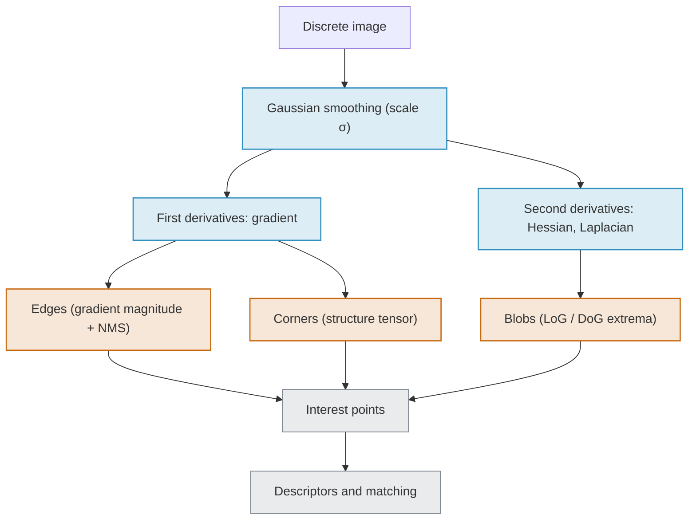

Edges, blobs and corners all come from the same two steps: smooth the image at a chosen scale, then take derivatives. This note follows that thread, from the calculus behind gradients and Hessians, through convolution kernels on discrete images, to corner detectors and the problem of matching interest points between images.

The diagram shows how the topics connect: smoothing and differentiation come first, the three detectors use different derivative orders, and all of them feed the matching problem.

## Derivatives as the common language {#derivatives}

In 1D the **derivative** is the limit of the secant slope,

$$
f'(x) = \lim_{h \to 0} \frac{f(x+h) - f(x)}{h},
$$

and its sign says whether the function is increasing or decreasing. A useful example: for data $x_1, \dots, x_n$, the function $V(x) = \frac{1}{n}\sum_i (x - x_i)^2$ has derivative zero only at the arithmetic mean $\bar{x}$, and that point is a minimum. The mean is therefore the unique minimiser of the squared error, a small instance of the optimisation view used throughout vision.

For a function $f(x, y)$ of two variables, the **partial derivatives** $\partial f / \partial x$ and $\partial f / \partial y$ are taken along one axis while the other variable is held fixed. Stacked into a column vector they form the **gradient** $\nabla f$, which points in the direction of steepest ascent. Its negative points in the direction of steepest descent, which is the idea behind gradient descent. A point where $\nabla f = 0$ is a **critical point**. Three standard examples have their critical point at the origin: $x^2 + y^2$ (minimum), $-\log(1 + x^2 + y^2)$ (maximum) and $x^2 - y^2$ (saddle).

Second derivatives form the symmetric **Hessian** matrix; the mixed derivatives are equal by Schwarz's theorem. Its trace is the **Laplacian**,

$$
\Delta f = \frac{\partial^2 f}{\partial x^2} + \frac{\partial^2 f}{\partial y^2} = \operatorname{tr}(\operatorname{Hess} f).
$$

In image terms, the gradient describes edges, and the Hessian and Laplacian describe blobs, ridges and valleys.

## Linear filtering {#linear-filtering}

An image is a grid of intensity values, often one byte per pixel (0 is black, 255 is white). A single-valued (grey-scale) image is best displayed with a grey colour map; arbitrary maps such as `jet` or `hsv` add structure that is not in the data.

Filtering serves several purposes: noise reduction, removing quantisation effects, anti-aliasing before resampling, estimating derivatives, enhancing structures, and detecting features such as edges and corners. Almost all filters are **local**: the response at a pixel depends on a patch around it. Many are also linear and position invariant, so they can be written as a **convolution** with a kernel $h$:

$$
(I * h)(x, y) = \sum_{u, v} I(u, v)\, h(x - u, y - v).
$$

In practice this means mirroring the kernel, sliding it to $(x, y)$, multiplying element by element and summing.

### Convolution and correlation {#convolution-correlation}

**Correlation** replaces $x - u$ with $x + u$, so the kernel is not mirrored. For a real, symmetric kernel the two operations are the same. Correlation is the natural tool for template matching. **Normalised cross-correlation** subtracts the means and divides by the standard deviations, so the result lies between $-1$ and $1$, and values near $1$ mean a strong linear relationship between patch and template.

Convolution follows a few rules that are used constantly:

| Property | Form |
| --- | --- |
| Commutative | $f * g = g * f$ |
| Distributive | $f * (g + h) = f * g + f * h$ |
| Associative | $f * (g * h) = (f * g) * h$ |
| Derivative | $D[f * g] = D[f] * g = f * D[g]$ |

The last row is the important one in practice. ==To differentiate a noisy image, convolve it with the derivative of a smoothing kernel instead of smoothing first and differentiating afterwards.== This costs one pass and gives a well-defined derivative.

A related observation: convolving a box signal with itself gives a triangle, and repeating the convolution makes the result smoother and closer to a Gaussian shape (not normalised). This is one reason the Gaussian appears everywhere.

Borders need a decision, because the kernel reaches outside the image. Common choices are zero padding, mirroring, periodic extension, or leaving border pixels unchanged.

### Frequency domain {#frequency-domain}

Like sound, an image can be written as a weighted sum of waves with different frequencies and orientations, using the Fourier transform or the cosine transform (the basis of JPEG). The **convolution theorem** says that the Fourier transform of a convolution is the product of the transforms, $\mathcal{F}\{f * h\} = \tilde{f}\,\tilde{h}$. Every linear, position-invariant filter can therefore be applied in either domain. For large kernels, or many kernels, the frequency domain is often faster. Differentiation is also simple there: a partial derivative becomes a multiplication by a polynomial in the frequency variables.

## Gaussian filters and scale {#gaussian-filters}

The two most used smoothing filters are the box filter, which is fast, and the **Gaussian**,

$$
G(x, y; \sigma) = \frac{1}{2\pi\sigma^2} \exp\left(-\frac{x^2 + y^2}{2\sigma^2}\right),
$$

which has better mathematical properties and only one parameter, the scale $\sigma$. Derivatives of the Gaussian give a family of derivative filters at any chosen scale. Receptive fields in the retina and visual cortex can also be modelled by Gaussian derivatives.

Simple 3×3 masks such as **Prewitt** and **Sobel** also estimate derivatives:

$$
\text{Sobel}_x = \begin{bmatrix} -1 & 0 & 1 \\ -2 & 0 & 2 \\ -1 & 0 & 1 \end{bmatrix}, \qquad
\text{Prewitt}_x = \begin{bmatrix} -1 & 0 & 1 \\ -1 & 0 & 1 \\ -1 & 0 & 1 \end{bmatrix}.
$$

They work at a fixed scale, and Gaussian smoothing followed by Sobel is not the same as a Gaussian derivative. In practice the difference is often small, but scale control is less clear with fixed masks.

For a discrete signal, Taylor expansion gives three difference approximations: forward $\frac{f(x+h) - f(x)}{h}$, backward $\frac{f(x) - f(x-h)}{h}$ and central $\frac{f(x+h) - f(x-h)}{2h}$. The central difference is symmetric, which makes it easier to interpret. A colour image has three channels, so it has six first-order partial derivatives rather than two.

**Scale space** (Witkin, 1983) studies an image at all blur levels together. When $\sigma$ increases, details disappear in an orderly way: local minima and maxima meet and annihilate, and new ones are not created. The Gaussian is the only filter with this property. The practical problem behind scale space is that the size of the structures of interest is not known in advance, so filters at a range of sizes are needed.

## Edges and blobs {#edges-and-blobs}

An **edge** is a place of rapid intensity change, so edges are extrema of the first derivative. On a noisy signal the raw derivative is useless, because noise dominates it. Convolving with a derivative of a Gaussian solves this, thanks to the associative property above. The edge strength is the gradient magnitude $\lVert \nabla I \rVert$, and the gradient direction $\theta = \tan^{-1}(I_y / I_x)$ is perpendicular to the edge.

Thresholding the gradient magnitude gives thick edges. **Non-maximum suppression** (NMS) thins them: for each pixel, interpolate the magnitude at the two neighbouring positions along the positive and negative gradient direction, and keep the pixel only if its magnitude is larger than both. The results still depend on $\sigma$ and the threshold, and edges can break, vanish or connect in unexpected ways at different scales.

The **Laplacian of Gaussian** (LoG) is the second-order counterpart. It measures how much the centre differs from its surroundings, has a centre-surround shape similar to retinal ganglion cells, and responds most strongly to a bright spot on a dark background or the reverse. Two uses follow from it:

- **Edges** are zero crossings of the LoG, because the second derivative is zero where the first derivative has a maximum.
- **Blobs** are extrema of the LoG response. At scale $\sigma$ the ideal response marks a circular spot of diameter $2\sqrt{2}\,\sigma$.

The **difference of Gaussians** (DoG) approximates the LoG and is cheaper to compute. Blobs are a main building block for feature-based image description.

## Corners from the structure tensor {#corners}

At an edge the gradients in a neighbourhood share one main direction; at a corner they have two. The detectors below all measure that difference with the **structure tensor**. Stack the $N$ gradients in a window (each weighted by a Gaussian of its distance to the centre) as rows of $A \in \mathbb{R}^{N \times 2}$, and form

$$
T = A^\top A = \sum_i w_i \begin{bmatrix} I_x^2 & I_x I_y \\ I_x I_y & I_y^2 \end{bmatrix}_i.
$$

$T$ is a symmetric 2×2 matrix of the second-order statistics of the gradient cloud. Its first eigenvector points where the cloud is widest (variance $\lambda_1$); the second is orthogonal to it and points where the cloud is narrowest (variance $\lambda_2$). The eigenvalues are the roots of $\det(T - \lambda I_2) = 0$:

$$
\lambda_{1,2} = \frac{\operatorname{tr} T \pm \sqrt{(\operatorname{tr} T)^2 - 4 \det T}}{2}.
$$

A unit eigenvector is only defined up to sign, so NumPy or MATLAB may return $x$ or $-x$.

::: table title="Corner measures built on the structure tensor" align="center"
| Detector | Measure | Notes |
| --- | --- | --- |
| Shi–Tomasi | $\min(\lambda_1, \lambda_2)$ | A corner only when the smaller eigenvalue is large; needs a square root |
| Harris | $R = \det T - k (\operatorname{tr} T)^2$ | Avoids the square root; corners are local maxima with $R > 0$; $k < 0.25$ |
| Plessey | $\det T / \operatorname{tr} T$ | No constant $k$; equals $\lambda_1\lambda_2 / (\lambda_1 + \lambda_2)$ |
:::

The Harris constant comes from asking that the eigenvalue ratio stays in a central band, $a\lambda_1 < \lambda_2 < \lambda_1 / a$ with $0 < a < 1$. Rewriting this condition gives $k = a / (1 + a)^2$, so $k$ is at most $0.25$; values between 0.15 and 0.20 correspond to a fairly permissive band.

::: note On the numbers
Many implementations use a much smaller Harris constant, typically around 0.04–0.06, so the value is worth checking against the implementation at hand. The Plessey measure is often called the harmonic mean of the eigenvalues; strictly it is half of it, since the harmonic mean of two numbers is $2\lambda_1\lambda_2 / (\lambda_1 + \lambda_2)$. The factor does not change where the local maxima are.
:::

Other detectors exist, such as the Kitchen operator (which looks at how strongly the iso-intensity curve bends), Förstner and SUSAN. Whichever detector is chosen, the detected points may differ from what one would intuitively call corners.

## From interest points to matching {#matching}

The reason for detecting these points is matching: 3D reconstruction, content-based image retrieval (CBIR), object detection and recognition all need to find where the same physical point appears in another image. Without prior knowledge about the camera positions, a point could match any point in the other image.

Not every patch can be matched. Sky has no structure, occluded areas have no partner, and repetitive structures like rows of windows are easily confused. **Dense** matching tries all pixels and is expensive; **sparse** matching uses a subset of **interest points** (also called salient points or key points): local structures that stand out from their surroundings, such as blobs and corners.

### Scale again {#multi-scale}

Objects contain structures of many sizes, and any camera has a finite inner and outer scale. The linear scale space of an image is the one-parameter family obtained by Gaussian smoothing with increasing $\sigma$. This differs from a **Gaussian pyramid**, which also reduces resolution at each level (multi-scale versus multi-resolution). Since resolution can be reduced but never increased, multi-scale analysis also enables **coarse-to-fine** strategies:

::: steps

1. **Solve at a coarse scale.**

   Reduce resolution and solve the problem where it is small and cheap.

2. **Constrain the finer scale.**

   Use the coarse solution to limit the search at the next finer level.

3. **Repeat until full resolution.**

   Iterate down the levels. This pattern appears in image matching, optical flow and video coding, adaptive thresholding and image registration.

:::

All the detectors above can be extended to work across scales. A multi-scale detector compares responses with neighbouring scale levels and suppresses non-maxima, which requires a detection strength that is scale invariant (Lindeberg's work on scale selection covers this).

### Descriptors {#descriptors}

Once a point is found, it needs a **descriptor** so that candidate matches can be compared. A good descriptor is local, informative, and insensitive to noise, illumination changes, perspective deformation (including rotation) and pixel quantisation. Low-dimensional descriptors are compact, but higher-dimensional ones can be more discriminative. Most modern descriptors combine histograms with spatial sampling of gradients around the point; few use raw pixel values as correlation does.

## Takeaways {#takeaways}

Everything here reduces to one practical habit: ==choose a scale, smooth with a Gaussian, and take derivatives through the kernel, not the noisy image.== First derivatives then give edges and, through the structure tensor, corners; second derivatives give blobs. What remains open is how to describe these points so that they can be matched reliably, which is where gradient-histogram descriptors such as SIFT come in.
