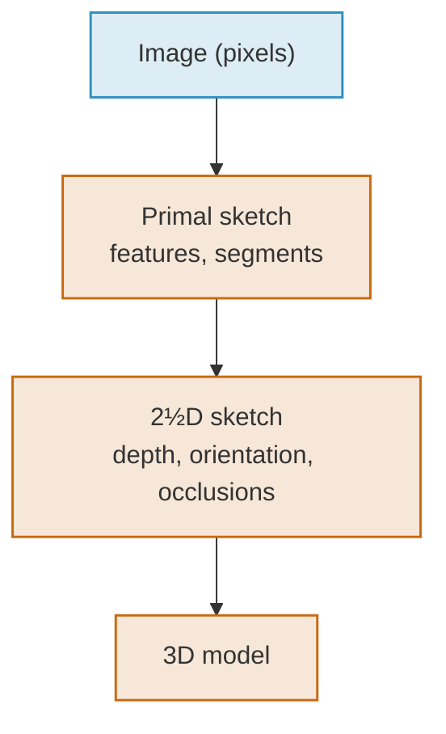

Computer vision and linear algebra look like separate subjects, but the second is the toolbox for the first: almost every operation in vision, from filtering to camera models and homographies, is a matrix acting on a vector. These notes summarise the basics of image formation and the linear algebra that goes with it.

## Typical vision problems {#vision-problems}

Computer vision tries to get a high-level understanding out of images or video, automating tasks the human visual system does without effort. Image processing is the lower layer that transforms the pixel data itself. Typical problems include:

- **Object recognition and detection**: what is in the image (cars, a house, a lamp post) and where.
- **Content-based image retrieval (CBIR)**: return all images similar to a query image.
- **Segmentation**: find object boundaries and parts.
- **3D reconstruction** from stereo or multiple views.
- **Tracking**: an object's 2D trajectory over time, or a person's 3D articulated pose.

Even a single still image already carries low-level cues (texture, shading, shadows, occlusion boundaries) and invites high-level interpretation (objects, foreground and background, depth). Motion adds another layer on top.

## Image formation with a pinhole camera {#image-formation}

Starting from the bottom: before asking what an image means, ask what an image is. The answer is a **perspective projection** of the 3D world onto a plane, and the simplest model of it is the **pinhole camera** (the camera obscura).

Place the pinhole (the **optical centre** $O$) at the origin, with the optical axis along $z$, and the image plane at distance $f'$, the **focal length**. A scene point $P = (x, y, z)$ projects to $P' = (x', y', f')$ with

$$
x' = f' \frac{x}{z}, \qquad y' = f' \frac{y}{z}.
$$

The division by depth $z$ is the whole story of perspective. It explains two effects everyone knows from photographs:

- objects far away appear smaller than nearby ones, because the same $x$ is divided by a larger $z$;
- parallel lines in the world appear to meet at a **vanishing point** in the image.

For a sensor of width $d$, the **field of view** follows from the same geometry:

$$
\text{FOV} = 2 \arctan\frac{d}{2f}.
$$

A short focal length gives a wide view; a long one narrows it. The human eye is also a camera (two of them, in fact, which is the basis of stereo) and noted that digital cameras replace film with a sensor chip such as a charge-coupled device (CCD).

## Images as arrays and as functions {#images-as-arrays}

A digital image is an array of **pixels**, indexed by $(x, y)$ with $I(0,0)$ in a corner. Each pixel holds one integer for a greyscale image or a vector of three for RGB. Equivalently, an image is a function $I(x, y)$ from positions to intensities, which is the view that makes derivatives and filtering natural.

The catch is that ==a table of numbers is not understanding==. Pixel values on their own are hard to interpret, so vision builds layers of abstraction on top of them. Marr's (1982) layers of abstraction are a useful map:



Vision methods roughly climb this ladder: features and edges first, then geometry and depth, then segmentation and recognition.

## A first look at filtering {#filtering}

**Linear position-invariant filtering**, better known as **convolution**, is the most frequent operation in image processing, in classical pipelines and in modern neural networks alike. It is used for noise reduction, converting quantised integers to smooth floats, anti-aliasing before resampling, estimating image derivatives, enhancing structures, and detecting features such as edges and corners.

A filter is defined by a kernel $h$, which is itself a small image. The filter response is

$$
R(x, y) = \sum_{i} \sum_{j} h(i, j)\, I(x - i, y - j),
$$

which amounts to sliding the mirrored kernel across the image and taking a product sum at each position. The response $R$ has the same size as $I$. Almost all useful filters are local and linear in this sense, which is exactly why linear algebra comes next.

## Linear algebra refresher {#linear-algebra}

This section covers vectors, matrices, linear maps, and the quantities attached to square matrices, with a focus on the interpretations that matter for vision.

### Vectors, inner products and norms {#vectors}

A vector in $\mathbb{R}^n$ is an ordered list of $n$ real numbers. It can represent a position, a velocity, or a whole image flattened into one long column. The **inner product** $x \cdot y = x^\top y = \sum_i x_i y_i$ gives the Euclidean **norm** $\lVert x \rVert = \sqrt{x \cdot x}$ and the distance $d(x, y) = \lVert x - y \rVert$. Squared norms are often used to avoid the square root.

Two vectors are **orthogonal** when $x \cdot y = 0$. For $x = [1, -2]^\top$ and $y = [4, 2]^\top$, $x \cdot y = 4 - 4 = 0$. Expanding $\lVert x + y \rVert^2 = \lVert x \rVert^2 + 2\,x \cdot y + \lVert y \rVert^2$ shows that Pythagoras' theorem is just the orthogonal special case. The high-school definition $u \cdot v = \lVert u \rVert \lVert v \rVert \cos\alpha$ is the same quantity, seen through lengths and angles.

In $\mathbb{R}^3$ the **cross product** $v \times w$ gives a vector orthogonal to both, with length $\lVert v \rVert \lVert w \rVert \,\lvert\sin\theta\rvert$. That makes it a compact way to write the plane spanned by $v$ and $w$: a point $z$ lies in it exactly when $z \cdot (v \times w) = 0$. The cross product is linear in each argument and antisymmetric, so $v \times v = 0$.

### Matrices and linear maps {#matrices}

A **linear map** uses only sums of coordinates and multiplications by scalars, with no constant terms and no powers. Every such map can be written as a matrix, and applying the map is a matrix–vector product. Seen geometrically, small matrices are familiar transformations: projection onto the $xy$-plane, rotation by an angle, anisotropic scaling, and shear.

The key property of the matrix product is

$$
M(Nv) = (MN)v,
$$

so ==multiplying matrices is composing linear maps==. This is why a chain of geometric operations, such as rotate, then scale, then project, collapses into a single matrix. Camera models rely on this directly.

A small example makes a related point. With $a = [1, 4, -5, 3]^\top$ and $b = [3, -1, 0, 2]^\top$, the inner product is $a^\top b = 5$, while the outer product $M = ab^\top$ is a $4 \times 4$ matrix. Applying it to anything only rescales $a$:

$$
Ma = a(b^\top a) = 5a, \qquad Mb = a(b^\top b) = 14a.
$$

Every output of $M$ lies on the line spanned by $a$, so $M$ has rank 1.

```python
import numpy as np

a = np.array([1, 4, -5, 3])
b = np.array([3, -1, 0, 2])

M = np.outer(a, b)          # same as a[:, None] @ b[None, :]
print(a @ b)                # 5
print(M @ a, M @ b)         # 5*a and 14*a
print(np.linalg.matrix_rank(M))  # 1
```

### Square matrices: inverse, trace, determinant {#square-matrices}

For square matrices a few extra notions apply.

- The **identity** $I_n$ has ones on the diagonal and satisfies $AI_n = I_nA = A$; it is the map that does nothing.
- $A$ is **invertible** when some $B$ gives $AB = BA = I_n$, which happens exactly when $\det A \neq 0$. Solving a linear system $Ax = c$ is then $x = A^{-1}c$, although in code `numpy.linalg.solve` is preferred over forming the inverse.
- The **trace** $\operatorname{Tr}(A)$ is the sum of the diagonal. It is linear, and $\operatorname{Tr}(AB) = \operatorname{Tr}(BA)$, but in general $\operatorname{Tr}(AB) \neq \operatorname{Tr}(A)\operatorname{Tr}(B)$.
- The **determinant** measures how the map scales area (in 2D) or volume (in 3D). The parallelogram spanned by $[2, 1]^\top$ and $[1, 1.5]^\top$ has area $2 \times 1.5 - 1 \times 1 = 2$. A zero determinant means the map flattens space onto something lower-dimensional, which is why it cannot be undone.

### Eigenvalues, eigenvectors and rank {#eigen}

An **eigenvector** $e$ of $A$ satisfies $Ae = \lambda e$ for a scalar **eigenvalue** $\lambda$. Since any non-zero multiple of $e$ also works, it is common to normalise to $\lVert e \rVert = 1$. The meaning is geometric: the line spanned by $e$ is left invariant by $A$, and $\lambda$ says how much $A$ stretches it.

Take

$$
A = \begin{bmatrix} 11 & 27 \\ -4 & -10 \end{bmatrix}, \qquad
A\begin{bmatrix} -9 \\ 4 \end{bmatrix} = -\begin{bmatrix} -9 \\ 4 \end{bmatrix}, \qquad
A\begin{bmatrix} -3 \\ 1 \end{bmatrix} = 2\begin{bmatrix} -3 \\ 1 \end{bmatrix}.
$$

So $A$ flips the direction $[-9, 4]^\top$ and doubles the direction $[-3, 1]^\top$; any vector can be split along these two directions and treated separately. The eigenvalues are $-1$ and $2$. The trace is $11 - 10 = 1 = -1 + 2$ and the determinant is $-110 + 108 = -2 = (-1)(2)$: the trace is the sum and the determinant the product of the eigenvalues.

For **symmetric** matrices the picture is cleaner. Eigenvectors for different eigenvalues are orthogonal and can be chosen with unit length, so the matrix acts as "rotate, scale along each axis, rotate back". This is the structure behind covariance matrices and the structure tensor used in corner detection.

Finally, the **rank** of a matrix is the dimension of its image: the set of all outputs. A projection from $\mathbb{R}^3$ onto a plane has rank 2; the outer product $ab^\top$ above has rank 1. An $n \times n$ matrix is invertible exactly when its rank is $n$, and for a square matrix that can be diagonalised (as here), the rank equals the number of non-zero eigenvalues.

## Takeaways {#takeaways}

The common idea is that an image is the result of a geometric mapping, and the tools for handling such mappings are linear. The pinhole model explains why images look the way they do; the matrix view explains how to compose, invert and analyse the transformations involved; and convolution applies the same linearity to the image as a whole.

| Concept | Where it reappears in vision |
| --- | --- |
| Inner product, norm | Comparing patches, descriptor matching |
| Matrix product as composition | Chaining camera and coordinate transforms |
| Determinant, invertibility | Whether a transform (such as a homography) can be undone |
| Eigenvectors of symmetric matrices | Principal directions of local structure, corner detection |
| Rank | Degenerate configurations, projections that lose a dimension |
