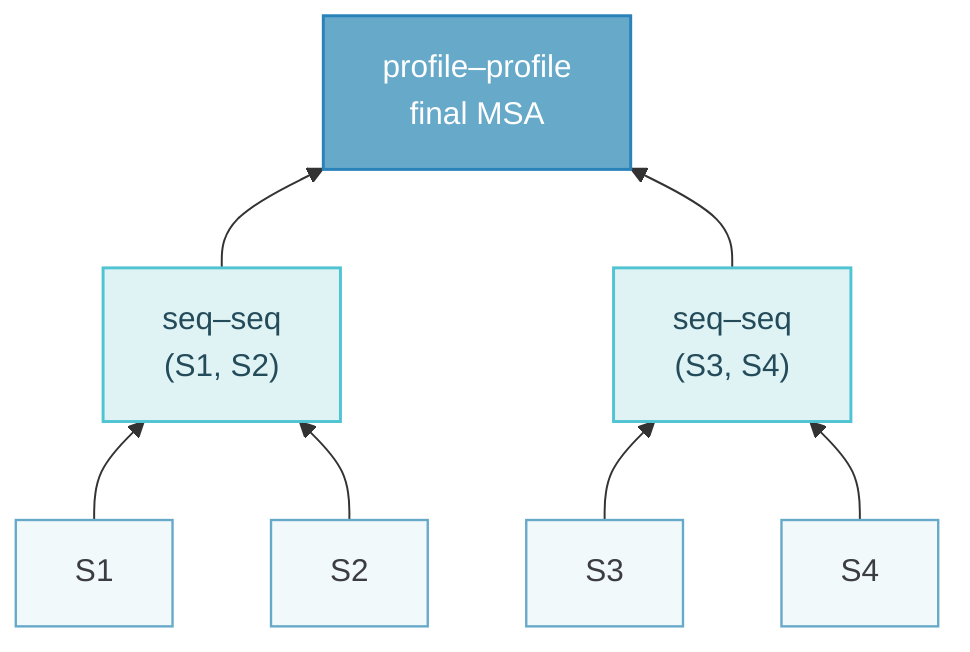

Multiple sequence alignment extends pairwise alignment to whole families, where exact DP becomes infeasible and progressive heuristics take over. The second half of the topic turns variation in a deep MSA into structural information through co-evolution and global coupling models.

## Purpose {#purpose}

A multiple sequence alignment (MSA) places corresponding residues of several related sequences into shared columns. Ideally a column represents a shared ancestral residue or an equivalent structural position, and these two goals need not coincide. MSAs support remote homology detection, family definition, functional-site analysis, phylogeny, profiles and co-evolution studies. A good alignment aligns key residues and structural cores and keeps indels coherent; a high score does not guarantee biological correctness.

Several weakly similar sequences reveal conserved positions that a single pairwise comparison misses (the lecture showed two proteins at 27% identity with the same structure and function). MSA has been called the "holy grail" of bioinformatics; the ClustalW paper has more than 40,000 citations. Uses include remote homology detection, family classification (Pfam), structure and function inference, AlphaFold input, phylogeny, conserved elements, positive selection, profiles and co-evolution. Historically, MSAs were built by experts using structure (β-strands, buried cores, conserved cysteines in the Ig I-set/telokin example).

A good MSA has many conserved columns while staying compact (no extra gaps just to line up more residues), keeps gaps together (one indel event, as with affine gaps), places gaps where they disrupt conserved columns least (loops), and has subgroup blocks that reflect the tree. Columns and sequences are not independent: structure constrains columns, and related sequences are sampled unevenly.

## Scoring: Entropy and Sum of Pairs {#scoring-entropy-and-sum-of-pairs}

Most objectives are column-additive, $S(M) = G(M) + \sum_i S(M_i)$ with a gap term $G$, which ignores dependencies between columns.

Minimum entropy uses column counts $c_i(a)$, $n_i = \sum_a c_i(a)$ and $p_i(a) = c_i(a) / n_i$:

$$
H_i = -\sum_a p_i(a) \log_2 p_i(a), \qquad -\log_2 P(M_i) = -\sum_a c_i(a) \log_2 p_i(a) = n_i H_i
$$

Conserved columns have zero entropy; gaps must be penalised so that the objective does not reward artificial conservation.

Sum of pairs (SP) adds substitution scores over every pair of sequences in every column:

$$
S_{SP}(M) = G(M) + \sum_i \sum_{k<l} s(m_{ki}, m_{li})
$$

Each pair is counted once and gaps must be defined consistently. SP is practical but not a full phylogenetic model.

**Whiteboard example.** Sequences ACG, ACT, AGT and ACG give $\binom{4}{2} = 6$ pairs per column; with match 1 and mismatch 0:

::: table align="center" title="Entropy and SP scores for the toy MSA"

| Column composition | $H_i$ (bits) | $n_i H_i$ | SP |
| :--- | :--- | :--- | :--- |
| 4 A | 0 | 0 | 6 |
| 3 C, 1 G | 0.811 | 3.245 | 3 |
| 2 G, 2 T | 1 | 4 | 2 |

:::

Entropy values are always non-negative; negative numbers in some versions of this example are typos.

SP has no strong theoretical backing: it treats every sequence pair as independent evidence, so with many close relatives the same substitution is counted many times and phylogeny is ignored. Minimum entropy makes the same independence assumption about the residues in a column. Sequence weighting is the usual remedy.

## Why Exact MSA is Infeasible {#why-exact-msa-is-infeasible}

For $N$ sequences of length $L$, exact DP has $(L+1)^N$ cells and $2^N - 1$ predecessor moves per cell (advance any non-empty subset of sequences). Time is $O\big((2^N - 1)(L+1)^N\big)$ and space $O\big((L+1)^N\big)$, so heuristics are unavoidable.

For 16 sequences of length 50 at one nanosecond per operation, exact DP would take about $10^{23}$ seconds, roughly $10^{15}$ years. SP-optimal MSA is NP-hard.

## Progressive Alignment {#progressive-alignment}

::: steps
1. Estimate pairwise distances, from alignments or fast $k$-mer comparisons.
2. Build a guide tree, for example with UPGMA or neighbour joining.
3. Merge from the leaves to the root: sequence–sequence, sequence–profile, then profile–profile DP, aligning similar sequences first and preserving existing correspondences within groups.
:::

With linear SP scoring, within-group scores are fixed, so only cross-group scores are optimised and gap–gap pairs score zero. A profile column pair is scored as $\sum_{a,b} f_i(a)\, g_j(b)\, s(a,b)$ using column frequencies. The guide tree is a merge order, not necessarily a phylogeny. Errors made early persist ("once a gap, always a gap"), so iterative refinement splits and realigns groups, without guaranteeing a global optimum. MUSCLE combines $k$-mer distances, progressive alignment and refinement; Clustal and MAFFT are other examples.

The key property of SP is $SP(\text{aln}_1 \cup \text{aln}_2) = SP(\text{aln}_1) + SP(\text{aln}_2) + \text{cross terms}$, and the cross terms are a pairwise alignment of two alignments (with $s(-,-) = 0$). This is why the MSA can be built step by step.

- **Distances:** from pairwise alignment scores, e.g. Feng–Doolittle $D = -\log \frac{S_{obs} - S_{rand}}{S_{max} - S_{rand}}$, or from fast $k$-mer counts (MUSCLE).
- **UPGMA:** repeatedly merge the two closest clusters and set the new cluster's distance to others as the size-weighted average; it gives a rooted tree under an equal-rates assumption.
- **Profile–profile alignment:** ordinary pairwise DP where each "letter" is a column frequency vector, gaps are inserted as whole columns, and existing within-profile alignments are kept. It is also used for remote homology detection (HHpred compares profile HMMs).
- **MUSCLE:** $k$-mer distances → UPGMA → progressive alignment; recompute distances from the alignment (Kimura) → new tree → realign; then iterative refinement by deleting a tree edge, realigning the two profiles and keeping the result if SP improves. T-Coffee (consistency) and ProbCons are further examples.

Progressive alignment follows the guide tree from the leaves: closest pairs first, then profile–profile alignment at the root.

**Bad MSA → bad phylogeny.** Phylogenetic inference assumes each column holds positionally homologous residues. Misaligned columns create false substitutions (overestimated distances, long branches) or false identities, which can give wrong topologies with high apparent support. Since progressive alignment follows a guide tree, a tree inferred from that alignment can be circular. Remedies are better aligners, trimming unreliable columns, or co-estimating alignment and tree.

## Co-evolution {#co-evolution}

Conservation concerns one column; co-evolution concerns joint variation between columns. Interacting residues may undergo compensatory substitutions: a K/E salt bridge can become E/K, where either single change would break the interaction but the double change restores it.

With marginal frequencies $p_i(a)$ and joint frequencies $p_{ij}(a,b)$, independence predicts $p_{ij}(a,b) = p_i(a) p_j(b)$:

$$
C_{ij}(a,b) = p_{ij}(a,b) - p_i(a) p_j(b), \qquad
MI(i,j) = \sum_{a,b} p_{ij}(a,b) \log_2 \frac{p_{ij}(a,b)}{p_i(a) p_j(b)}
$$

Independent columns have zero mutual information, and fully conserved columns carry no co-variation signal. In the toy case where half the sequences have K/E and half E/K, both marginals are $(1/2, 1/2)$ but only two of four combinations occur; each observed pair has $C = 1/2 - 1/4 = 1/4$, and $MI = 2 \cdot \tfrac{1}{2} \log_2 2 = 1$ bit.

"To calculate co-variation, there needs to be variation": fully conserved columns give no signal. Because the number of pair parameters grows quadratically, the rule of thumb is about $5n$ diverse (effective, non-redundant) sequences for a protein of length $n$. Going from a contact to a sequence constraint is easy; going back from correlated columns to contacts is the hard part.

## Why Correlation is Not Contact {#why-correlation-is-not-contact}

- **Indirect coupling:** if A contacts B and B contacts C, A and C can correlate without touching.
- **Shared ancestry and sampling bias:** related sequences are not independent observations, and overrepresented clades dominate counts.
- **Alignment problems:** misalignment, gaps and low diversity distort frequencies. Functional constraints can also link physically distant sites.

Diverse homologues, alignment checks and sequence weighting help, although weighting cannot remove all phylogenetic confounding.

## Global Coupling Models {#global-coupling-models}

A pairwise Potts model describes single-site preferences and pairwise couplings jointly:

$$
P(\mathbf{a}) = \frac{1}{Z} \exp\left[\sum_i h_i(a_i) + \sum_{i<j} J_{ij}(a_i, a_j)\right]
$$

$h_i$ are single-position fields, $J_{ij}$ pairwise couplings and $Z$ the normalisation over all sequences. The model is fitted to the observed single- and pair-site frequencies, and direct coupling analysis (DCA) looks for couplings that explain the correlations jointly, helping separate direct from indirect effects. In the mean-field approximation, couplings relate to the negative inverse of the (suitably encoded and regularised) covariance matrix; raw covariance and inferred couplings are different quantities. Exact $Z$ would sum over $q^L$ sequences ($q = 20$, or 21 with gaps), so approximate inference is required, and the many parameters need many diverse sequences plus pseudocounts or regularisation.

Ranked couplings yield a contact map whose top pairs can be used as restraints for 3D modelling, much like experimental distance restraints, and this kind of co-evolutionary information is one ingredient that AlphaFold2 integrates with structural reasoning. Strong couplings suggest candidate contacts but do not prove physical interaction. A PSSM models independent positions; a profile HMM adds ordered match, insert and delete paths; a coupling model adds pairwise dependencies. All of them depend on alignment quality and sequence diversity.

Further applications are functional sites, protein–protein interaction partners and interfaces (co-evolution across interacting families), pathogenic variant effects (EVmutation), and design of new family members. A generative model should produce sequences indistinguishable from natural ones, which is tested on features not used in fitting (e.g. higher-order statistics). Contact-based 3D modelling was demonstrated by Marks et al. (2012) and Ovchinnikov et al. (2015, 2017).

## Ten-Minute Presentation {#presentation}

### Keyword Card {#keyword-card}

- **MSA**: same column = same ancestral residue / same 3D position; holy grail; reveals conservation missed pairwise (27% id, same fold)
- **Uses**: remote homologs, Pfam, function, phylogeny, profiles/pHMM, co-evolution, AlphaFold
- **Good MSA**: conserved & compact; gaps grouped, in loops
- **Scores**: $S=G+\sum S(m_i)$ (columns independent); entropy $-\sum c\log p$; SP $\sum_{k<l}s$
- **Example** ACG/ACT/AGT/ACG: (0, 6), (3.25, 3), (4, 2)
- SP: no theory; overcounts related seqs → weighting
- **Exact DP** $O(2^NL^N)$: 16 × 50 → $10^{15}$ yr
- **Progressive**: SP cross terms = alignment of alignments; distances (scores / k-mers) → guide tree (UPGMA/NJ) → seq-seq, seq-profile, profile–profile → refine (MUSCLE); ClustalW, MAFFT, T-Coffee
- **Limits**: once a gap always a gap; tree ≠ phylogeny; bad MSA → bad tree
- **Co-evolution**: contact → compensatory (K/E ↔ E/K); MI (toy 1 bit); needs variation; ~5n sequences
- **Indirect** A–B–C, phylogeny, misalignment → **Potts** $h_i$, $J_{ij}$, $Z$ intractable → inverse covariance / pseudo-likelihood (DCA)
- **Contacts** → restraints → 3D (CASP, Marks/Ovchinnikov) → AlphaFold2; interactions, variants, design
- **Limits**: depth/diversity, alignment quality, prediction ≠ proof

### Full Script {#full-script}

::: details Full spoken script

My topic is multiple sequence alignment and the co-evolution of protein sequences. A multiple sequence alignment places residues from several related sequences into columns so that each column contains residues that correspond — ideally residues descended from the same ancestral residue, and at the same position in the 3D structure. It has been called the holy grail of bioinformatics, and it is perhaps the most used modelling method in biology. Why do we need more than pairwise alignment? Two distant relatives may share only around 25 percent identity, and the similarity is hard to see; but when we add many family members, the conserved positions stand out. MSAs are used to detect remote homologs, classify families like in Pfam, identify functional residues, infer phylogenies, build profiles and profile HMMs, and — the second half of my talk — to detect co-evolution and predict structure.

A good MSA should have many conserved columns, but stay compact — we don't want to add extra gaps just to line up more residues; gaps should be grouped, like affine gaps, and placed where they disrupt conserved columns least, typically in loops.

How do we score an MSA? Usually as a sum over columns plus a gap term, which treats columns as independent. Two column scores were presented. Minimum entropy: assuming the sequences are independent, the probability of a column is the product of the residue probabilities, and the score is its negative log, $-\sum_a c_{ia}\log p_{ia}$ — zero for a fully conserved column and large for a variable one. Sum of pairs: sum the substitution scores over all pairs of sequences in the column.

With four sequences there are six pairs per column. The first column, all A, has entropy zero and SP six; the second, three C and one G, has entropy 3.25 bits and SP three; the third, two G and two T, entropy 4 and SP two. Sum of pairs is the most common score, but it has no strong theoretical basis: it counts each sequence pair as independent evidence, so if the alignment contains many near-identical sequences, the same substitution is counted many times — the sequences are not independent because of phylogeny. Sequence weighting helps.

Why not just use dynamic programming? We could, in $N$ dimensions: but for $N$ sequences of length $L$ there are $L^N$ cells, and each has $2^N-1$ predecessors, so the cost is about $2^NL^N$ — for 16 sequences of length 50 it would take something like $10^{15}$ years. So we need heuristics.

The classic heuristic is progressive alignment. The key property of sum-of-pairs is that the score of two merged alignments equals the score of each plus the cross terms — and the cross terms are just a pairwise alignment of two alignments. So we can build the MSA step by step.

First compute pairwise distances, from pairwise alignment scores or, as MUSCLE does, from fast k-mer counts. Second, build a guide tree, for example with UPGMA, which repeatedly merges the closest clusters and averages distances, or neighbour joining. Third, follow the tree from the leaves: align the closest sequences first, then align sequences to profiles and profiles to profiles with ordinary dynamic programming, where the score of two columns is the average substitution score between them. Programs are ClustalW, MAFFT and MUSCLE; MUSCLE then iteratively refines by splitting the alignment into two groups and realigning. The limitation is "once a gap, always a gap": mistakes made early cannot be corrected later, and the guide tree is only a merge order, not necessarily the true phylogeny. And if the alignment is wrong, everything downstream suffers: a phylogeny built from misaligned columns compares non-homologous residues, which distorts distances and topology.

Now co-evolution. Conservation concerns one column; co-evolution concerns two columns varying together. Residues in contact in the 3D structure constrain each other: if a lysine forms a salt bridge with a glutamate, a mutation of the lysine to glutamate is harmful on its own, but can be compensated by a mutation of the partner to lysine. Selection removes the single mismatched changes, so in the MSA we see the pairs K–E and E–K but rarely K–K or E–E. Going from contact to sequence constraint is easy; the challenge is to go back from correlated columns to contacts.

$$
MI_{ij}=\sum_{a,b}p_{ij}(a,b)\log\frac{p_{ij}(a,b)}{p_i(a)\,p_j(b)}
$$

Mutual information measures how much observing one column tells us about the other; it is zero for independent columns. In the toy example with half K/E and half E/K, each column alone is 50/50, but the pair is fully determined, so the MI is one bit. Note two requirements: to see covariation there must be variation — fully conserved columns carry no information — and we need many diverse sequences, roughly five times the protein length, because we are estimating parameters for all pairs of positions.

The main problem with MI is indirect correlation: if A contacts B and B contacts C, then A and C appear correlated without touching. Phylogenetic relatedness of the sequences and alignment errors add more false signal. The solution is a global statistical model that considers all positions simultaneously — a Potts model:

$$
P(\mathbf a)=\frac1Z\exp\Big(\sum_i h_i(a_i)+\sum_{i<j}J_{ij}(a_i,a_j)\Big)
$$

The single-site terms $h$ describe conservation and the couplings $J$ describe direct pairwise dependencies. The normalisation $Z$ sums over $20^N$ sequences, so it cannot be computed exactly; approximations such as inverting the covariance matrix — mean-field direct coupling analysis — or pseudo-likelihood are used. The strongest couplings are predicted contacts, and a contact map used as distance restraints, like in NMR, allows quite accurate 3D structure prediction — this was demonstrated in CASP, and AlphaFold2 builds on the same MSA information combined with structural knowledge. Further applications are finding functional sites, predicting protein–protein interactions, predicting the effect of mutations, and designing new sequences in a family.

To summarise: MSA is central but exact optimisation is infeasible, so progressive heuristics are used, whose errors propagate; and co-evolution turns variation in a good, deep MSA into structural information — but only with enough diverse sequences, and couplings are predictions, not proof of contact.

:::

## Board Plan {#board-plan}

::: tip Whiteboard route

MSA purpose → entropy and SP example → exponential DP → guide tree and progressive merges → compensatory pair and MI → indirect correlation → global couplings and contact map.

:::

### Must {#board-must}

1. Toy MSA with the column scores:

::: table align="center" title="Board: toy MSA column scores"

| | col 1 | col 2 | col 3 |
| :--- | :--- | :--- | :--- |
| S1 | A | C | G |
| S2 | A | C | T |
| S3 | A | G | T |
| S4 | A | C | G |
| entropy $-\sum c\log_2p$ | 0 | 3.25 | 4 |
| SP (identity, 6 pairs) | 6 | 3 | 2 |

:::

2. **Guide tree and merge order:** (see the diagram in the notes above).

3. Co-evolution: two columns with K/E and E/K pairs; MI formula; "50/50 marginals, only 2 of 4 combinations → MI = 1 bit".
4. **Indirect correlation triangle:** A — B — C contacts, dashed A ··· C "correlated but no contact".

### Optional {#board-optional}

Potts formula with $h_i$ (conservation) and $J_{ij}$ (couplings).

## Follow-up Questions {#follow-up-questions}

::: note How to use these questions

Questions marked ★ were raised in the revision sessions on 27 and 29 October. Answer directly first, then justify with the model, then name an assumption or limitation. Each answer is collapsed so the list can be used for self-testing.

:::

::: collapse

- ★ What is profile–profile alignment?

  Aligning two alignments (profiles) to each other with ordinary pairwise DP, where each position is a column (frequency vector) rather than a single letter. The column-pair score is e.g. $\sum_{a,b}f_i(a)g_j(b)s(a,b)$ (average SP score), with gaps inserted as whole columns; existing within-profile alignment is kept. Used at internal nodes of the guide tree in progressive alignment (Clustal, MUSCLE) and for sensitive homology detection (HHpred aligns profile HMMs).

- ★ Phylogeny — sum of pairs and minimum entropy treat the sequences as … ?

  Both treat the sequences (and columns) as independent observations. Minimum entropy assumes the residues in a column are independent draws; SP sums over all pairs as if each pair were independent evidence. But sequences are related through a phylogeny: closely related sequences share residues because of common descent, not because of constraint, and a cluster of near-identical sequences dominates the score (a substitution on one branch is counted many times). Remedies: sequence weighting, or phylogeny-aware scoring/tree-based models.

- ★ What effect does a bad MSA have on the inferred phylogeny (homology)?

  Phylogenetic inference assumes each column contains positionally homologous residues. Misalignment places non-homologous residues together, creating false substitutions (overestimated distances, long branches) or false identities, which can give wrong topologies and branch lengths with high apparent support; gap placement errors create spurious indel signals. Progressive alignment is guided by a tree, so the alignment is biased toward that guide tree and a tree inferred from it can be circular. Solutions: better aligners, removing unreliable columns (trimming), co-estimating alignment and tree.

- Why is exact MSA infeasible?

  $N$-dimensional DP: $L^N$ cells, each with $2^N-1$ predecessor combinations → $O(2^NL^N)$; 16 sequences × 50 residues ≈ $10^{15}$ years. (SP-optimal MSA is NP-hard.)

- Explain progressive alignment and its main weakness.

  Distances → guide tree (UPGMA/NJ) → align most similar first, then add sequences/profiles following the tree → (refine). Weakness: greedy, "once a gap always a gap" — early errors propagate; guide tree quality; no optimality guarantee.

- How does UPGMA work?

  Start with each sequence as a cluster; repeatedly merge the two clusters with smallest distance; distance of the new cluster to others = average of member distances (weighted by cluster size); gives a rooted tree with equal rates assumption.

- What does MUSCLE do?

  (1) Fast k-mer distances → UPGMA tree → progressive alignment; (2) recompute distances from the alignment (Kimura) → new tree → realign; (3) iterative refinement: delete an edge to split into two profiles, realign them, accept if SP improves.

- Why is co-evolution evidence for contacts?

  Contacting residues must remain compatible (charge, size, H-bonding). A destabilising mutation at one can be compensated by a mutation at the partner; selection removes uncompensated variants, leaving correlated patterns in the MSA (K/E ↔ E/K).

- Why does MI fail? What does a global model do?

  MI is a local pairwise statistic: correlations propagate through chains of contacts (A–B, B–C → A–C), phylogenetic structure creates correlations, and small samples give noise; conserved columns give 0. A global Potts/DCA model fits all single-site terms and couplings simultaneously so that a coupling $J_{ij}$ reflects only the direct dependency after accounting for all others (like partial vs marginal correlation; inverse covariance).

- How many sequences do you need, and why?

  Rule of thumb ~5n effective (weighted, non-redundant) sequences for a protein of length $n$, because the model has $O(n^2q^2)$ coupling parameters; and there must be variation in the columns.

- How are co-evolution couplings used for structure prediction?

  Rank pairs by coupling strength → top ~L pairs as predicted contacts (contact map) → distance restraints for folding simulations (like NMR restraints) → accurate 3D models (CASP); AlphaFold2 uses the MSA together with structural knowledge in a deep network.

- What makes an MSA "good"?

  Homologous residues aligned (evolution) and structurally equivalent residues aligned (structure), maximal conserved columns while compact, gaps grouped and in loops, key functional residues (e.g. conserved Cys) aligned.

- Other uses of co-evolution?

  Functional/active sites, protein–protein interaction partners and interfaces (inter-protein co-evolution), predicting pathogenic variants (EVmutation), designing new functional sequences (generative models evaluated on features not used in training).

:::
