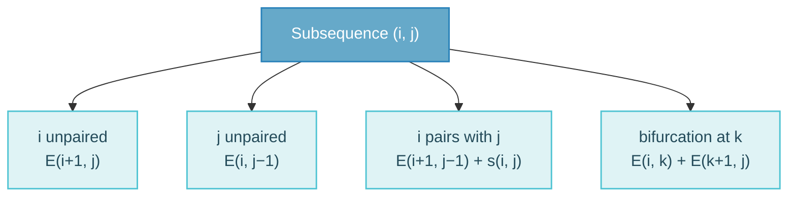

RNA structure prediction is dynamic programming over intervals of one sequence instead of prefixes of two. The topic starts with why RNA structure matters and how secondary structure is defined, then develops the Nussinov algorithm, its limitations, and the move to free-energy models and comparative (covariation) evidence.

## Why RNA Structure Matters {#why-rna-structure}

Many RNAs function through their structure rather than by coding for protein:

- **rRNA** (the ribosome is a ribozyme) and **tRNA**;
- **SRP RNA**, which binds signal peptides and targets ribosomes to the ER;
- **RNase P RNA**, which removes the tRNA 5′ leader and is catalytic in bacteria;
- **tmRNA**, which rescues ribosomes stalled on mRNA without a stop codon;
- **snoRNAs**, which guide rRNA 2′-O-methylation (box C/D) and pseudouridylation (H/ACA);
- **miRNAs** (~22 nt, processed from ~70 nt hairpin precursors by Drosha and Dicer, acting in RISC), lncRNAs, riboswitches and the iron-responsive element (IRE).

Structure is often more conserved than sequence: homologous RNAs keep their base pairs while the sequence changes through compensatory substitutions (GC → AU). Knowing the structure helps predict function, find homologues (Rfam/Infernal) and design experiments.

## Secondary Structure {#secondary-structure}

Structure can be described at three levels: 1D sequence, 2D secondary structure (base pairs) and 3D tertiary structure. A **secondary structure** is a list of base pairs $(i, j)$ such that each base pairs at most once and pairs do not cross: there are no pairs $(i,j)$ and $(k,l)$ with $i < k < j < l$. Crossing pairs are **pseudoknots**, which are excluded.

Allowed pairs are the Watson–Crick pairs GC/CG and AU/UA plus the **wobble** pair GU/UG. The G·U pair has a shifted geometry and two hydrogen bonds, is roughly as stable as AU, and is common in RNA helices and at the tRNA anticodon wobble position, where it lets one tRNA read several codons.

Structural elements are stems (stacked pairs), hairpin loops, bulges (unpaired on one side), interior loops (both sides), multi-branch loops and external unpaired regions. Representations include dot-bracket `((..))`, arc and circle plots, secondary-structure drawings, mountain plots and dot plots of base-pair probabilities.

::: echarts Nested and crossing base pairs

```json
{
  "animation": false,
  "textStyle": {"fontFamily": "Google Sans Flex, Noto Sans SC, sans-serif"},
  "grid": {"left": 10, "right": 10, "top": 40, "bottom": 30},
  "xAxis": {"type": "value", "min": 0, "max": 23, "show": false},
  "yAxis": {"type": "value", "min": -1, "max": 7, "show": false},
  "title": [
    {"text": "Nested: allowed  ((..)(..))", "left": "25%", "top": 6, "textAlign": "center", "textStyle": {"color": "#2982ba", "fontSize": 14, "fontWeight": "normal", "fontFamily": "Google Sans Flex, Noto Sans SC, sans-serif"}},
    {"text": "Crossing: pseudoknot (excluded)", "left": "75%", "top": 6, "textAlign": "center", "textStyle": {"color": "#bf360c", "fontSize": 14, "fontWeight": "normal", "fontFamily": "Google Sans Flex, Noto Sans SC, sans-serif"}}
  ],
  "series": [{
    "type": "graph", "coordinateSystem": "cartesian2d", "silent": true,
    "symbol": "circle", "symbolSize": 10,
    "itemStyle": {"color": "#6b7a86"},
    "data": [
      {"name": "n1", "value": [1, 0], "label": {"show": true, "position": "bottom", "formatter": "1", "color": "#6b7a86", "fontSize": 12}},
      {"name": "n2", "value": [2, 0], "label": {"show": true, "position": "bottom", "formatter": "2", "color": "#6b7a86", "fontSize": 12}},
      {"name": "n3", "value": [3, 0], "label": {"show": true, "position": "bottom", "formatter": "3", "color": "#6b7a86", "fontSize": 12}},
      {"name": "n4", "value": [4, 0], "label": {"show": true, "position": "bottom", "formatter": "4", "color": "#6b7a86", "fontSize": 12}},
      {"name": "n5", "value": [5, 0], "label": {"show": true, "position": "bottom", "formatter": "5", "color": "#6b7a86", "fontSize": 12}},
      {"name": "n6", "value": [6, 0], "label": {"show": true, "position": "bottom", "formatter": "6", "color": "#6b7a86", "fontSize": 12}},
      {"name": "n7", "value": [7, 0], "label": {"show": true, "position": "bottom", "formatter": "7", "color": "#6b7a86", "fontSize": 12}},
      {"name": "n8", "value": [8, 0], "label": {"show": true, "position": "bottom", "formatter": "8", "color": "#6b7a86", "fontSize": 12}},
      {"name": "n9", "value": [9, 0], "label": {"show": true, "position": "bottom", "formatter": "9", "color": "#6b7a86", "fontSize": 12}},
      {"name": "n10", "value": [10, 0], "label": {"show": true, "position": "bottom", "formatter": "10", "color": "#6b7a86", "fontSize": 12}},
      {"name": "c1", "value": [13, 0], "label": {"show": true, "position": "bottom", "formatter": "1", "color": "#6b7a86", "fontSize": 12}},
      {"name": "c2", "value": [14, 0], "label": {"show": true, "position": "bottom", "formatter": "2", "color": "#6b7a86", "fontSize": 12}},
      {"name": "c3", "value": [15, 0], "label": {"show": true, "position": "bottom", "formatter": "3", "color": "#6b7a86", "fontSize": 12}},
      {"name": "c4", "value": [16, 0], "label": {"show": true, "position": "bottom", "formatter": "4", "color": "#6b7a86", "fontSize": 12}},
      {"name": "c5", "value": [17, 0], "label": {"show": true, "position": "bottom", "formatter": "5", "color": "#6b7a86", "fontSize": 12}},
      {"name": "c6", "value": [18, 0], "label": {"show": true, "position": "bottom", "formatter": "6", "color": "#6b7a86", "fontSize": 12}},
      {"name": "c7", "value": [19, 0], "label": {"show": true, "position": "bottom", "formatter": "7", "color": "#6b7a86", "fontSize": 12}},
      {"name": "c8", "value": [20, 0], "label": {"show": true, "position": "bottom", "formatter": "8", "color": "#6b7a86", "fontSize": 12}},
      {"name": "c9", "value": [21, 0], "label": {"show": true, "position": "bottom", "formatter": "9", "color": "#6b7a86", "fontSize": 12}},
      {"name": "c10", "value": [22, 0], "label": {"show": true, "position": "bottom", "formatter": "10", "color": "#6b7a86", "fontSize": 12}}
    ],
    "links": [
      {"source": "n1", "target": "n10", "lineStyle": {"color": "#2982ba", "width": 3, "curveness": 0.9}},
      {"source": "n2", "target": "n5", "lineStyle": {"color": "#2982ba", "width": 3, "curveness": 0.9}},
      {"source": "n6", "target": "n9", "lineStyle": {"color": "#2982ba", "width": 3, "curveness": 0.9}},
      {"source": "c1", "target": "c6", "lineStyle": {"color": "#bf360c", "width": 3, "curveness": 0.9}},
      {"source": "c4", "target": "c9", "lineStyle": {"color": "#bf360c", "width": 3, "curveness": 0.9}}
    ]
  }]
}
```

:::

Base pairs drawn as arcs over the sequence. Nested pairs, such as $(1,10)$ enclosing $(2,5)$ and $(6,9)$, are allowed; pairs $(1,6)$ and $(4,9)$ cross, form a pseudoknot and are excluded from the secondary-structure model.

Secondary structure is a useful level to work at: it is a coarse-graining of 3D structure, covers most of the folding free energy, is an intermediate on the folding pathway, is conserved in evolution and is computationally easy. Excluding pseudoknots simplifies both the model and the algorithms (many are sterically impossible and their energetics are poorly known), but some pseudoknots are functional, for example in telomerase RNA and in frameshifting signals.

## The Nussinov Algorithm {#nussinov}

Nussinov's algorithm finds the structure with the maximum number of base pairs. Let $E(i,j)$ be the maximum number of pairs in the subsequence $x_i \ldots x_j$:

$$
E(i,j) = \max
\begin{cases}
E(i+1, j) & i \text{ unpaired} \\
E(i, j-1) & j \text{ unpaired} \\
E(i+1, j-1) + s(i,j) & i \text{ pairs with } j \\
\max_{i < k < j} \left[E(i,k) + E(k+1,j)\right] & \text{bifurcation}
\end{cases}
$$

with $s(i,j) = 1$ for an allowed pair and 0 otherwise.



- **Initialisation:** $E(i,i) = 0$, and $E(i,j) = 0$ whenever $j - i$ is at most the minimum hairpin loop size $h$. Sterically, a hairpin needs at least three unpaired bases; the exercises use 1–2.
- **Fill order:** by increasing interval length (diagonal by diagonal), because every case refers to shorter intervals. The answer is $E(1,n)$ in the top-right corner.
- **Bifurcation** is needed because two adjacent stems, `(...)(...)`, cannot be built by pairing or skipping the ends alone; every split point $k$ is tried.
- **Traceback** starts at $(1,n)$ and follows whichever case produced the maximum, recording pairs; at a bifurcation both halves are traced. Ties give several co-optimal structures, so Nussinov structures are ambiguous.
- **Optimal substructure:** because pairs cannot cross, the parts on either side of a pair or split are independent intervals.

**Complexity.** There are $O(N^2)$ intervals, each with up to $O(N)$ split points, so time is $O(N^3)$ and memory $O(N^2)$. Compared with pairwise alignment, the subproblems are intervals of one sequence rather than prefixes of two, and the bifurcation adds the extra factor $N$. Algorithms that allow pseudoknots cost $O(N^4)$–$O(N^6)$ or are NP-hard in general.

**Worked examples.**

::: table align="center" title="Nussinov worked examples"

| Sequence | $h$ | Optimal pairs | Structure |
| :--- | :--- | :--- | :--- |
| GCAAAGC | 3 | 2 | `((...))` |
| GAAACGAAAC | 3 | 2 | `(...)(...)` (bifurcation at $k = 5$) |
| AGGCUAUUCU | 2 (GU allowed) | 3 | `(((...)).)` |
| GGUCCACGGUCCAC | 1 | 5 | `(((..))((.)).)` |

:::

For GCAAAGC, $E(2,6) = 1$ (C2–G6 around AAA) and $E(1,7) = E(2,6) + 1 = 2$ (G1–C7):

::: table align="center" title="Nussinov matrix for GCAAAGC"

|   | G1 | C2 | A3 | A4 | A5 | G6 | C7 |
| :--- | :--- | :--- | :--- | :--- | :--- | :--- | :--- |
| G1 | 0 | 0 | 0 | 0 | 0 | 1 | **2** |
| C2 |   | 0 | 0 | 0 | 0 | **1** | 1 |
| A3 |   |   | 0 | 0 | 0 | 0 | 0 |
| A4 |   |   |   | 0 | 0 | 0 | 0 |
| A5 |   |   |   |   | 0 | 0 | 0 |
| G6 |   |   |   |   |   | 0 | 0 |
| C7 |   |   |   |   |   |   | 0 |

:::

## From Pair Counting to Free Energy {#free-energy}

Nussinov rewards every pair equally and ignores stacking, which is unrealistic and produces ambiguous optima. Stability is governed by free energy, not pair count:

- **Nearest-neighbour energy model:** the free energy of a structure is the **sum of its loop energies** (a structure decomposes uniquely into loops, the faces of its graph). **Stacked base pairs** are the main stabilising contribution (two stacked GC pairs ≈ −3.3 to −3.4 kcal/mol; all 21 stacking combinations have been measured), while hairpin, bulge, interior and multi-loops are destabilising, depending on type, size and sequence.
- Parameters come from **UV-melting experiments** on oligonucleotides (1 M NaCl, 37 °C; Turner group); some are estimated or optimised.
- **MFE folding** (Zuker; ViennaRNA `RNAfold`) minimises $\Delta G$ with a more complex DP that needs more matrices (just replacing max by min is not enough), still $O(N^3)$.
- $\Delta G < 0$ means stable. The thermodynamic ensemble $P(S) \propto e^{-\Delta G(S)/RT}$ gives base-pair probabilities (McCaskill), shown as a dot plot. Well-defined high-probability pairs are more reliable than a single MFE structure, which has no reliability measure of its own.
- MFE prediction recovers roughly 40–70% of the base pairs of phylogenetically determined structures, with accuracy decreasing with length; the correct structure is often within a small energy increment of the MFE.

## Predicted versus Real Structure {#predicted-vs-real}

- Real RNAs need not maximise base pairs, nor even sit at the MFE: they form ensembles, fold kinetically and co-transcriptionally, and can switch between functional states (riboswitches).
- The models miss pseudoknots, tertiary interactions, non-canonical pairs, base triples, Mg²⁺ and other ions, protein binding, modifications and the cellular environment; the energy parameters are incomplete.
- Single-sequence folding cannot distinguish real ncRNAs from random sequences, since random (especially GC-rich) sequences also fold stably (Rivas & Eddy). We cannot "fold our way through the genome", which motivates comparative analysis.

## Covariation and Mutual Information {#covariation}

Compensatory changes (CG ↔ AU, GC ↔ UA) keep pairing while the sequence changes, which is evidence for a conserved base pair. For alignment columns $i$ and $j$:

$$
M_{ij} = \sum_{a,b \in \{A,C,G,U\}} p_{ab,ij} \log_2 \frac{p_{ab,ij}}{p_{a,i}\, p_{b,j}}
$$

$M_{ij}$ is the KL divergence between the joint distribution and the product of the marginals: 0 for independent columns, at most 2 bits for RNA.

::: table align="center" title="Mutual information in two scenarios"

| Scenario | Pairs observed | $M_{ij}$ |
| :--- | :--- | :--- |
| A | AU, CG, GC, UA | 2 bits (perfect covariation) |
| B | AU, AU, GU, GU (column $j$ all U) | 0 bits (no variation in $j$) |

:::

Conserved columns give MI = 0 even if they pair, and MI is evidence of dependency rather than proof of pairing; it needs a good structural alignment and enough diverse sequences. Combining folding energy with covariation (RNAalifold, PETfold) improves prediction, and MatrixPlot draws MI plots.

## RNA Homology Search {#rna-homology-search}

To search for homologous RNAs, build a structural MSA (sequence- or structure-based, curated), train a **covariance model** (a stochastic context-free grammar, SCFG) that models both sequence and paired columns, and search databases with **Infernal**; families are collected in **Rfam** (4070 families in v14.6). A weight matrix models independent positions; a covariance model adds pair emissions (16 pair probabilities) for base-paired columns, insertions, deletions and nested structure, which gains sensitivity when sequence diverges but structure is conserved.

## Ten-Minute Presentation {#presentation}

### Keyword Card {#keyword-card}

- **Why**: ncRNA function via structure (rRNA ribozyme, tRNA, RNase P, SRP, snoRNA, miRNA); structure > sequence conservation
- **Secondary structure**: pairs, each base ≤ 1, **no crossing** ($i<k<j<l$) = no pseudoknots; GC, AU, **GU wobble**
- Why 2D: coarse 3D, most free energy, conserved, easy; elements: stem, hairpin, bulge, interior, multiloop; dot-bracket, arcs, mountain, dot plot
- **Nussinov**: max #pairs; $E(i,j)$ = max{i unpaired, j unpaired, pair +1, bifurcation $\max_k$}
- Bifurcation for adjacent stems; no crossing → independent parts (optimal substructure)
- **Init** 0, min loop h (3; exercises 1–2); fill by interval length; answer $E(1,n)$
- **Example** GCAAAGC h=3 → 2, `((...))`; traceback cases; ties; AGGCUAUUCU → 3
- **Complexity** $O(N^3)$ time, $O(N^2)$ memory; intervals vs prefixes
- **Limits**: all pairs equal, no stacking; reality ≠ max pairs; → nearest-neighbour energy, loops sum, melting experiments, **MFE** (Zuker/Vienna) 40–70%; ensemble, dot plot; pseudoknots, tertiary, ions, proteins, kinetics; random seqs fold too
- **Comparative**: compensatory CG→AU; **MI** max 2 bits; constant column → 0; covariance model (SCFG), Infernal, Rfam

### Full Script {#full-script}

::: details Full spoken script

My topic is algorithms on RNA structure, focusing on the Nussinov algorithm. Many RNAs function through their structure rather than by coding for protein: ribosomal RNA — the ribosome is a ribozyme — transfer RNA, RNase P RNA, which in bacteria is catalytic, the SRP RNA, snoRNAs that guide rRNA modification, microRNAs, which are processed from hairpin precursors, and many others. For such RNAs the structure is often more conserved than the sequence: homologous RNAs keep their base pairs even when the sequence changes. So predicting structure helps us understand function and find homologs.

RNA folds back on itself by base pairing. A secondary structure is defined as a list of base pairs $(i,j)$ with two constraints: each base pairs with at most one other base, and pairs must not cross — there can be no pairs $(i,j)$ and $(k,l)$ with $i<k<j<l$. Crossing pairs are pseudoknots, and excluding them makes the model and the algorithms much simpler. The allowed pairs are the Watson–Crick pairs GC and AU, plus the GU wobble pair — a G·U pair with a shifted geometry and two hydrogen bonds, which is common in RNA.

Secondary structure is a useful level to work at: it is a coarse-graining of 3D structure, it contains most of the folding free energy, it is conserved in evolution, and it is computationally easy. The elements are stems of stacked pairs, hairpin loops, bulges, interior loops and multi-branch loops, and we can draw a structure as dot-bracket, as arcs, as a mountain plot or as a dot plot.

The first algorithmic approach, by Nussinov, is to find the structure with the maximum number of base pairs, using dynamic programming over intervals of the sequence. Let $E(i,j)$ be the maximum number of pairs in the subsequence from $i$ to $j$. There are four ways the best structure on $[i,j]$ can look:

$$
E(i,j)=\max\begin{cases}E(i+1,j) & i\text{ unpaired}\\ E(i,j-1) & j\text{ unpaired}\\ E(i+1,j-1)+s(i,j) & i\text{ pairs with }j\\ \max_{i<k<j}\big[E(i,k)+E(k+1,j)\big] & \text{bifurcation}\end{cases}
$$

$i$ is unpaired, so the answer is $E(i+1,j)$; $j$ is unpaired, $E(i,j-1)$; $i$ pairs with $j$, so we add one to the best structure inside, $E(i+1,j-1)+1$; or the structure bifurcates — it consists of two independent parts side by side, and we try every split point $k$. The bifurcation is needed because two adjacent stems, like `(...)(...)`, cannot be described by just pairing or skipping the ends. Because pairs cannot cross, the parts on either side of a split are independent — that is the optimal substructure that makes dynamic programming valid.

We initialise the diagonal with zeros and also intervals too short to form a hairpin — in practice a hairpin loop needs at least three unpaired bases, in the exercises one or two. Then we fill the matrix diagonal by diagonal, by increasing interval length, so that all smaller intervals are known, and the answer is in the top-right corner, $E(1,n)$.

For example, GCAAAGC with minimum loop three: the interval from C2 to G6 can form one pair, C–G, around the three A's; and then G1 can pair with C7 around it, so $E(1,7)=2$. The traceback starts at $E(1,n)$ and asks which case produced the value: here the pair case, so we record the pair (1,7) and go to (2,6), which is again a pair, (2,6), and the inside has score zero. The structure is `((...))`. When the traceback meets a bifurcation, we trace both halves; when there are ties, there are several equally good structures. In the class exercise, AGGCUAUUCU with minimum loop two gives three pairs, including GU wobbles.

Complexity: there are on the order of $N^2$ intervals, and for each we try up to $N$ split points, so the time is $O(N^3)$ and the memory $O(N^2)$. Compared to pairwise alignment, the subproblems here are intervals of one sequence, not prefixes of two sequences, and the bifurcation adds the extra factor $N$.

Now the limitations — and Nussinov is clearly insufficient. All pairs count the same, but a GC pair is more stable than an AU or GU pair, and what really stabilises RNA is the stacking of adjacent base pairs; loops cost energy depending on their type, size and sequence. Real structures do not maximise the number of pairs. The realistic model is the nearest-neighbour energy model: the free energy of a structure is the sum of the energies of its loops, with stacking energies measured in melting experiments. Minimum free energy folding — Zuker's algorithm, implemented in ViennaRNA — uses a more complex DP with the same $O(N^3)$ idea but minimises free energy. Even this reaches only about 40 to 70 percent accuracy, decreasing with length. An RNA in the cell is an ensemble of structures, so base-pair probabilities, shown in a dot plot, are more informative than a single MFE structure. And the predicted structure can differ from reality because of pseudoknots, tertiary interactions, non-canonical pairs, metal ions, proteins, modifications and folding kinetics. Also, a single sequence fold cannot distinguish a real ncRNA from a random sequence — we cannot fold our way through the genome.

$$
M_{ij}=\sum_{a,b}p_{ab,ij}\log_2\frac{p_{ab,ij}}{p_{a,i}\,p_{b,j}}
$$

Therefore we use comparative information. If a base pair is conserved while the sequence changes — for example CG replaced by AU — the two columns of an alignment vary together. Mutual information measures this covariation: with all four Watson–Crick pairs equally frequent it reaches the maximum of 2 bits, while if one column is constant the MI is zero, even if the positions pair. Combining covariation with folding energy improves predictions, and covariance models — stochastic context-free grammars that model both sequence and paired positions — are used by Infernal and the Rfam database to search for homologous RNAs. So Nussinov is the conceptual starting point: the same dynamic programming over intervals, extended with realistic energies and evolutionary information.

:::

## Board Plan {#board-plan}

### Must {#board-must}

1. **Arc diagram:** nested pairs allowed vs crossing pairs (pseudoknot) excluded; dot-bracket under it (see the diagram in the notes above).

2. Recurrence with four small interval pictures: $i$ unpaired, $j$ unpaired, $i$–$j$ paired, split at $k$.
3. **GCAAAGC matrix** ($h=3$; only the upper triangle; fill by diagonals):

::: table align="center" title="Board: GCAAAGC matrix"

|   | G1 | C2 | A3 | A4 | A5 | G6 | C7 |
| :--- | :--- | :--- | :--- | :--- | :--- | :--- | :--- |
| G1 | 0 | 0 | 0 | 0 | 0 | 1 | **2** |
| C2 |   | 0 | 0 | 0 | 0 | **1** | 1 |
| A3 |   |   | 0 | 0 | 0 | 0 | 0 |
| A4 |   |   |   | 0 | 0 | 0 | 0 |
| A5 |   |   |   |   | 0 | 0 | 0 |
| G6 |   |   |   |   |   | 0 | 0 |
| C7 |   |   |   |   |   |   | 0 |

:::

Traceback E(1,7) = E(2,6) + 1 → pair (1,7); E(2,6) = E(3,5) + 1 → pair (2,6) → `((...))`.

4. MI formula with the two scenarios: AU, CG, GC, UA → 2 bits; AU, AU, GU, GU → 0 bits.

### Optional {#board-optional}

"stacking > pair count" note; GAAACGAAAC → `(...)(...)` to show the bifurcation.

## Follow-up Questions {#follow-up-questions}

::: note How to use these questions

Questions marked ★ were raised in the revision sessions on 27 and 29 October. Answer directly first, then justify with the model, then name an assumption or limitation. Each answer is collapsed so the list can be used for self-testing.

:::

::: collapse

- ★ Nussinov optimises the number of base pairs — why is that not the most biological?

  Stability is determined by free energy, not pair count: GC pairs (3 H-bonds) are stronger than AU/GU, and most stabilisation comes from stacking between adjacent pairs; loops (hairpins, bulges, interior, multiloops) cost energy depending on size/type/sequence. Maximising pairs favours many isolated pairs and tiny loops that are not stable, and gives many ambiguous optima. Real structures can have fewer pairs but lower free energy.

- ★ What is free energy here?

  The Gibbs free energy ΔG of forming the structure from the unfolded chain; negative = stabilising. Nearest-neighbour model: ΔG = sum of loop contributions (stacking negative, loops positive), parameters from optical melting experiments (Turner). MFE folding minimises ΔG (Zuker; RNAfold); thermodynamic ensemble $P(S)\propto e^{-\Delta G/RT}$ gives base-pair probabilities (McCaskill, dot plot).

- ★ Why do we want to know RNA folding?

  ncRNA function depends on structure (ribozymes, tRNA, rRNA, riboswitches, IRE, miRNA precursors processed by Drosha/Dicer); structure is more conserved than sequence, so structure helps find homologs (Rfam/Infernal) and annotate ncRNA genes; understanding mutations' effects, designing RNA (siRNA, aptamers, mRNA vaccines), probing regulation (UTR structures).

- ★ What is a wobble pair?

  G·U (and U·G) base pair: non-Watson–Crick geometry shifted relative to canonical pairs, two hydrogen bonds; thermodynamically weaker than GC, comparable to AU; common in RNA helices and at the tRNA anticodon wobble position (allows one tRNA to read several codons). Allowed in Nussinov/MFE models.

- ★ What is the mutual information formula? Interpret it.

  $M_{ij}=\sum_{a,b\in\{A,C,G,U\}}p_{ab,ij}\log_2\frac{p_{ab,ij}}{p_{a,i}p_{b,j}}$ — the KL divergence between the joint distribution of columns $i,j$ and the product of marginals; 0 if independent, max 2 bits for RNA. Example AU, CG, GC, UA → 2 bits (perfect covariation); AU, AU, GU, GU → 0 (column $j$ constant). High MI = compensatory changes = evidence for a conserved base pair (not proof).

- ★ Difference between predicted structure and reality?

  Reality may not be the optimum of the model: Nussinov maximises pairs; MFE only ~40–70% accurate; the true fold may be a suboptimal or kinetically trapped structure, an ensemble, or condition-dependent (riboswitch states). The models exclude pseudoknots, tertiary interactions, non-canonical pairs, base triples, ion (Mg$^{2+}$) effects, protein binding, modifications, co-transcriptional folding. Energy parameters are incomplete (1 M NaCl, 37 °C).

- Write the Nussinov recursion and explain each case.

  $E(i,j)=\max\{E(i+1,j),E(i,j-1),E(i+1,j-1)+s(i,j),\max_{i<k<j}E(i,k)+E(k+1,j)\}$: i unpaired; j unpaired; i–j pair; bifurcation into two independent substructures. Base cases zero; minimum hairpin loop length.

- Why is the bifurcation term necessary?

  Two adjacent helices `(...)(...)`: the ends 1 and n are each paired with inner partners, not with each other, so skipping or pairing the ends can't build this; splitting at k combines two independent optimal sub-structures.

- Complexity and why?

  $O(N^2)$ subproblems (intervals) × $O(N)$ split points = $O(N^3)$ time; $O(N^2)$ memory. Pseudoknot algorithms are $O(N^4)$–$O(N^6)$ or NP-hard in general.

- Why exclude pseudoknots?

  Crossing pairs break the decomposition into independent intervals, which is what makes the DP work; pseudoknots also have poorly known energies and many are sterically impossible. But they are functionally important (e.g. telomerase RNA, frameshifting) — a limitation.

- In which order do you fill the matrix? Where is the answer?

  By increasing interval length $j-i$ (diagonals), since every case refers to shorter intervals; answer at $E(1,n)$ (top-right); traceback from there.

- Do the exercise: GCAAAGC (h=3).

  E(2,6)=1 (C2–G6 around AAA), E(1,7)=E(2,6)+1=2 (G1–C7) → `((...))`. With bifurcation example GAAACGAAAC → `(...)(...)` score 2.

- Can we find ncRNA genes by folding the genome?

  No — random sequences (especially GC-rich) also form stable folds; single-sequence MFE of real ncRNAs is not distinguishable from shuffled sequences (Rivas & Eddy). Comparative (covariation) evidence is needed.

- Weight matrix vs covariance model?

  Weight matrix: independent position-specific probabilities, no gaps. Covariance model (SCFG): adds paired emissions for base-paired columns (16 pair probabilities), insert/delete states and nested structure; used by Infernal for Rfam homology search — gains sensitivity from structure conservation when sequence diverges.

- Dot plot vs MFE — which would you trust?

  The dot plot shows base-pair probabilities in the ensemble; well-defined (high-probability) pairs are reliable, competing alternatives are visible; the MFE structure gives no reliability measure. Prefer the dot plot for interpretation.

:::
