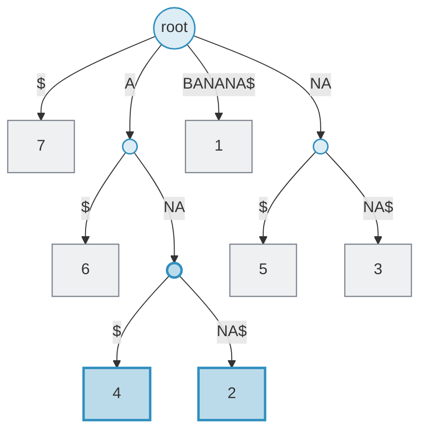

Every database search and every read mapper starts by finding where short exact pieces of the query occur in the reference. String-matching data structures do this by preprocessing: spend time and memory once to build an index, and every later lookup is fast. The page starts with which index is used for which job and how exact matches become biological alignments, then shows on BANANA how a suffix tree and a suffix array answer a query.

::: tip Opening

When I search a query against a genome or map sequencing reads, the first step is always to find where short exact pieces of the query occur in the reference. Doing that by full alignment is far too slow, so real tools preprocess sequences into an index. I will start with which index is used for which job and how exact matches become biological alignments, and then show on BANANA how a suffix tree and a suffix array answer a query.

:::

## Which Index for Which Job {#application}

::: table align="center" title="Index structures in practice"

| Index | Typical use | Practical trade-off |
| :--- | :--- | :--- |
| Hash of $k$-mers | BLAST (query words), BLAT (genome) | Fast; fixed word length $k$ |
| Suffix tree | Matches of any length, all occurrences | Fastest queries; large memory |
| Suffix array | Any length; basis of BWT read mappers | Compact; slower search |

:::

- **Query index**: index the query words and scan the database (classical BLAST in the lecture).
- **Database index**: preprocess the reference once and reuse it for many queries (BLAT).

Both trade preprocessing and memory for faster repeated searches.

## From Exact Matching to Biological Similarity {#exact-seeds}

Let the reference length be $N$, the query length $m$ and the number of occurrences $z$. Full alignment costs about $O(mN)$.

With at most $d$ mismatches in $m$ aligned positions, divide the query into $d + 1$ blocks. ==At least one block is an exact seed==, because $d$ mismatches cannot hit $d+1$ blocks, and its length is at least

$$
k = \left\lfloor \frac{m}{d+1} \right\rfloor.
$$

Example: $m = 12$, $d = 2$ gives three 4-base blocks, at least one of which matches exactly. This assumes mismatches only; insertions and deletions shift positions and need more care.

Short $k$ increases sensitivity and random hits; long $k$ reduces random hits but can miss real similarities. For independent uniform letters from an alphabet of size $M$, $P(\text{random word match}) = M^{-k}$.

For mismatch-only search: split into $d + 1$ blocks, search each, use block offsets to infer candidate alignment starts, and verify the candidates. Exact seeds locate candidates; extension handles mismatches and gaps. Protein BLAST generates high-scoring neighbourhood words first, so lookup is exact to a retained neighbour even if it differs from the original query word.

## Choosing a Structure: Cost Comparison {#cost-comparison}

::: table align="center" title="Index structures compared"

| Structure | Space | Search including output |
| :--- | :--- | :--- |
| Hash of fixed $k$-mers | Representation-dependent | Expected $O(1)$ per bucket; key and output extra |
| Suffix trie | $O(N^2)$ | $O(m + z)$ |
| Suffix tree | $O(N)$, high overhead | $O(m + z)$ |
| Suffix array | $O(N)$, compact | Basic $O(m \log N + z)$ |

:::

Naive suffix sorting by comparison can cost $O(N^2 \log N)$, because sorting needs $O(N \log N)$ comparisons and each can take $O(N)$; specialised linear-time construction exists. BWT/FM-indexes reduce memory further (see [NGS and the BWT](/docs/ku-bsa/ngs-and-bwt/)).

::: table align="center" title="Memory for a human-sized genome"

| Structure | Bytes per character | Human genome |
| :--- | :--- | :--- |
| Suffix tree | > 15 | ≈ 45 GB |
| Suffix array | ≈ 4 | ≈ 12 GB |
| FM-index (BWT) | ≈ 0.5 | ≈ 1.5 GB |

:::

**Decision rule**: one query against a changing database → index the query; many queries against one genome → index the genome once; for a human-sized reference, memory decides, favouring suffix arrays and compressed (BWT) indexes.

## Hash Tables {#hash-tables}

A hash maps a word to a bucket storing the key and its occurrence positions. A **collision** occurs when distinct words share a bucket; it is resolved by chaining or open addressing, comparing keys to distinguish the words.

With a suitable hash and controlled load, bucket lookup is expected $O(1)$. Forming a key can cost $O(k)$ and reporting positions adds $O(z)$, so the whole search is not constant-time.

For DNA, encode $A = 0$, $C = 1$, $G = 2$, $T = 3$:

$$
h(x_1 \cdots x_k) = \sum_{i=1}^{k} x_i\, 4^{k-i}, \qquad h(\text{ACGT}) = 0 \cdot 64 + 1 \cdot 16 + 2 \cdot 4 + 3 = 27.
$$

This is collision-free for fixed $k$, but direct addressing needs $4^k$ slots; the exponential growth limits memory efficiency. Smaller ordinary hash tables may have collisions.

## Suffix Tries and Suffix Trees {#suffix-tries-and-suffix-trees}

A prefix begins at the first character; a suffix continues to the end. ==Every substring is a prefix of a suffix==, so indexing suffixes indexes all substrings. Append a unique terminal `$` so that no suffix is a prefix of another.

- **Suffix trie**: insert every suffix with one character per edge; shared prefixes share paths. Leaves store suffix start positions. Worst-case construction time and space are $O(N^2)$.
- **Suffix tree**: compress non-branching paths into single edges. Labels can contain several characters, and outgoing edges of a node begin with different characters. Each root-to-leaf path spells a suffix.
- Edge labels are stored as intervals in the reference, not copied strings. Linear-time construction (Ukkonen, McCreight) exists under suitable alphabet assumptions; space is $O(N)$ with substantial overhead.

> **Say (constructing a small tree):** List all suffixes with their start positions. Insert them one by one, sharing their common prefixes. If a new suffix diverges inside an existing edge, split that edge at the first mismatch and add a branch. Mark terminal leaves by suffix starts; compress non-branching paths. This simple insertion procedure is for hand construction, not the linear-time algorithm.

**Search**: start at the root and consume query characters along edges. A mismatch or missing edge means no exact occurrence. Matching all query characters establishes a substring match, even when it ends inside an edge. Descendant leaves give all start positions:

$$
\text{existence: } O(m), \qquad \text{reporting all matches: } O(m + z).
$$

For BANANA\$, the root branches to `$`, `A`, `BANANA$` and `NA`. The `A` branch has children `$` and `NA`; the latter branches to `$` and `NA$`. Searching ANA goes via `A` then `NA`; the descendant leaves give positions 2 and 4 (1-based). Searching `ANA$` additionally establishes a suffix match.

Suffix tree of BANANA\$. Leaves carry 1-based suffix starts; the highlighted node is reached by searching ANA, and its leaves 4 and 2 are the occurrences.

A **generalised suffix tree** indexes several sequences with distinct terminators and labels leaves by (sequence ID, suffix start position).

## Suffix Arrays {#suffix-arrays}

> **Say:** A suffix tree is fast but has substantial memory overhead. A suffix array instead stores suffix starting positions in sorted order.

::: table align="center" title="Suffix array of BANANA$"

| Rank | 1 | 2 | 3 | 4 | 5 | 6 | 7 |
| :--- | :--- | :--- | :--- | :--- | :--- | :--- | :--- |
| SA | 7 | 6 | 4 | 2 | 1 | 5 | 3 |
| Suffix | `$` | `A$` | `ANA$` | `ANANA$` | `BANANA$` | `NA$` | `NANA$` |

:::

All suffixes starting with the query form a contiguous interval, and two binary searches find its boundaries. For ANA, ranks 3–4 map to reference positions 4 and 2. Ranks are not reference coordinates.

## Ten-Minute Presentation {#presentation}

### Full Script {#full-script}

::: details Full spoken script

**What it is for.** Whenever I search a query against a genome or map sequencing reads, the first step is the same: find where short exact pieces of the query occur in the reference. If I had to compare the query with every position of a three-billion-base genome, each search would cost time proportional to the query length times the genome length. String-matching data structures avoid this by preprocessing: I spend time and memory once to build an index, and afterwards every lookup is fast. The exact matches are then used as seeds, and a proper alignment is done only around them.

**Why exact matching helps find inexact similarity.** Biological matches are rarely exact, but there is a simple guarantee. If a query of length $m$ matches the reference with at most $d$ mismatches, and I cut the query into $d + 1$ blocks, then at least one block must match exactly, because $d$ mismatches cannot hit $d + 1$ blocks. So I search each block exactly, and verify the candidates by alignment. This is the logic behind seed-and-extend. The guarantee holds for mismatches; insertions and deletions shift positions and need a more careful treatment.

**Structure one: the hash table.** I choose a fixed word length $k$ and store, for every $k$-mer, the list of positions where it occurs. A hash function turns the word into a table address; for DNA I can simply read the word as a number in base four, so ACGT becomes $0 \cdot 64 + 1 \cdot 16 + 2 \cdot 4 + 3 = 27$. Looking up a word then takes constant expected time. This is what BLAST does with the words of the query and what BLAT does with the words of the genome. The limitations are that $k$ is fixed, so I cannot search for matches of arbitrary length, and that a direct table needs $4^k$ entries, which grows quickly.

**Structure two: the suffix tree.** The key observation is that every substring of a text is a prefix of one of its suffixes. So if I store all suffixes in a tree in which common prefixes share a path, I can find any substring by walking down from the root. A suffix trie has one character per edge and can need quadratic space. A suffix tree compresses every path without branching into a single edge, which brings the space down to linear in the text length. I append a unique end symbol, the dollar sign, so that no suffix is a prefix of another and every suffix ends in its own leaf.

**Searching in the tree.** To search a pattern of length $m$ I start at the root and follow the edges that spell the pattern. If I get stuck, the pattern does not occur. If I can read the whole pattern, it occurs, and the leaves below the point where I stopped give all the starting positions. So deciding whether the pattern occurs takes $O(m)$, independent of the genome length, and listing all $z$ occurrences takes $O(m + z)$. For BANANA with the end symbol, searching ANA leads through the edge A and then NA; below that point there are two leaves, for the suffixes starting at positions 2 and 4, so ANA occurs twice.

**Structure three: the suffix array.** A suffix tree is fast but needs a lot of memory per character, too much for large genomes. A suffix array keeps only the essential information: the starting positions of all suffixes, sorted alphabetically. For BANANA with the end symbol the sorted suffixes are the end symbol, A, ANA, ANANA, BANANA, NA and NANA, so the array is 7, 6, 4, 2, 1, 5, 3. Because the suffixes are sorted, all suffixes that begin with my pattern are next to each other, so they form one contiguous interval, and I can find its two ends by binary search in $O(m \log N)$. For ANA the interval is ranks 3 to 4, which point to positions 4 and 2.

**How I choose in practice.** If I have one query and a database that keeps changing, I index the query, as BLAST does. If I have many queries against one fixed genome, I index the genome once. If the genome is large, memory decides: a hash of long words or a suffix tree of the human genome is very large, a suffix array is smaller, and the compressed form based on the Burrows–Wheeler transform, the FM-index, is small enough for an ordinary computer, which is why read mappers use it. In all cases the index only finds candidates; the biological alignment comes from extending them.

:::

## Key Terms {#key-terms}

::: table align="center" title="Key terms"

| English | 中文与要点 |
| :--- | :--- |
| exact matching / seed | 精确匹配 / 种子 |
| preprocessing, index | 预处理、索引：一次构建，多次查询 |
| hash table, collision | 哈希表、冲突（不同词落入同一桶） |
| prefix / suffix / substring | 前缀 / 后缀 / 子串（每个子串是某后缀的前缀） |
| suffix trie / suffix tree | 后缀字典树 / 后缀树（压缩不分叉路径） |
| suffix array | 后缀数组：排序后各后缀的起始位置 |
| terminal symbol `$` | 结束符：保证每个后缀对应一个叶子 |
| binary search | 二分查找：在有序后缀中定位区间 |

:::

## Follow-up Questions {#follow-up-questions}

::: note How to use these questions

Questions marked ★ were raised in the revision sessions on 27 and 29 October. Answer directly first, then justify with the model, then name an assumption or limitation. Each answer is collapsed so the list can be used for self-testing.

:::

::: collapse

- Why do we add the dollar symbol at the end of the text?

  So that no suffix is a prefix of another suffix. Then every suffix ends at its own leaf, and the leaf can store the starting position. In the sorted order the symbol is defined to be smaller than all letters.

- What is the difference between a suffix trie and a suffix tree?

  In a trie every edge carries one character, so long unbranched paths use many nodes and the size can be quadratic. In a suffix tree unbranched paths are merged into one edge whose label is stored as a pair of positions in the text, so the size is linear.

- ★ How do you find a substring with a suffix tree or a suffix array, and how long does it take?

  Suffix tree: walk from the root along edges matching the pattern; if all letters are consumed (possibly inside an edge) it occurs and the leaves below give the positions. $O(m)$ to decide whether it occurs and $O(m + z)$ to report all $z$ occurrences. Suffix array: binary search for the first and last suffix starting with the pattern, $O(m \log N)$ plus $z$ for reporting. Demonstrate with BANANA\$ and ANA (positions 2 and 4).

- Why do the matches form a contiguous interval in the suffix array?

  Because the suffixes are sorted alphabetically, and all suffixes that share the same prefix, namely the pattern, are neighbours in alphabetical order.

- A hash table has constant lookup time. Why not always use it?

  It only works for one fixed word length, it gives exact matches of that length only, and the table for long words over a large genome is very big. Suffix-based indexes handle patterns of any length.

- How do exact matches help when reads contain sequencing errors?

  By the block argument: with at most $d$ mismatches, one of $d + 1$ blocks matches exactly. I search the blocks, use each exact hit and its offset to propose a candidate location, and then verify the whole read there by alignment that allows mismatches and gaps.

- ★ (Cross-question) How do Smith–Waterman and Needleman–Wunsch relate to string matching?

  Exact string matching finds identical words very fast and serves as seeds; dynamic programming then provides the optimal local or global alignment with mismatches and gaps around the seeds. Seed-and-extend combines them: an exact index for speed, DP for accuracy in a small region.

:::
