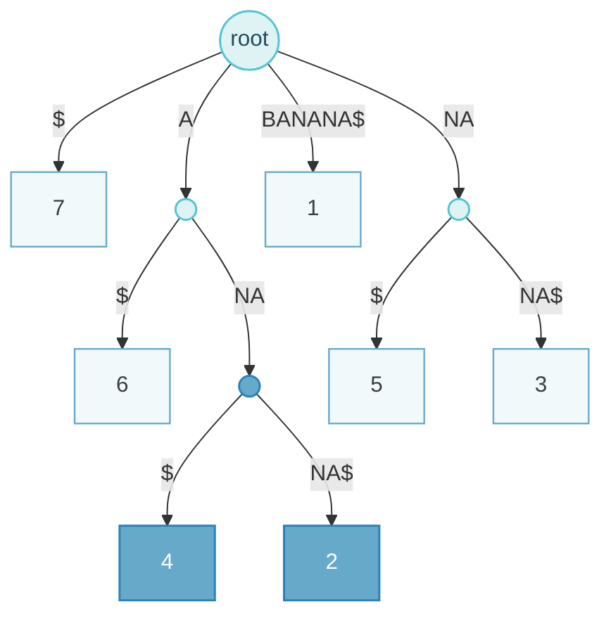

Exact string matching is much faster than DP and supplies the seeds for BLAST, BLAT and read mappers. The trick is preprocessing: index once so that each lookup is fast. The topic compares hash tables, suffix trees and suffix arrays in time and memory.

## Exact Seeds {#exact-seeds}

String matching finds a query pattern of length $m$ inside a reference of length $N$; with $z$ occurrences, full alignment would cost about $O(mN)$. The same pigeonhole argument as before applies: $m = 12$ and $d = 2$ give three 4-base blocks, at least one of which matches exactly. For independent uniform letters, a random word matches with probability $M^{-k}$.

## Hash Tables {#hash-tables}

A hash maps a word to a bucket holding the key and its occurrence positions. Distinct words can collide in a bucket; chaining or open addressing resolves this by comparing keys. With a suitable hash and controlled load, bucket lookup is expected $O(1)$, but forming the key costs $O(k)$ and reporting positions costs $O(z)$, so the whole search is not constant time.

For DNA, encode A = 0, C = 1, G = 2, T = 3:

$$
h(x_1 \cdots x_k) = \sum_{i=1}^{k} x_i\, 4^{k-i}, \qquad h(\text{ACGT}) = 27
$$

This is collision-free for fixed $k$, but direct addressing needs $4^k$ slots, which grows exponentially. Indexing the query and scanning the database is the classical BLAST layout; indexing the database once for many queries is the BLAT layout.

Collisions appear earlier than intuition suggests (the birthday paradox). Python's `dict` and C++'s `unordered_map` are hash tables.

::: table align="center" title="Index the query or the database"

| Layout | Advantage | Cost |
| :--- | :--- | :--- |
| Index the query, scan the database (classic BLAST) | Small memory | Every search scans the whole database, $O(L)$ |
| Index the database (BLAT, read mappers) | Built once; lookup time in principle independent of database size | Large memory and preprocessing |

:::

## Suffix Tries and Suffix Trees {#suffix-tries-and-suffix-trees}

Every substring is a prefix of some suffix, so indexing suffixes indexes all substrings. A unique terminator `$` ensures no suffix is a prefix of another.

- **Suffix trie:** one character per edge, shared prefixes share paths, leaves store suffix starts. Worst-case time and space $O(N^2)$.
- **Suffix tree:** non-branching paths are compressed into single edges whose labels are stored as intervals in the reference. Linear-time construction exists under suitable alphabet assumptions; space is $O(N)$ with substantial constant overhead.

To build a small tree by hand, list all suffixes, insert them one by one, split an edge at the first mismatch when a new suffix diverges inside it, and mark leaves with suffix starts. Searching starts at the root and consumes query characters along edges; a mismatch means no occurrence, and all descendant leaves of the end point give the positions. Existence costs $O(m)$; reporting all matches costs $O(m + z)$.

For BANANA\$, the root branches to `$`, `A`, `BANANA$` and `NA`. Searching ANA follows A then NA, and the descendant leaves give positions 2 and 4 (1-based). A generalised suffix tree indexes several sequences with distinct terminators and labels leaves by (sequence ID, start).

Tree vocabulary that may come up: root, edge, parent, child, leaf (no children), internal node, depth (distance from the root), height (longest path down to a leaf) and breadth (number of leaves). A plain trie stores words with one character per edge and tests membership in $O(k)$ for a word of length $k$.

The BANANA\$ tree in full: the root has children `$` (leaf 7), `A`, `BANANA$` (leaf 1) and `NA`. Under `A` are `$` (leaf 6) and `NA`, which splits into `$` (leaf 4) and `NA$` (leaf 2). Under `NA` are `$` (leaf 5) and `NA$` (leaf 3). Linear-time construction uses Ukkonen's or McCreight's algorithm; inserting suffixes one by one is $O(N^2)$ in the worst case. The main drawback is memory: more than 15 bytes per input character, about 45 GB for the human genome.

Suffix tree of BANANA\$. Leaves carry 1-based suffix starts; the highlighted node is reached by searching ANA, and its leaves 4 and 2 are the occurrences.

## Suffix Arrays {#suffix-arrays}

A suffix array stores suffix start positions in sorted order:

::: table align="center" title="Suffix array of BANANA$"

| Rank | 1 | 2 | 3 | 4 | 5 | 6 | 7 |
| :--- | :--- | :--- | :--- | :--- | :--- | :--- | :--- |
| SA | 7 | 6 | 4 | 2 | 1 | 5 | 3 |
| Suffix | `$` | `A$` | `ANA$` | `ANANA$` | `BANANA$` | `NA$` | `NANA$` |

:::

All suffixes starting with the query form a contiguous interval, found by two binary searches. For ANA, ranks 3–4 map to reference positions 4 and 2. Ranks are not reference coordinates.

::: table align="center" title="Index structures compared"

| Structure | Space | Search including output |
| :--- | :--- | :--- |
| Hash of fixed $k$-mers | Representation-dependent | Expected $O(1)$ per bucket, plus key and output |
| Suffix trie | $O(N^2)$ | $O(m + z)$ |
| Suffix tree | $O(N)$, high overhead | $O(m + z)$ |
| Suffix array | $O(N)$, compact | $O(m \log N + z)$ |

:::

Naive comparison sorting of suffixes can cost $O(N^2 \log N)$; specialised linear-time construction exists. The BWT/FM-index reduces memory further.

For mismatch-tolerant search, split the query into $d+1$ blocks, search each exactly, use block offsets to infer candidate starts, and verify. Exact seeds locate candidates; extension handles mismatches and gaps.

Memory in practice for a human-sized genome:

::: table align="center" title="Memory for a human-sized genome"

| Structure | Bytes per character | Human genome |
| :--- | :--- | :--- |
| Suffix tree | > 15 | ≈ 45 GB |
| Suffix array | ≈ 4 | ≈ 12 GB |
| FM-index (BWT) | ≈ 0.5 | ≈ 1.5 GB |

:::

Naive suffix-array construction is $O(N^2 \log N)$ because sorting needs $O(N \log N)$ comparisons and each suffix comparison can take $O(N)$; linear-time algorithms exploit the fact that suffix $i+1$ is suffix $i$ without its first letter.

## Ten-Minute Presentation {#presentation}

### Keyword Card {#keyword-card}

- **Why**: DP $O(lL)$ slow → index once, exact seeds; pigeonhole $d+1$ blocks
- **Hash**: key → integer → bucket (positions); collisions (birthday), chaining; expected $O(1)$
- **Perfect hash**: A0 C1 G2 T3, $\sum x_iM^{k-i}$, ACGT = 27; $4^k$ slots
- **Query index** (BLAST, scan DB) vs **DB index** (BLAT, memory)
- **Trie** $O(k)$; **suffix** = to end; every substring = prefix of a suffix; `$`
- **Suffix trie** $O(N^2)$ → compress → **suffix tree** (edges = coordinates)
- **BANANA$ tree**; ANA → leaves 2, 4; $O(m)$ exist, $O(m+z)$ all; linear build (Ukkonen); generalized ST
- **Memory**: >15 B/char (45 GB human)
- **Suffix array** 7 6 4 2 1 5 3; contiguous block; 2 binary searches; $O(m\log N)$; 4 B/char (12 GB); naive $O(N^2\log N)$
- **FM/BWT** 0.5 B/char (1.5 GB) → BWA
- **Limits**: exact only → seed & extend; repeats

### Full Script {#full-script}

::: details Full spoken script

My topic is string matching for database searching. Dynamic programming gives optimal alignments but is slow, $O$ of query length times database length. Most practical search tools therefore begin with exact matching of short words — seeds — and only then do alignment around the seeds. Exact matching can be made extremely fast if we preprocess, or index, the sequences once. So the question today is: which data structures let us find all occurrences of a word quickly, and what do they cost in memory?

The reason exact seeds are useful at all is the pigeonhole argument: if a query of length $n$ matches with at most $d$ mismatches, splitting it into $d+1$ blocks guarantees at least one block matches exactly. So exact search of the blocks finds every candidate, which we then verify and extend.

The first data structure is the hash table. A hash function maps a key — here a word — to an integer, which determines a bucket where we store the information, for example the list of positions where that word occurs. Python dictionaries are hash tables. If two different keys map to the same bucket we have a collision; like the birthday paradox, collisions appear sooner than one expects, and they are resolved for example by storing a linked list in the bucket and comparing keys. As long as the table is not overfull, lookup takes constant expected time — independent of how many words are stored.

For DNA we can even make a perfect hash with no collisions by enumerating words: code A=0, C=1, G=2, T=3 and read the word as a number in base 4.

$$
h=\sum_{i=1}^{k}x_i\,M^{k-i},\qquad h(\text{ACGT})=0+16+8+3=27
$$

The cost is that we need $4^k$ slots, which grows exponentially with the word length. There is also a design choice: classic BLAST hashes the query and scans through the database, so time grows with database size; BLAT and many modern tools hash the database instead, so a lookup is in principle constant time, independent of the database size — but this needs a lot of memory.

Hash tables need a fixed word length. Trees remove that restriction. A trie, or prefix tree, stores words with one letter per edge, and checking whether a word is present takes time proportional to its length. If we put all suffixes of a text into a trie, we get a suffix trie. A suffix is a substring that runs to the end of the string, and the key observation is: every substring is the prefix of some suffix. So searching a suffix trie from the root for any query tells us whether it occurs anywhere in the text. We add a terminal symbol dollar so that no suffix is a prefix of another and every suffix ends in its own leaf.

A suffix trie can have $O(N^2)$ nodes, so we compress every path of nodes with a single child into one edge labelled by several letters — stored as two coordinates into the text, not as copied strings. That is the suffix tree. Let me draw it for BANANA dollar.

To search for ANA, I follow A, then NA; I have consumed the whole query, so ANA occurs, and the leaves below this point, 2 and 4, are the start positions. Existence takes $O(m)$ time in the query length, independent of the text length, and reporting all $z$ occurrences takes $O(m+z)$. A search that ends at a dollar means the query is a suffix; a missing edge means no occurrence. The tree can be built in linear time with clever algorithms; inserting suffixes one by one is quadratic in the worst case. A generalized suffix tree indexes several sequences at once, labelling leaves with sequence number and position — useful for a database.

The problem is memory: more than 15 bytes per character, about 45 gigabytes for the human genome. A suffix array is the compact alternative: just the start positions of the suffixes, in sorted order.

For BANANA the sorted suffixes are dollar, A-dollar, ANA-dollar, ANANA-dollar, BANANA-dollar, NA-dollar and NANA-dollar, so the suffix array is 7, 6, 4, 2, 1, 5, 3.

Because the suffixes are sorted, all suffixes starting with the query form one contiguous block, which we find with two binary searches, like looking up a word in a dictionary. For ANA that block is ranks 3 to 4, i.e. positions 4 and 2. Search costs $O(m\log N)$ and memory about 4 bytes per character, around 12 gigabytes for a human genome. Naive construction by sorting is $O(N^2\log N)$ because comparing two suffixes can take $O(N)$, but linear-time algorithms exist.

To summarise: hash tables are simple and fast for fixed-length seeds and are what BLAST and BLAT use; suffix trees allow arbitrary-length exact queries in time independent of the text size but use a lot of memory; suffix arrays trade a log factor for much less memory; and the Burrows–Wheeler transform with the FM-index, which is closely related to the suffix array, compresses it further to about half a byte per character — that is what read mappers like BWA use. The limitation of all of these is that they only find exact matches: biological similarity with substitutions and indels still requires the seed-and-extend strategy, and repeats generate many hits.

:::

## Board Plan {#board-plan}

### Must {#board-must}

1. Perfect hash: A=0, C=1, G=2, T=3; ACGT → $0\cdot64+1\cdot16+2\cdot4+3=27$ → bucket → list of positions.
2. **Suffix tree of BANANA\$** (search ANA → leaves 2 and 4) (see the diagram in the notes above).

3. Suffix array next to it:

::: table align="center" title="Board: suffix array of BANANA$"

| rank | 1 | 2 | 3 | 4 | 5 | 6 | 7 |
| :--- | :--- | :--- | :--- | :--- | :--- | :--- | :--- |
| suffix | \$ | A\$ | ANA\$ | ANANA\$ | BANANA\$ | NA\$ | NANA\$ |
| SA | 7 | 6 | 4 | 2 | 1 | 5 | 3 |

:::

ANA = ranks 3–4 → positions 4 and 2 (two binary searches).

### Optional {#board-optional}

closing table — hash $O(1)$ / $M^k$ slots; suffix tree $O(m+z)$, ~15 B/char; suffix array $O(m\log N)$, ~4 B/char; FM-index $O(m)$, ~0.5 B/char.

## Follow-up Questions {#follow-up-questions}

::: note How to use these questions

Questions marked ★ were raised in the revision sessions on 27 and 29 October. Answer directly first, then justify with the model, then name an assumption or limitation. Each answer is collapsed so the list can be used for self-testing.

:::

::: collapse

- ★ How do you find a substring (with a suffix tree / suffix array)?

  Suffix tree: start at the root, follow edges matching the query letter by letter; if all letters are consumed (possibly inside an edge) the query occurs; all leaves below give start positions ($O(m+z)$); a missing edge = absent. Suffix array: binary-search the sorted suffixes for the first and last suffix starting with the query; the interval gives all occurrences ($O(m\log N)$). Demonstrate with BANANA\$ and ANA (positions 2 and 4).

- ★ (Cross-question) Smith–Waterman and Needleman–Wunsch — how do they relate to string matching?

  Exact string matching finds identical words very fast and serves as seeds; SW/NW then provide the optimal (local/global) alignment with mismatches and gaps around the seeds. Seed-and-extend combines them: exact index for speed, DP for sensitivity in a small region.

- What is a hash function, a collision, and why is lookup O(1)?

  Function from key to integer bucket. Collision: two keys → same bucket (resolved by chaining/open addressing and comparing keys). With a good, uniform hash and a table that isn't overfull, each bucket holds O(1) items on average, so lookup time doesn't depend on the number of keys.

- Why is the base-4 enumeration a perfect hash, and what is its drawback?

  Each word maps to a unique integer $\sum x_i4^{k-i}$ (ACGT → 27), so no collisions. Drawback: the table has $4^k$ slots (k = 11 → 4M, k = 16 → 4G), so memory grows exponentially, and many slots are empty.

- Why do suffix trees need so much memory?

  Up to $2N$ nodes, each with child pointers, edge coordinates, suffix links; > 15 bytes per character (human genome ~45 GB), versus ~4 bytes for a suffix array and ~0.5 for an FM-index.

- Why add a $ terminator?

  So that no suffix is a prefix of another suffix — otherwise some suffixes would end in the middle of an edge instead of a leaf; it guarantees exactly $N$ leaves, one per suffix, and defines the sort order (smallest).

- What is a generalized suffix tree?

  A suffix tree of several strings (concatenated with distinct terminators); leaves are labelled (string, position), so one search finds matches in all database sequences.

- Suffix trie vs suffix tree complexity?

  Trie $O(N^2)$ nodes/time; tree $O(N)$ nodes after compressing unary paths; linear-time construction (Ukkonen) possible; naive insertion $O(N^2)$ worst case. Query both $O(m)$.

- Why is naive suffix array construction O(N² log N)?

  Sorting needs $O(N\log N)$ comparisons, and comparing two suffixes can take $O(N)$ character comparisons. Linear-time algorithms exploit that suffixes are related (suffix $i+1$ is suffix $i$ minus its first letter).

- How do you allow mismatches with exact methods?

  Pigeonhole: split the pattern into $d+1$ pieces; at least one matches exactly; look up the pieces, then verify candidates. Or backtracking in a suffix trie/BWT (BWA aln), or neighbourhood words (BLAST).

- Index the query or the database — trade-offs?

  Query index: small memory, but each search scans the whole database ($O(L)$). Database index: built once, very fast repeated queries, but large memory and preprocessing; good when many queries hit the same database (genomes, read mapping).

- Tree vocabulary: depth, height, breadth?

  Depth = distance from root to the node; height = longest path from the node down to a leaf (height of tree = height of root); breadth = number of leaves; internal node = non-leaf.

:::
