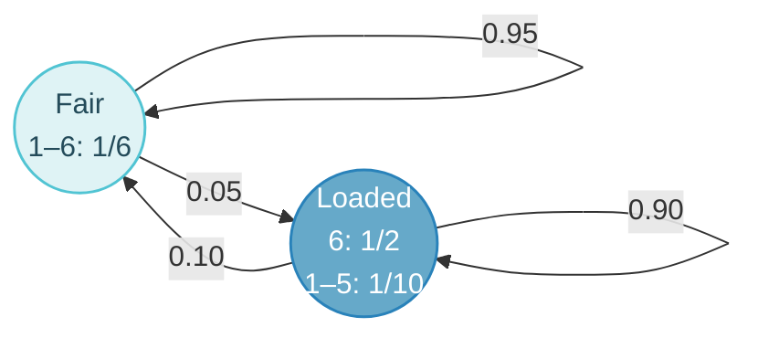

Hidden Markov models add an unobserved layer of states to a Markov chain. The topic covers the model and its assumptions, the five standard questions and their algorithms (Viterbi, Forward, Backward/posterior, Baum–Welch), and the practical issues of complexity, underflow and length distributions.

## From Markov Chains to HMMs {#markov-chains}

A sequence model assigns probabilities to sequences. The chain rule $P(x_1 \ldots x_L) = P(x_1) P(x_2 \mid x_1) P(x_3 \mid x_1 x_2) \cdots$ is always true but has too many parameters. The first-order **Markov assumption** $P(x_i \mid x_1 \ldots x_{i-1}) = P(x_i \mid x_{i-1})$ reduces the model to an initial distribution and a transition matrix $a_{st} = P(x_i = t \mid x_{i-1} = s)$; for DNA that is a 4 × 4 matrix with 12 free parameters, since rows sum to 1:

$$
P(x) = \pi_{x_1} \prod_{i=2}^{L} a_{x_{i-1} x_i}, \qquad \hat a_{st} = \frac{N_{st}}{\sum_{t'} N_{st'}}
$$

A length-$L$ sequence contributes $L - 1$ transitions. A $k$-th order chain has $4^k \times 3$ free parameters: zero order is cheap but context-free, first order captures local dependencies, and a fully dependent model is impossible to estimate.

**CpG islands** motivate the hidden layer. $P(G \mid C)$ is much higher inside islands than outside. With two chains (+ and −) a given sequence can be classified by $\sum_i \log [a^+_{x_{i-1}x_i} / a^-_{x_{i-1}x_i}]$, but to find islands inside a long sequence the region boundaries are unknown: the region becomes a **hidden** variable.

In a Markov chain the states **are** the observed symbols. In an HMM the states are hidden and each state **emits** observed symbols. An HMM is two stochastic processes: a Markov chain over hidden states and emissions from each state.

## Model and Assumptions {#model-and-assumptions}

A hidden Markov model describes observations $x_{1:N}$ generated by hidden states $z_{1:N}$, with parameters

$$
\pi_k = P(z_1 = k), \qquad a_{kl} = P(z_{i+1} = l \mid z_i = k), \qquad e_k(b) = P(x_i = b \mid z_i = k).
$$

The next state depends only on the current state (first-order Markov), and each observation depends only on its own state. The joint probability is

$$
P(x, z) = \pi_{z_1} e_{z_1}(x_1) \prod_{i=2}^{N} a_{z_{i-1} z_i}\, e_{z_i}(x_i),
$$

with each of $\pi$, the rows of $A$ and each emission distribution summing to 1. Simulation samples a start state, emits, samples the next state and repeats. The formulas below assume a fixed sequence length with no explicit end state.

## The Occasionally Dishonest Casino {#the-occasionally-dishonest-casino}

Hidden states are a fair die F and a loaded die L; observations are rolls 1–6.

$$
A = \begin{pmatrix} 0.95 & 0.05 \\ 0.10 & 0.90 \end{pmatrix}, \qquad
e_F(b) = \tfrac{1}{6}, \qquad e_L(6) = \tfrac{1}{2}, \qquad e_L(1,\ldots,5) = \tfrac{1}{10}
$$

Rows are the current state and columns the next, ordered (F, L). A run of sixes supports L, but a single six is not conclusive: emissions supply local evidence while transitions favour persistence, so short genuine switches can be missed. As an example, $P(x = 66, z = FL) = \pi_F \cdot \tfrac{1}{6} \cdot 0.05 \cdot \tfrac{1}{2}$.

::: table align="center" title="HMM questions and algorithms"

| Question | Algorithm |
| :--- | :--- |
| Generate a sequence | Simulation |
| Most probable complete state path | Viterbi |
| Probability of the observations $P(x)$ | Forward |
| State probabilities at each position | Forward–Backward |
| Estimate parameters with unknown states | Baum–Welch |

:::



The occasionally dishonest casino: two hidden states, their emission probabilities, and the transition probabilities on the arrows.

## Viterbi: the Best Complete Path {#viterbi-the-best-complete-path}

Since $P(x)$ is constant across paths, $z^* = \arg\max_z P(z \mid x) = \arg\max_z P(x, z)$. Let $v_k(i)$ be the highest joint probability of a path generating $x_{1:i}$ and ending in $k$:

$$
v_k(1) = \pi_k e_k(x_1), \qquad v_k(i) = e_k(x_i) \max_l \left[v_l(i-1)\, a_{lk}\right]
$$

Store the argmax pointers, choose $z_N^* = \arg\max_k v_k(N)$, and trace back. The result is a globally optimal path, not a set of independent position-wise choices.

## Forward: Summing Over Paths {#forward-summing-over-paths}

$f_k(i) = P(x_{1:i}, z_i = k)$ replaces the max with a sum:

$$
f_k(1) = \pi_k e_k(x_1), \qquad f_k(i) = e_k(x_i) \sum_l f_l(i-1)\, a_{lk}, \qquad P(x) = \sum_k f_k(N)
$$

Viterbi keeps the best path into each state; Forward adds all of them. Both reuse prefixes instead of enumerating $K^N$ paths.

## Backward and Posterior Decoding {#backward-and-posterior-decoding}

$b_k(i) = P(x_{i+1:N} \mid z_i = k)$ covers the remaining observations and excludes $x_i$, which Forward already includes:

$$
b_k(N) = 1, \qquad b_k(i) = \sum_l a_{kl}\, e_l(x_{i+1})\, b_l(i+1), \qquad
\gamma_k(i) = P(z_i = k \mid x) = \frac{f_k(i)\, b_k(i)}{P(x)}
$$

Useful checks are $\sum_k \gamma_k(i) = 1$ and $\sum_k f_k(i) b_k(i) = P(x)$ at every position. Posterior decoding picks $\arg\max_k \gamma_k(i)$ independently at each position. It optimises position-wise accuracy and keeps uncertainty visible in posterior curves, but it can differ from Viterbi and may even produce an invalid path when some transitions are forbidden.

::: echarts Forward and backward meet at position i

```json
{
  "animation": false,
  "textStyle": {"fontFamily": "Google Sans Flex, Noto Sans SC, sans-serif"},
  "grid": {"left": 10, "right": 10, "top": 10, "bottom": 10},
  "xAxis": {"type": "value", "min": 0, "max": 13, "show": false},
  "yAxis": {"type": "value", "min": -2.7, "max": 2.6, "show": false},
  "series": [{
    "type": "graph", "coordinateSystem": "cartesian2d", "silent": true,
    "label": {"show": false}, "edgeSymbol": ["none", "arrow"], "edgeSymbolSize": 12,
    "data": [
      {"name": "x1", "value": [1, 0], "symbol": "roundRect", "symbolSize": 26, "itemStyle": {"color": "#8b99a5", "borderWidth": 0}, "label": {"show": true, "position": "bottom", "formatter": "x1", "color": "#6b7a86", "fontSize": 13}},
      {"name": "x2", "value": [2, 0], "symbol": "roundRect", "symbolSize": 26, "itemStyle": {"color": "#8b99a5", "borderWidth": 0}, "label": {"show": true, "position": "bottom", "formatter": "x2", "color": "#6b7a86", "fontSize": 13}},
      {"name": "x3", "value": [3, 0], "symbol": "roundRect", "symbolSize": 26, "itemStyle": {"color": "#8b99a5", "borderWidth": 0}, "label": {"show": true, "position": "bottom", "formatter": "x3", "color": "#6b7a86", "fontSize": 13}},
      {"name": "x4", "value": [4, 0], "symbol": "roundRect", "symbolSize": 26, "itemStyle": {"color": "#8b99a5", "borderWidth": 0}, "label": {"show": true, "position": "bottom", "formatter": "x4", "color": "#6b7a86", "fontSize": 13}},
      {"name": "x5", "value": [5, 0], "symbol": "roundRect", "symbolSize": 26, "itemStyle": {"color": "#8b99a5", "borderWidth": 0}, "label": {"show": true, "position": "bottom", "formatter": "x5", "color": "#6b7a86", "fontSize": 13}},
      {"name": "x6", "value": [6, 0], "symbol": "roundRect", "symbolSize": 26, "itemStyle": {"color": "#51c4d3", "borderColor": "#2982ba", "borderWidth": 1.5}, "label": {"show": true, "position": "bottom", "formatter": "x6", "color": "#6b7a86", "fontSize": 13}},
      {"name": "x7", "value": [7, 0], "symbol": "roundRect", "symbolSize": 26, "itemStyle": {"color": "#8b99a5", "borderWidth": 0}, "label": {"show": true, "position": "bottom", "formatter": "x7", "color": "#6b7a86", "fontSize": 13}},
      {"name": "x8", "value": [8, 0], "symbol": "roundRect", "symbolSize": 26, "itemStyle": {"color": "#8b99a5", "borderWidth": 0}, "label": {"show": true, "position": "bottom", "formatter": "x8", "color": "#6b7a86", "fontSize": 13}},
      {"name": "x9", "value": [9, 0], "symbol": "roundRect", "symbolSize": 26, "itemStyle": {"color": "#8b99a5", "borderWidth": 0}, "label": {"show": true, "position": "bottom", "formatter": "x9", "color": "#6b7a86", "fontSize": 13}},
      {"name": "x10", "value": [10, 0], "symbol": "roundRect", "symbolSize": 26, "itemStyle": {"color": "#8b99a5", "borderWidth": 0}, "label": {"show": true, "position": "bottom", "formatter": "x10", "color": "#6b7a86", "fontSize": 13}},
      {"name": "x11", "value": [11, 0], "symbol": "roundRect", "symbolSize": 26, "itemStyle": {"color": "#8b99a5", "borderWidth": 0}, "label": {"show": true, "position": "bottom", "formatter": "x11", "color": "#6b7a86", "fontSize": 13}},
      {"name": "x12", "value": [12, 0], "symbol": "roundRect", "symbolSize": 26, "itemStyle": {"color": "#8b99a5", "borderWidth": 0}, "label": {"show": true, "position": "bottom", "formatter": "x12", "color": "#6b7a86", "fontSize": 13}},
      {"name": "fa", "value": [1, 1.1], "symbolSize": 0},
      {"name": "fb", "value": [6.2, 1.1], "symbolSize": 0},
      {"name": "ba", "value": [12, 1.1], "symbolSize": 0},
      {"name": "bb", "value": [6.8, 1.1], "symbolSize": 0},
      {"name": "ft", "value": [3.6, 1.75], "symbolSize": 0, "label": {"show": true, "formatter": "forward f_k(i): x1 … xi", "color": "#2982ba", "fontSize": 14}},
      {"name": "bt", "value": [9.4, 1.75], "symbolSize": 0, "label": {"show": true, "formatter": "backward b_k(i): x(i+1) … xL", "color": "#bf360c", "fontSize": 14}},
      {"name": "sk", "value": [6, -1.15], "symbolSize": 0, "label": {"show": true, "formatter": "state k at i", "color": "#6b7a86", "fontSize": 13}},
      {"name": "pf", "value": [6.5, -2.0], "symbolSize": 0, "label": {"show": true, "formatter": "P(state k at i | x) = f_k(i) · b_k(i) / P(x)", "color": "#2982ba", "fontSize": 15}}
    ],
    "links": [
      {"source": "fa", "target": "fb", "lineStyle": {"color": "#2982ba", "width": 3}},
      {"source": "ba", "target": "bb", "lineStyle": {"color": "#bf360c", "width": 3}}
    ]
  }]
}
```

:::

Forward covers $x_1 \ldots x_i$ and includes the emission at $i$; backward covers $x_{i+1} \ldots x_L$. They meet at position $i$ without double counting, and $P(\pi_i = k \mid x) = f_k(i)\, b_k(i) / P(x)$.

Forward covers the past including $x_i$ and backward the future excluding it, so the two meet at position $i$ without double counting. Forward alone gives $P(x)$ and the left context; the state at $i$ also depends on what comes after it, which only backward supplies.

## Parameter Estimation {#parameter-estimation}

With known state paths, count transitions $A_{kl}$ and emissions $E_k(b)$, add pseudocounts, and normalise:

$$
a_{kl} = \frac{A_{kl}}{\sum_j A_{kj}}, \qquad e_k(b) = \frac{E_k(b)}{\sum_c E_k(c)}
$$

With unknown states, use expected counts under the current parameters. The adjacent-state posterior is

$$
\xi_{kl}(i) = P(z_i = k, z_{i+1} = l \mid x) = \frac{f_k(i)\, a_{kl}\, e_l(x_{i+1})\, b_l(i+1)}{P(x)},
$$

and for one sequence

$$
a_{kl} = \frac{\sum_{i=1}^{N-1} \xi_{kl}(i)}{\sum_{i=1}^{N-1} \gamma_k(i)}, \qquad
e_k(b) = \frac{\sum_{i=1}^{N} \gamma_k(i)\, \mathbf{1}[x_i = b]}{\sum_{i=1}^{N} \gamma_k(i)}, \qquad \hat\pi_k = \gamma_k(1).
$$

For several independent sequences, aggregate the counts without adding transitions between sequences.

Baum–Welch is expectation maximisation: initialise within a fixed topology; in the E-step run Forward–Backward to get expected transition and emission counts; in the M-step normalise them; repeat until the log-likelihood $\ell(\theta) = \sum_j \log P(x^{(j)} \mid \theta)$ stops improving. Exact EM never decreases the likelihood but does not guarantee a global optimum, so initialisation and multiple starts matter. Viterbi training instead counts along the single best path, and decoding alone never updates parameters.

More data gives better estimates: in the casino, 300 rolls gave $a_{FF} = 0.73$, while 30,000 rolls gave 0.93, close to the true 0.95. Parameters can come from counting with labels, from Baum–Welch or Viterbi training without labels, or from expert knowledge. The model **topology** (which states and transitions exist) is designed, not learned.

Dynamic programming in one sentence: solve a problem by combining stored solutions of overlapping subproblems with optimal substructure, filling a table in dependency order instead of enumerating; here it reduces $K^L$ paths to $O(LK^2)$ work.

## Complexity, Durations and Biological Meaning {#complexity-durations-and-biological-meaning}

Dense algorithms take $O(NK^2)$ time for $K$ states. The likelihood alone needs $O(K)$ rolling memory, while traceback or stored posteriors need $O(NK)$. To avoid underflow, use scaling or log probabilities (log-sum-exp for Forward, max for Viterbi).

A self-loop implies a geometric duration:

$$
P(D = \ell) = a_{kk}^{\ell-1}(1 - a_{kk}), \qquad E[D] = \frac{1}{1 - a_{kk}}
$$

so the casino's fair and loaded dice persist for 20 and 10 rolls on average. In biological models, states represent regions, emissions describe sequence preferences, and topology constrains their order; a signal peptide, for example, has a K/R-rich N-region, a hydrophobic H-region and a cleavage-associated C-region before the mature protein.

## Ten-Minute Presentation {#presentation}

### Keyword Card {#keyword-card}

- **Markov chain**: $P(x_i|x_{i-1})$, $\pi$ + $a_{st}$ 4×4 (12 free), count to estimate; CpG islands ($a_{CG}$ ↑)
- **Hidden**: region unknown → HMM; Markov chain states = observed; HMM states hidden + emissions
- **Two processes**: $a_{kl}$, $e_k(b)$; $P(x,\pi)=a_{0\pi_1}\prod e\,a$
- **Casino**: F 1/6; L six ½ others 1/10; .95/.05, .90/.10
- **5 questions**: simulate, Viterbi, Forward, F–B posterior, Baum–Welch
- **Viterbi**: $v_l(i+1)=e_l\max_kv_ka_{kl}$, pointers, traceback; legal path
- **DP**: overlapping subproblems, table, $O(LK^2)$ vs $K^L$
- **Forward**: max → sum; $P(x)=\sum f_k(L)$
- **Backward**: $b_k(i)=\sum_la_{kl}e_l(x_{i+1})b_l(i+1)$; **posterior** $fb/P(x)$; past + future
- **Posterior decoding**: per-position best, maybe illegal; confidence curve
- **Estimation**: known → count + pseudocounts; unknown → **Baum–Welch** (E: F–B expected counts; M: normalise; LL ↑, local optimum); 300 vs 30,000 rolls (0.73 → 0.93); Viterbi training
- **Practical**: logs/scaling; geometric length $1/(1-a)$ (20, 10); topology by design
- **Uses**: signal peptides, genes, TM, profile HMMs

### Full Script {#full-script}

::: details Full spoken script

My topic is hidden Markov models. Let me start from Markov chains. A simple sequence model treats every letter as independent. But in real DNA a base depends on its neighbours. A first-order Markov chain assumes that the next letter depends only on the previous one: it is defined by an initial distribution and a transition matrix, $a_{st}$, the probability of letter $t$ given that the previous letter was $s$; for DNA that is a 4-by-4 matrix whose rows sum to one. The probability of a sequence is the initial probability of the first letter times the product of transition probabilities, and we estimate the transitions simply by counting.

$$
P(x)=\pi_{x_1}\prod_{i=2}^{L}a_{x_{i-1}x_i}
$$

A classic example is CpG islands: the transition probability from C to G is much higher inside CpG islands than outside. So different regions of a sequence have different transition probabilities. If we knew where the islands were, we could just use two Markov chains. But we don't know where the region boundaries are — the region is hidden. That leads to the hidden Markov model.

In a Markov chain, the states are the letters we observe. In a hidden Markov model, the states are hidden, and each state emits observable symbols. So an HMM consists of two stochastic processes: a Markov chain over hidden states, with transition probabilities $a_{kl}$, and emissions, where state $k$ emits symbol $b$ with probability $e_k(b)$. The joint probability of a path $\pi$ and a sequence $x$ is the product along the path of transitions and emissions.

The standard example is the occasionally dishonest casino: a fair die and a loaded die that shows six half of the time. We see the rolls, but not which die was used. A single six is weak evidence; a run of sixes is strong evidence for the loaded die, and the transition probabilities say the casino tends to stay with the same die.

There are five questions we can ask. How to simulate a sequence — sample a state, emit, transition, repeat. What is the most likely path — Viterbi. What is the probability of the sequence — Forward. What is the probability of each state at each position — Forward–Backward. And how do we estimate the parameters — counting or Baum–Welch.

Viterbi. We want the path that maximises $P(x,\pi)$. There are $K^L$ paths, so we use dynamic programming. Let $v_k(i)$ be the probability of the best path that ends in state $k$ at position $i$. To extend to position $i+1$ in state $l$, we take the best predecessor:

$$
v_l(i+1)=e_l(x_{i+1})\,\max_k\big[v_k(i)\,a_{kl}\big]
$$

We store a pointer to the best predecessor, take the best final state, and trace back. Dynamic programming here means exactly what it meant in alignment: break the problem into overlapping subproblems, store their solutions in a table, and build up — giving $O(LK^2)$ instead of exponential time. In the casino example Viterbi recovers the loaded stretches quite well, but misses short ones.

Forward. To get the probability of the sequence we must sum over all paths, not take the best one. The recursion is identical to Viterbi with the max replaced by a sum:

$$
f_l(i+1)=e_l(x_{i+1})\sum_k f_k(i)\,a_{kl},\qquad P(x)=\sum_k f_k(L)
$$

$f_k(i)$ is the probability of the first $i$ observations and being in state $k$ at position $i$. $P(x)$ is used to compare models or score sequences.

Backward and posterior. Often we want to know, for each position, how likely it is that we are in state $k$ — given the whole sequence, including what comes after. Forward only uses information from the left. So we compute the backward variable $b_k(i)$, the probability of the rest of the sequence after $i$ given state $k$ at $i$, with the mirror recursion. Multiplying forward and backward at the same position gives the probability of the whole sequence and state $k$ at $i$; dividing by $P(x)$ gives the posterior:

$$
P(\pi_i=k\mid x)=\frac{f_k(i)\,b_k(i)}{P(x)}
$$

That is why we need both: forward covers the past including $x_i$, backward the future. In the casino, the posterior gives a curve of the probability of the fair die along the rolls — it shows the uncertainty. Posterior decoding picks the most probable state at each position independently. That maximises the expected number of correct positions, but the resulting labels might not form a legal path, because transitions are not checked. Viterbi always returns one complete legal path.

Parameter estimation. If the states are known — labelled data — we simply count transitions and emissions, add pseudocounts so that unseen events are not impossible, and normalise. If the states are unknown, we use Baum–Welch, which is an expectation–maximisation algorithm. Start with initial guesses. E-step: run forward and backward to compute the expected number of times each transition and each emission is used — weighted by posterior probabilities, so they are not integers. M-step: normalise these expected counts into new parameters. Repeat until the log-likelihood stops improving. The likelihood never decreases, but we can end in a local optimum, so the starting point matters. With 300 casino rolls the estimates were poor; with 30,000 rolls they were close to the truth — the stay-fair probability went from 0.73 to 0.93, against the true 0.95. A faster alternative is Viterbi training, counting along the single best path.

Finally, practical points. Time is $O(LK^2)$; probabilities become tiny, so we work in log space or with scaling. A self-loop implies a geometric length distribution — fair runs average 20 rolls, loaded runs 10 — which is not always realistic. The model structure — which states and transitions exist — comes from our knowledge, not from training. HMMs are used for signal peptides, gene finding, membrane proteins, and as profile HMMs for protein families.

:::

## Board Plan {#board-plan}

::: tip Whiteboard route

casino → joint probability → Viterbi (max) → Forward (sum) → Backward and posteriors → expected counts and Baum–Welch.

:::

### Must {#board-must}

1. **Casino HMM:** (see the diagram in the notes above).

2. Five questions → algorithms: simulate; Viterbi (max); Forward (sum); Forward–Backward (posterior); Baum–Welch.
3. Viterbi and Forward recurrences one under the other, circling **max** vs **Σ**.
4. **Forward meets backward** (asked: "use forward and backward up to the overlap, then multiply?") (see the diagram in the notes above).

5. Baum–Welch loop: initialise → Forward + Backward → expected counts → normalise → log-likelihood → repeat.

### Optional {#board-optional}

$P(x)=\pi_{x_1}\prod a_{x_{i-1}x_i}$ for a plain Markov chain (to contrast with the HMM).

## Follow-up Questions {#follow-up-questions}

::: note How to use these questions

Questions marked ★ were raised in the revision sessions on 27 and 29 October. Answer directly first, then justify with the model, then name an assumption or limitation. Each answer is collapsed so the list can be used for self-testing.

:::

::: collapse

- ★ What is the difference between a Markov chain and a hidden Markov chain?

  Markov chain: the states are the observed symbols, and the next symbol depends only on the current one (transition matrix). HMM: a Markov chain over unobserved (hidden) states, each emitting observable symbols with state-specific emission probabilities; we infer the states from the observations. Two processes vs one.

- ★ Why do we need the forward and backward algorithms?

  Forward computes $P(x)$ (summing over all exponentially many paths in $O(LK^2)$) — needed to score sequences/compare models — and $f_k(i)=P(x_{1..i},\pi_i=k)$. But the state at position $i$ also depends on what comes later; backward $b_k(i)=P(x_{i+1..L}|\pi_i=k)$ supplies the future. Together they give posterior state probabilities $P(\pi_i=k|x)=f_k(i)b_k(i)/P(x)$, used for posterior decoding and for expected counts in Baum–Welch.

- ★ Baum–Welch / posterior decoding / different ways of getting transition and emission probabilities?

  (1) If state labels are known (labelled training data, e.g. annotated signal peptides): count transitions and emissions, add pseudocounts, normalise — maximum likelihood. (2) Unknown states: Baum–Welch (EM) — Forward–Backward gives expected counts, normalise, iterate; converges to a local maximum. (3) Viterbi training — count along the best path, iterate. (4) Expert/prior knowledge. Posterior decoding is not training; it uses the trained model to label positions.

- ★ What is dynamic programming?

  Solving a problem by breaking it into overlapping subproblems with optimal substructure, solving each once, storing the results in a table, and combining them in a fixed order. Viterbi: best path to each (state, position) from the best paths at the previous position; reduces $K^L$ paths to $O(LK^2)$.

- ★ Posterior probability — do you use forward and backward up to the overlap and then multiply?

  Yes: forward runs from the start up to and including position $i$ (it contains the emission $x_i$), backward runs from the end back to $i$ but covers only $x_{i+1}..x_L$, so the two meet at position $i$ without double counting. Multiply $f_k(i)b_k(i)=P(x,\pi_i=k)$ and divide by $P(x)$ (from Forward). Check: $\sum_kf_k(i)b_k(i)$ is the same $P(x)$ for every $i$.

- Viterbi vs posterior decoding — when do they differ?

  Viterbi: single best complete path, always legal, may be overconfident. Posterior: best state per position, maximises expected correct positions, gives confidence, may produce illegal paths (e.g. no cleavage site, exon without start). Differ when probability mass is spread over many paths.

- What does the Viterbi table contain, and why the pointers?

  $v_k(i)$ = probability of the most probable path ending in state $k$ at $i$; pointers store which previous state achieved the max, so the path can be reconstructed by traceback.

- Give the joint probability of rolls 6, 6 with path F, L.

  $\pi_F\cdot e_F(6)\cdot a_{FL}\cdot e_L(6)=\pi_F\cdot\frac16\cdot0.05\cdot\frac12$.

- What is the complexity of Viterbi/Forward? Memory?

  Time $O(LK^2)$ (each of $LK$ cells looks at $K$ predecessors); memory $O(LK)$ (or $O(K)$ for Forward score only).

- How do you avoid underflow?

  Log probabilities (Viterbi: add logs, max; Forward: log-sum-exp) or scale each column of the forward/backward tables.

- What does Baum–Welch guarantee?

  The likelihood never decreases between iterations; converges to a local maximum (or saddle), not necessarily global; results depend on initialisation and amount of data (casino 300 vs 30,000 rolls); risk of overfitting with many parameters.

- What does the self-transition probability imply about region lengths?

  Geometric length distribution $P(\ell)=a^{\ell-1}(1-a)$, mean $1/(1-a)$: fair die runs 20, loaded 10. Unrealistic for exons → generalized HMMs.

- What are the assumptions of an HMM?

  First-order Markov hidden process (next state depends only on current state); emissions depend only on the current state (conditionally independent given states); stationarity of parameters along the sequence.

- Higher-order Markov chains — why and what cost?

  Capture longer dependencies (codons need order 2; gene finders use order 5). Parameters grow as $4^k\cdot3$ → need more data; trade-off zero order (fast, no context) vs fully dependent (impossible).

- How would you classify a sequence as CpG island or not with Markov chains?

  Train two chains (+ inside islands, − outside) by counting; score $S=\log\frac{P(x|+)}{P(x|-)}=\sum\log\frac{a^+_{x_{i-1}x_i}}{a^-_{x_{i-1}x_i}}$; positive → island. To find islands within a long sequence (unknown boundaries) → HMM with + and − states.

:::
