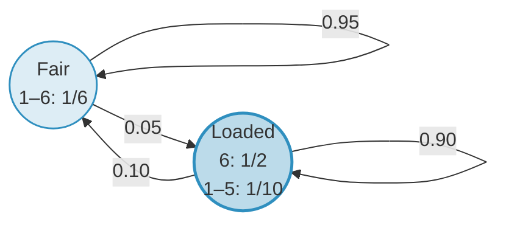

Many biological sequences consist of regions that cannot be observed directly: coding and non-coding DNA, a signal peptide and the mature protein, a membrane helix and a loop. A hidden Markov model (HMM) infers these regions from the observed letters and says how confident the labelling is. The page uses the occasionally dishonest casino as a stand-in for such a labelling problem, starts with which practical question each HMM algorithm answers and how its output is read, and then gives the recurrences as supporting detail.

::: tip Opening

Many biological sequences consist of regions that we cannot observe directly: coding and non-coding DNA, a signal peptide and the mature protein, a membrane helix and a loop. A hidden Markov model lets me infer these regions from the letters I do observe. I will use the dishonest casino as a stand-in for such a labelling problem, start with which practical question each HMM algorithm answers and how its output is read, and then give the recurrences as supporting detail.

:::

## Which Algorithm Answers Which Question {#application}

::: table align="center" title="HMM questions and algorithms"

| Practical question | Method | How the output is used |
| :--- | :--- | :--- |
| What is the single best annotation? | Viterbi | One consistent labelling, e.g. a gene structure |
| Does this sequence fit the model? | Forward, $P(x)$ | Score against a null or another model |
| How confident is each position? | Forward–Backward | Posterior curve; uncertain boundaries |
| Labels unknown: how to train? | Baum–Welch | Parameters from unlabelled sequences |
| Does the model behave sensibly? | Simulation | Compare generated with real sequences |

:::

## From Markov Chains to HMMs {#markov-chains}

A first-order **Markov chain** assumes $P(x_i \mid x_1 \ldots x_{i-1}) = P(x_i \mid x_{i-1})$, so a sequence model needs only an initial distribution and a transition matrix; for DNA that is a $4 \times 4$ matrix with 12 free parameters. In a Markov chain the states *are* the observed symbols.

**CpG islands** motivate the hidden layer: $P(G \mid C)$ is much higher inside islands than outside, but to find islands inside a long sequence the region boundaries are unknown, so the region becomes a **hidden** variable. An HMM is two stochastic processes: a Markov chain over hidden states, and emissions of observed symbols from each state.

## The Model on the Casino Example {#model-and-assumptions}

Hidden states $z_{1:N}$ generate observations $x_{1:N}$. Parameters:

$$
\pi_k = P(z_1 = k), \qquad a_{kl} = P(z_{i+1} = l \mid z_i = k), \qquad e_k(b) = P(x_i = b \mid z_i = k).
$$

- **First-order Markov**: the next state depends only on the current state.
- **Conditional independence**: given its state, an observation is independent of other states and observations.

$$
P(x, z) = \pi_{z_1} e_{z_1}(x_1) \prod_{i=2}^{N} a_{z_{i-1} z_i}\, e_{z_i}(x_i).
$$

### The Occasionally Dishonest Casino {#the-occasionally-dishonest-casino}

Hidden states: fair die $F$ and loaded die $L$. Observations: rolls 1–6.

$$
A = \begin{pmatrix} 0.95 & 0.05 \\ 0.10 & 0.90 \end{pmatrix}, \qquad
e_F(b) = \tfrac{1}{6}, \qquad e_L(6) = \tfrac{1}{2}, \qquad e_L(1,\ldots,5) = \tfrac{1}{10}.
$$

Rows are current states and columns next states, ordered $(F, L)$. A run of sixes supports $L$, but a single six is not conclusive. ==Emissions supply local evidence; transitions favour persistence.== Short true switches can be missed. For example,

$$
P(x = 66, z = FL) = \pi_F \cdot \tfrac{1}{6} \cdot 0.05 \cdot \tfrac{1}{2}.
$$

The occasionally dishonest casino: two hidden states, their emission probabilities, and the transition probabilities on the arrows.

In biology, states represent regions, emissions describe sequence preferences, and the topology constrains the order. Example: signal-peptide N-region (K/R-rich), H-region (hydrophobic), C-region (cleavage-associated), then the mature protein.

## Choosing a Decoder and Reading Its Output {#backward-and-posterior-decoding}

**Viterbi** answers what happened overall: one legal path, but no indication of confidence. **Posterior decoding** picks the most probable state at each position separately: it optimises position-wise accuracy and keeps uncertainty visible as posterior curves, but the labels can form an invalid path when some transitions are forbidden.

==In practice report both==: the Viterbi path as the annotation and the posterior curve to show where it is uncertain, for example around a switch between the fair and the loaded die.

## Practical Issues {#complexity-durations-and-biological-meaning}

- **Complexity**: dense algorithms take $O(NK^2)$ time for $K$ states and $N$ observations. The likelihood alone needs $O(K)$ rolling memory; standard traceback or stored posteriors use $O(NK)$.
- **Underflow**: use scaling or log probabilities. Forward in log space requires log-sum-exp; Viterbi uses max.
- **Region lengths**: a self-loop implies geometrically distributed lengths with mean $1/(1 - a_{kk})$ (casino: fair 20 rolls, loaded 10). A geometric distribution is always highest at length one, so regions with a typical length, such as exons, need several states in a row or explicit durations (generalised HMMs).
- **Training**: exact EM updates do not decrease the likelihood but do not guarantee a global optimum. Initialisation matters and multiple starts help; more data improve estimation. Pseudocounts prevent zero estimates for plausible events absent from small samples.
- The model can only find the kinds of regions built into its structure.

## Viterbi: the Best Complete Path {#viterbi-the-best-complete-path}

Convention: fixed sequence length and no explicit end state. With an end state, include its transition probabilities in termination and backward initialisation.

$$
z^* = \arg\max_z P(z \mid x) = \arg\max_z P(x, z),
$$

since $P(x)$ is constant across paths. Let $v_k(i)$ be the highest joint probability of a path generating $x_{1:i}$ and ending in $k$:

$$
v_k(1) = \pi_k e_k(x_1), \qquad v_k(i) = e_k(x_i) \max_l \left[v_l(i-1)\, a_{lk}\right].
$$

Store $\psi_k(i) = \arg\max_l [v_l(i-1) a_{lk}]$. Choose $z^*_N = \arg\max_k v_k(N)$, then trace back through $\psi$. This is a global path optimum, not independent position-wise choices.

## Forward: Summing Over Paths {#forward-summing-over-paths}

$f_k(i) = P(x_{1:i}, z_i = k)$ is the total prefix probability ending in $k$:

$$
f_k(1) = \pi_k e_k(x_1), \qquad f_k(i) = e_k(x_i) \sum_l f_l(i-1)\, a_{lk}, \qquad
P(x) = \sum_z P(x, z) = \sum_k f_k(N).
$$

> **Say:** Viterbi keeps the best path into each state. Forward adds contributions from all paths into that state. Both reuse prefixes instead of enumerating $K^N$ paths.

## Backward and Posterior Probabilities {#posterior-probabilities}

$b_k(i) = P(x_{i+1:N} \mid z_i = k)$ is the probability of the remaining observations given state $k$. It excludes $x_i$, which is already included in Forward, so the two meet at position $i$ without double counting.

$$
b_k(N) = 1, \qquad b_k(i) = \sum_l a_{kl}\, e_l(x_{i+1})\, b_l(i+1), \qquad
\gamma_k(i) = P(z_i = k \mid x) = \frac{f_k(i)\, b_k(i)}{P(x)}.
$$

Useful checks: $\sum_k \gamma_k(i) = 1$ and $\sum_k f_k(i) b_k(i) = P(x)$ at every position.

## Parameter Estimation and Baum–Welch {#parameter-estimation}

**Known states**: count transitions $A_{kl}$ and emissions $E_k(b)$, then normalise:

$$
\hat a_{kl} = \frac{A_{kl}}{\sum_j A_{kj}}, \qquad \hat e_k(b) = \frac{E_k(b)}{\sum_c E_k(c)}.
$$

**Unknown states**: use expected counts under the current parameters. The adjacent-state posterior is

$$
\xi_{kl}(i) = P(z_i = k, z_{i+1} = l \mid x) = \frac{f_k(i)\, a_{kl}\, e_l(x_{i+1})\, b_l(i+1)}{P(x)}.
$$

Update $\hat a_{kl}$ = expected $k \to l$ transitions / expected visits to $k$, and $\hat e_k(b)$ = expected emissions of $b$ from $k$ / expected visits to $k$. Aggregate counts over independent sequences.

::: steps

1. Initialise parameters within a chosen model topology.
2. E-step: Forward–Backward → posterior probabilities → expected transition and emission counts.
3. M-step: normalise expected counts to update parameters.
4. Repeat until the log-likelihood improvement is small or an iteration limit is reached.

:::

Viterbi training counts along one best path; Baum–Welch uses expected counts over all paths. Decoding alone does not update parameters.

::: tip Whiteboard route

Labelling question / method table → casino model and joint probability → Viterbi path versus posterior curve → practical issues → support: Viterbi / max → Forward / sum → Backward / posterior → expected counts / Baum–Welch.

:::

## Ten-Minute Presentation {#presentation}

### Full Script {#full-script}

::: details Full spoken script

**What it is for.** Many biological sequences consist of regions that I cannot see directly: coding and non-coding DNA, a signal peptide followed by the mature protein, membrane helices and loops. What I see is only the letters. A hidden Markov model is a tool for labelling: it lets me infer the most plausible sequence of hidden regions from the observed letters, and it tells me how confident I can be. I will use the standard toy example, the occasionally dishonest casino, as a stand-in for any such labelling problem.

**The model.** The casino has a fair die and a loaded die. The loaded die shows a six half of the time. The dealer usually keeps the same die but occasionally switches. I see the rolls; I do not see which die was used. In HMM language the two dice are the hidden states, the rolls are the observations, the chances of switching are the transition probabilities, and the chance of each number given the die is the emission probability. Two assumptions make everything computable: the next state depends only on the current state, and each observation depends only on the state that produced it. The probability of a particular path together with the observations is then just a product of one transition and one emission per position.

**Why both parts matter.** Emissions give local evidence: a six is more likely from the loaded die. Transitions give context: because switching is rare, a single six in the middle of ordinary rolls is probably still the fair die, while a run of sixes is probably the loaded one. This is exactly why HMMs work well in biology: each letter is weak evidence, but regions are long, and the model combines many weak signals into a coherent segmentation.

**Three practical questions, three algorithms.** The first question is: what is the single best explanation of this sequence? That is the Viterbi algorithm; its output is one path, for example fair for thirty rolls and then loaded for twelve, or in biology one gene structure. The second question is: how well does this sequence fit the model at all? That is the Forward algorithm, which gives the total probability of the observations, summed over all paths; I use it to compare models or to score a sequence against a null model. The third question is: how sure am I about each position? That is Forward–Backward, which gives for every position the posterior probability of each state; plotted along the sequence it shows where the labelling is confident and where a boundary is uncertain.

**Viterbi in words.** The number of possible paths is the number of states to the power of the sequence length, so I cannot try them all. Viterbi uses dynamic programming. For each position and each state I store the probability of the best path that ends in that state at that position. To extend by one position I take, for each state, the best predecessor: $v_k(i) = e_k(x_i) \max_l [v_l(i-1) a_{lk}]$. I remember which predecessor was best, and at the end I trace back. The cost is the sequence length times the number of states squared.

**Forward and Backward.** The Forward algorithm has exactly the same structure, with the maximum replaced by a sum: instead of keeping the best path into each state, it adds up all paths into it. At the end the sum over states is the probability of the whole sequence. The Backward algorithm does the same from the right-hand end: it gives the probability of the remaining observations given the state at a position. Multiplying forward and backward values and dividing by the total probability gives the posterior, $P(\text{state } k \text{ at } i \mid x) = f_k(i) b_k(i)/P(x)$.

**Viterbi path or posterior decoding?** They answer different questions and can disagree. Viterbi gives one path that is consistent as a whole, which is what I want for an annotation, but it gives no measure of confidence. Posterior decoding picks the most probable state at each position separately; it is the best choice position by position and shows uncertainty, but the sequence of labels it produces may contain a transition that the model forbids. In practice I report the Viterbi path and show the posterior curve next to it.

**Where the parameters come from.** If I have training sequences with known labels, I simply count how often each transition and each emission occurs and normalise, adding pseudocounts so that rare events do not get probability zero. If the labels are unknown, I use the Baum–Welch algorithm, which is expectation–maximisation: start with a guess, use Forward–Backward to compute the expected number of times each transition and emission is used, re-estimate the parameters from these expected counts, and repeat. The likelihood never decreases, but the procedure can end in a local optimum, so I try several starting points.

**Practical issues.** Multiplying thousands of probabilities underflows, so implementations work with logarithms or rescale. A state with a self-loop stays for a number of steps that follows a geometric distribution, with mean $1/(1 - a_{kk})$: in the casino the fair die is used for about twenty rolls on average and the loaded one for about ten. A geometric distribution is always highest at length one, which is a poor description of regions that have a typical length, such as exons; then I use several states in a row or a generalised HMM with explicit lengths. And the model can only find the kinds of regions I have built into its structure.

:::

## Key Terms {#key-terms}

::: table align="center" title="Key terms"

| English | 中文与要点 |
| :--- | :--- |
| hidden state / observation | 隐藏状态 / 观测 |
| transition / emission probability | 转移概率 $a_{kl}$ / 发射概率 $e_k(b)$ |
| Markov property | 马尔可夫性：下一状态只依赖当前状态 |
| Viterbi algorithm | 求单条最可能路径（取最大值 + 回溯） |
| Forward / Backward algorithm | 前向 / 后向算法（对所有路径求和） |
| posterior probability, posterior decoding | 后验概率、后验解码（逐位置取最可能状态） |
| Baum–Welch, EM | 标签未知时的参数估计；期望最大化 |
| pseudocount, underflow | 伪计数、数值下溢（用对数或缩放） |
| geometric length distribution | 几何长度分布：自环状态的停留长度 |

:::

## Follow-up Questions {#follow-up-questions}

::: note How to use these questions

Questions marked ★ were raised in the revision sessions on 27 and 29 October. Answer directly first, then justify with the model, then name an assumption or limitation. Each answer is collapsed so the list can be used for self-testing.

:::

::: collapse

- ★ What is hidden in a hidden Markov model? How does it differ from a Markov chain?

  The sequence of states. The states form a Markov chain, but I only observe the symbols they emit. In a plain Markov chain the states are the observed symbols themselves. In the casino the die is hidden and the rolls are observed; in a gene finder the labels exon and intron are hidden and the nucleotides are observed.

- What is the difference between the Viterbi and the Forward algorithm?

  The recursion is the same except that Viterbi takes the maximum over predecessors and Forward takes the sum. Viterbi gives the probability of the single best path and, by traceback, the path itself. Forward gives the probability of the observations summed over all paths.

- ★ Why do we need the forward and backward algorithms?

  Forward computes $P(x)$, summing over exponentially many paths in $O(NK^2)$, which is needed to score sequences and compare models. But the state at position $i$ also depends on what comes later; Backward supplies that future. Together they give posterior state probabilities, used for posterior decoding and for the expected counts in Baum–Welch.

- ★ For the posterior, do you run forward and backward up to the overlap and then multiply?

  Yes. Forward runs from the start up to and including position $i$ (it contains $x_i$); Backward runs from the end back to $i$ but covers only $x_{i+1} \ldots x_N$, so the two meet at $i$ without double counting. Multiply $f_k(i) b_k(i) = P(x, z_i = k)$ and divide by $P(x)$. Check: $\sum_k f_k(i) b_k(i)$ is the same $P(x)$ for every $i$.

- When would posterior decoding give a different answer from Viterbi, and which do you trust?

  When many different paths with similar probability exist, for example when a boundary could be at several neighbouring positions. Viterbi commits to one of them; the posterior shows the spread. For a consistent annotation I use Viterbi; for judging reliability of each label I use posteriors. Posterior decoding can give a path that is impossible under the model.

- ★ What is the time complexity, and why not enumerate the paths? What is dynamic programming?

  $O(NK^2)$ for $N$ positions and $K$ states, because each of the $NK$ cells looks at $K$ predecessors. Enumeration would be $K^N$ paths, astronomically many already for short sequences. Dynamic programming breaks the problem into overlapping subproblems with optimal substructure, solves each once and stores the results in a table: here, the best path to each (state, position) is built from the best paths at the previous position.

- ★ Explain Baum–Welch without formulas. What are the different ways of getting transition and emission probabilities?

  With labelled training data, count transitions and emissions, add pseudocounts and normalise. Without labels, Baum–Welch: with the current parameters I compute how probable each state is at each position and each transition between positions, use these probabilities as fractional counts, compute new parameters from them, and repeat until the likelihood stops improving. Viterbi training counts along the single best path instead. Posterior decoding is not training; it uses a trained model to label positions.

- Does Baum–Welch find the best parameters?

  It finds a local maximum of the likelihood. The result depends on the starting values, so I run it from several starts and keep the best, and I check the model on data not used for training.

- What length distribution does a state with a self-loop imply, and is that a problem?

  A geometric distribution: the probability of leaving is the same at every step, so short stays are always the most probable. It is a problem for regions with a characteristic length. Solutions are chains of several states or generalised HMMs that draw the length from an explicit distribution.

:::
