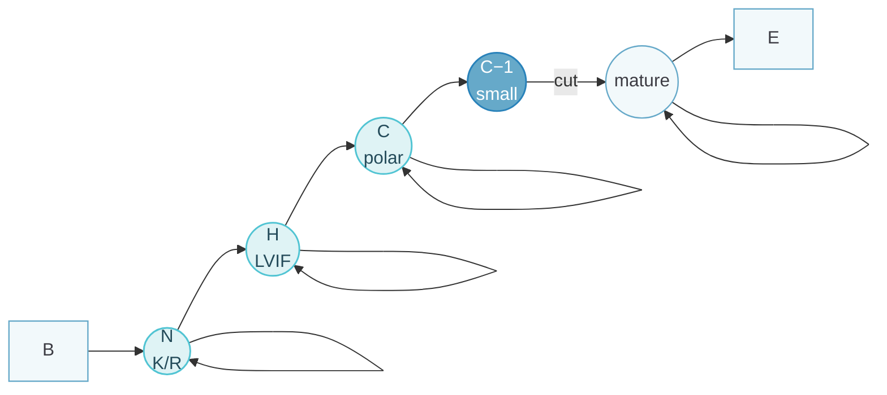
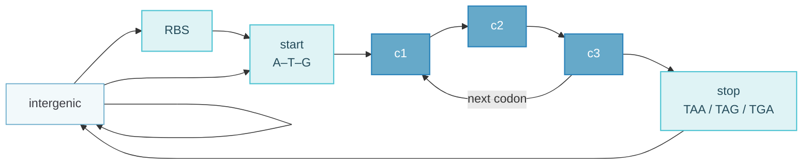
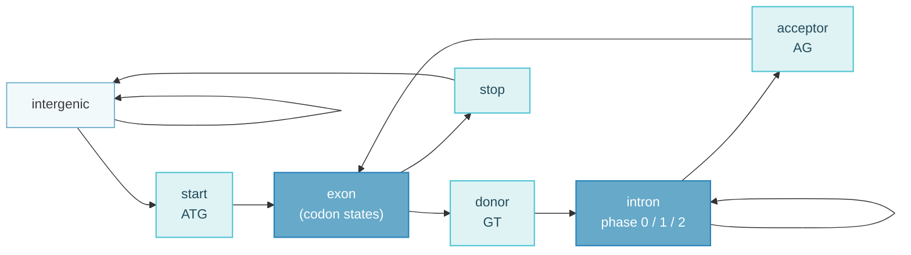

This topic applies the machinery of [Topic 8](/docs/ku-bsa/hidden-markov-models/) to biology: how to design a topology from biological knowledge, how to train and decode it, and how to evaluate it. The three course examples are signal peptides, gene finding (prokaryotic and eukaryotic) and membrane-protein topology.

## From Biology to a Model {#from-biology-to-a-model}

Biological sequences contain regions with different properties in a constrained order. An HMM represents those regions as hidden states and the residues as emissions; begin and end states are usually silent:

$$
P(x, z) = a_{B z_1} e_{z_1}(x_1) \prod_{i=2}^{n} a_{z_{i-1} z_i} e_{z_i}(x_i)\; a_{z_n E}
$$

The point is to combine weak local evidence into a single coherent annotation. Training only learns parameters within the chosen architecture; it does not discover the correct biology by itself.

The general recipe:

::: steps
1. Decide what is **observed** (nucleotides or amino acids) and what is **hidden** (biological regions or labels).
2. **Design** the topology from biological knowledge: states, allowed transitions, begin/end states and what each state emits. "All models are wrong, but some are useful" (Box).
3. **Train**: labelled data → counting with pseudocounts (`trainanhmm -labels`); unlabelled data → Baum–Welch or Viterbi training (`trainanhmm`).
4. **Decode** new sequences with Viterbi or posterior decoding (`decodeanhmm`).
5. **Evaluate** on held-out data: confusion matrix, exact site accuracy, cross-validation.
:::

Several internal states may share one output label; for example, N, H and C states can all be labelled "signal peptide".

## Signal Peptides and the Cleavage Boundary {#signal-peptides-and-the-cleavage-boundary}

A simple model is $B \to S \to Q \to M \to E$, with self-loops in the signal ($S$) and mature ($M$) states and $Q$ marking the cleavage-associated residue. Because the physical cut lies between residues, the labelling convention has to be stated.

::: table align="center" title="Refined signal-peptide states"

| Refined state | Region | Emission preference |
| :--- | :--- | :--- |
| $N$ | N-terminal region | Positively charged, K/R-rich |
| $H$ | Hydrophobic core | Hydrophobic residues |
| $C$ | C-terminal signal region | Polar, cleavage-associated |
| $Q_{-1}, Q$ | Positions next to the cut | Position-specific preferences |
| $M$ | Mature protein | Typical protein composition |

:::

The refined topology $B \to N \to H \to C \to Q_{-1} \to Q \to M \to E$ uses loops for variable region lengths and dedicated boundary states to learn a local motif; several internal states may share one coarse label. In the exercise, region-specific emissions and a pre-cleavage state improved exact cut prediction, though more complexity is not automatically better.

Biologically, a signal peptide is a sequence of about 25 N-terminal residues that targets a protein for secretion (via SRP, across the ER or bacterial membrane) and is cleaved off by signal peptidase. The C-region carries small residues at positions −1 and −3 (the "A-X-A" rule), which is why a dedicated state for the position just before the cut pays off.



Signal-peptide topology. N, H and C share the label "signal peptide"; the dedicated C−1 state captures the residue just before the cut.

## Training and Decoding {#training-and-decoding}

Training takes a model specification and sequences and returns an estimated model. Fully labelled paths allow counting with pseudocounts; coarse labels can leave internal states unresolved; unknown paths require Baum–Welch (expected counts) or Viterbi training (hard counts from the best path), both sensitive to initialisation.

Decoding takes a trained model and a sequence and returns labels and posteriors without re-estimating anything:

$$
z^* = \arg\max_z P(z \mid x) \;\;(\text{Viterbi}), \qquad z_i = \arg\max_k P(z_i = k \mid x) \;\;(\text{posterior})
$$

::: warning Why posterior decoding can miss the cut
Every legal path through this topology contains $Q$, so Viterbi must predict a cut. Posterior decoding decides each position independently: the cut probability can be spread across neighbouring residues and never be the largest at any single one. The result can omit $Q$ or violate allowed transitions, even though the boundary certainly exists and only its location is uncertain. For labels shared by several states, sum their posteriors first.
:::

## Evaluation {#evaluation}

In a confusion matrix (rows actual, columns predicted), the diagonal holds correct predictions and the off-diagonal cells show which labels are over- or underpredicted. For a target class,

$$
\text{recall} = \frac{TP}{TP + FN}, \qquad \text{precision} = \frac{TP}{TP + FP}.
$$

Residue-level accuracy and exact cleavage-site accuracy per protein measure different things: one misplaced cut can coexist with almost perfect residue accuracy, and rare boundary labels make overall accuracy misleading. Five-fold cross-validation trains on four subsets and tests on the fifth in turn; close homologues should stay in the same fold to limit leakage, and a separate final test set is needed if validation was used to choose the design.

In the exercise the lecture admitted that "we behaved badly": the model was trained and tested on the same data, which overestimates performance. Viterbi produced many proteins with a 100%-correct labelling, while posterior decoding produced many in the 95–100% range.

## Prokaryotic Gene Finding {#prokaryotic-gene-finding}

An open reading frame (ORF) is a stretch without an in-frame stop, but random DNA contains ORFs too, so a gene finder combines codon usage, ORF length, the ribosome binding site (RBS) and start/stop signals. A schematic forward-strand architecture:

```text
Intergenic → RBS → Start → (C1 → C2 → C3)+ → Stop → Intergenic
```

Codon usage is scored against a composition-matched background, $s(c) = \log_2 [P(c \mid \text{coding}) / P(c \mid \text{background})]$, and summed over codons under an independence assumption. GC enrichment alone is not sufficient evidence.

Three phase states with independent single-base emissions cannot capture codon preferences: TAA is a stop while TAT is a sense codon. Context-dependent emissions or expanded states are needed:

$$
P(x_1 x_2 x_3) = P_1(x_1)\, P_2(x_2 \mid x_1)\, P_3(x_3 \mid x_1 x_2)
$$

For random ORF lengths with stop probability $p$ per independent triplet,

$$
P(\text{no stop in } m \text{ codons}) = (1-p)^m, \qquad P(m \text{ non-stops then a stop}) = (1-p)^m p,
$$

with $p = 3/64$ for uniform bases under the standard code. Long ORFs support coding but are insufficient alone; tools such as GeneMark decode an integrated model with Viterbi.

Prokaryotic genes are densely packed and form one continuous ORF from start (ATG) to stop (TAA/TAG/TGA). With $p = 3/64$, an ORF of 100 codons arises by chance with probability only about 0.8%. AT-rich genomes contain more stops, because stop codons are AT-rich, and therefore have shorter random ORFs. The ribosome binding site (Shine–Dalgarno) lies upstream of the start and can be scored with a PSSM. Codon-usage log-odds from the lecture (*A. pernix*): AGG $+1.55$, CGA $-3.65$. Glimmer is another prokaryotic gene finder.



Forward-strand prokaryotic gene model. The codon states use higher-order emissions; a mirrored model handles the reverse strand.

## Eukaryotic Genes {#eukaryotic-genes}

Introns interrupt the coding sequence, and repeats and variable GC content complicate background modelling. The core path is

```text
Exon → Donor → Intron → Acceptor → Exon
```

with repeated introns and intronless genes allowed, start and stop modules delimiting the CDS, and optional promoter, transcription start, UTR and poly-A modules. Transcription start differs from translation start, and the stop codon is not the transcript end. Splice-site scores supply local evidence while the full model enforces a coherent structure. Intron phase (0, 1 or 2) must be tracked, because introns can fall between codons or after one or two bases of a codon; separate phase paths keep the reading frame intact when exons are joined. HMMgene and GENSCAN are examples.

About half the human genome consists of interspersed repeats, gene density is low and GC content varies along the genome (isochores), and alternative splicing exists, so ORF search fails. Splice-site sub-models can be weight matrices, neural networks (NetGene) or HMM modules.

The HMMgene slide model uses codon states for the coding region (with special first and last codons), an intergenic region modelled by **one state with 3rd-order emissions** (each base depends on the previous three), and start/stop models of about eight first-order states each. GENSCAN is a generalised HMM that models both strands at once and has a sophisticated donor model.

A first-order chain captures dinucleotide dependencies only. Coding DNA has codon-level, 3-periodic dependencies, so gene finders use inhomogeneous chains of order 2–5 (5 = hexamers) with separate distributions per codon position. Higher order needs more parameters ($4^k \times 3$) and more training data.

Here Viterbi is clearly preferable: it returns one complete, consistent gene structure, whereas posterior labels can give fragments or impossible combinations (exon labels without start or stop, frame breaks between exons).



Core eukaryotic gene model. Separate intron states per phase keep the reading frame when exons are joined.

## Prokaryotic versus Eukaryotic Gene Finding {#prokaryotic-vs-eukaryotic}

::: table align="center" title="Prokaryotic versus eukaryotic gene finding"

| | Prokaryotes | Eukaryotes |
| :--- | :--- | :--- |
| Gene structure | Continuous ORF | Exons interrupted by introns |
| Extra hidden states | Intergenic, RBS, start, codon loop, stop | Donor, acceptor, introns with phase 0/1/2, UTRs, promoter, poly-A |
| Gene density | Dense (~88% coding) | Sparse |
| Composition | Fairly homogeneous GC | Variable GC, many repeats |
| Upstream signal | Shine–Dalgarno RBS | Kozak context, promoters |
| ORF length as evidence | Informative | Nearly useless |
| Length modelling | Geometric often acceptable | Explicit lengths (GHMM) help |

:::

## Generalised HMMs {#generalised-hmms}

Ordinary self-loops imply geometric lengths, meaning the chance of leaving a state does not depend on how long the model has stayed. A generalised HMM samples a length explicitly and emits a whole segment. GENSCAN combines explicit lengths with gene signals and strand structure, at the cost of a more expensive DP over candidate lengths.

Membrane-protein topology is another application: amino-acid emissions separate hydrophobic transmembrane helices from inside and outside loops (inside → TM → outside → TM → inside), the positive-inside bias adds evidence, and multiple helix states or explicit lengths constrain the span. Hydrophobic signal peptides must be distinguished using cleavage and context evidence.

The DP cost of a generalised HMM rises by a factor of the maximum segment length unless tricks are used, for example keeping intron lengths geometric. In membrane-protein models (TMHMM), a TM helix is a chain of states enforcing about 15–30 hydrophobic residues; because the H-region of a signal peptide can be mistaken for the first TM helix, combined models such as Phobius predict both.

## Ten-Minute Presentation {#presentation}

### Keyword Card {#keyword-card}

- **Idea**: regions + constrained order → hidden states, emissions, transitions
- **Recipe**: observed/hidden → design (biology; "all models are wrong") → train (labels: count + pc; none: Baum–Welch) → decode (Viterbi/posterior) → evaluate (held-out)
- **Signal peptide**: ~25 aa, N-term, secretion, cleaved; N (K/R+), H (hydrophobic LVIF), C (polar, cleavage), mature
- **Models**: simple B-S-C-M-E (self-loops) → N/H/C (shared labels, distinct emissions) → C$_{-1}$ state (big gain)
- **trainanhmm -labels / decodeanhmm**
- **Viterbi** always 1 cleavage (legal path); **posterior** per position → maybe none/illegal; gives uncertainty
- **Confusion matrix** rows actual/cols predicted; residue vs site accuracy; **5-fold CV**, homologs together
- **Prokaryotes**: dense, continuous ORF; random ORF $(1-3/64)^n$ (100 → 0.8%); AT-rich → shorter
- Evidence: codon usage log-odds, ORF length, RBS PSSM, start/stop → HMM; **codon memory** (TAA vs TAT) $P_1P_2P_3$; GeneMark, Viterbi
- **Eukaryotes**: introns, sparse, repeats ~50%, GC varies; exon–donor–intron–acceptor; **phase 0/1/2**; Viterbi → consistent gene
- **GHMM** (GENSCAN): explicit lengths vs geometric
- **TM proteins**: in–TM(~20 hydrophobic)–out; positive-inside
- **Limits**: topology, memory, lengths, training bias, boundary uncertainty

### Full Script {#full-script}

::: details Full spoken script

My topic is how hidden Markov models are applied to biological sequences. The general idea is that a biological sequence consists of regions with different properties that occur in a constrained order — for example, a signal peptide followed by the mature protein, or exons and introns in a gene. We observe the letters, nucleotides or amino acids, but not the region labels. In an HMM, the regions become hidden states, their typical compositions become emission probabilities, and the allowed order becomes the transition structure.

The recipe has five steps. First, decide what is observed and what is hidden. Second, design the model: which states, which transitions are allowed, what each state emits — this comes from biological knowledge, not from the data; as Box said, all models are wrong, but some are useful. Third, train the parameters: with labelled data, simply count transitions and emissions and add pseudocounts; with unlabelled data use Baum–Welch or Viterbi training. Fourth, decode new sequences with Viterbi or posterior decoding. Fifth, evaluate on data that were not used for training.

My main example is signal peptides. A signal peptide is a short N-terminal sequence of about 25 amino acids that directs a protein to the secretory pathway and is then cut off by signal peptidase. The task is to predict the cleavage site. Biologically, a signal peptide has three regions: a positively charged N-region, rich in lysine and arginine; a hydrophobic H-region, rich in leucine, valine, isoleucine and phenylalanine; and a polar C-region containing the cleavage motif; then follows the mature protein with ordinary composition.

In the exercise we started with a simple model: begin, a signal-peptide state with a self-loop, a cleavage state, a mature-protein state with a self-loop, and end. The self-loops allow regions of variable length. We trained it on labelled eukaryotic signal peptides with `trainanhmm` — just counting — and decoded with `decodeanhmm`. Then we improved it by splitting the signal into N, H and C states. They can all carry the same label — several states can share one label — but they have different emission probabilities, and the trained H-state indeed emitted mostly hydrophobic residues. This gave slightly more correct cleavage sites. Adding a special state for the position just before the cleavage site, which has a strong amino-acid preference — small residues — improved the exact cleavage-site prediction a lot. So the model structure encodes biology, and better structure gives better prediction.

An important observation was the difference between Viterbi and posterior decoding. Viterbi finds the single most probable complete path, which must obey the allowed transitions; in this topology every legal path goes through the cleavage state, so Viterbi always predicts exactly one cleavage site. Posterior decoding chooses, at each position independently, the state with the highest posterior probability. If the model is uncertain, the cleavage probability is spread over several neighbouring positions and may never be the largest at any one of them — so posterior decoding can predict no cleavage site at all, or a label sequence with illegal transitions. On the other hand it gives a probability profile that shows uncertainty.

To evaluate, we used a confusion matrix: rows are the true labels, columns the predicted labels, the diagonal counts correct predictions, and off-diagonal cells show which classes are confused. Residue-level accuracy can be high even if the cleavage site is shifted by one, so we also counted exactly correct cleavage sites. And — as the lecture admitted — we "behaved badly" by testing on the training data. Properly, we should use cross-validation: split the data into, say, five parts, train on four and test on the fifth, rotate, and average, ideally keeping homologous proteins in the same part.

The second application is gene finding, starting with prokaryotes. Prokaryotic genes are densely packed and are one continuous open reading frame from a start codon to a stop codon. But ORFs also occur in random sequence: with uniform base frequencies, three of the 64 codons are stops, so the probability of an ORF of $n$ codons without a stop is $(1-3/64)^n$, which decays exponentially — 100 codons only about 0.8 percent. AT-rich genomes have more stops, so even shorter random ORFs.

Gene finders combine several kinds of evidence: codon usage — log-odds of each codon in genes versus background; ORF length; the ribosome binding site upstream of the start codon, which can be scored with a weight matrix; and start and stop signals. An HMM combines these coherently. One important detail is that the codon model needs memory: the probability of a nucleotide depends on the two previous ones within the codon — for example TAA is a stop codon and almost never occurs inside genes, while TAT is common. So the codon states use higher-order emissions: $P(x_1)P(x_2|x_1)P(x_3|x_1x_2)$. The model is: intergenic, ribosome binding site, start codon states, a loop of codon states, stop codon states, back to intergenic — trained on known genes and decoded with Viterbi, as in GeneMark.

Eukaryotic genes are much harder. Genes are interrupted by introns that are spliced out; genes are sparse; about half the human genome is repeats; and GC content varies along the genome. So simply searching for ORFs does not work. The model needs additional hidden states: exons, donor sites, introns, acceptor sites, plus start, stop, and possibly promoter, UTR and poly-A signals. Splice sites are scored by weight matrices, neural networks or HMM modules. An important subtlety is intron phase: an intron can fall between codons or after the first or second base of a codon, so the model has separate intron states for phase 0, 1 and 2 to keep the reading frame correct across the exon junction. Here Viterbi is clearly preferable: it returns one complete, consistent gene structure, whereas posterior labels can produce fragments or impossible combinations.

Another limitation is length modelling. A self-loop gives a geometric length distribution — the probability of leaving a state does not depend on how long we have been there — which fits exon lengths badly. Generalized HMMs, like GENSCAN, choose an explicit length for a segment from a length distribution and then emit the whole segment, at the cost of more computation; GENSCAN also models both strands at once.

Briefly, the third course example is membrane proteins: hidden states for inside loops, transmembrane helices of about 20 hydrophobic residues, and outside loops, with the topology forcing alternation between inside and outside; positively charged residues are enriched on the inside, which helps determine orientation.

To conclude: HMMs are powerful because they combine weak local signals into one consistent annotation. Their limitations are that the topology is chosen by us, they have limited memory and geometric lengths, predictions depend on representative training data, and boundaries remain uncertain — which the posterior probabilities make visible.

:::

## Board Plan {#board-plan}

::: tip Whiteboard route

define observations and states → draw the signal-peptide topology → explain the missing posterior cut → draw the coding cycle and exon–intron path → geometric versus explicit lengths.

:::

### Must {#board-must}

1. **Signal-peptide topology** (say "N, H, C share the label *signal*") (see the diagram in the notes above).

2. **Prokaryotic gene model:** (see the diagram in the notes above).

3. **Eukaryotic gene model** (point at the phase states) (see the diagram in the notes above).

### Optional {#board-optional}

2×2 confusion matrix (rows actual, columns predicted); $P(\text{no stop in }n)=(1-3/64)^n$.

## Follow-up Questions {#follow-up-questions}

::: note How to use these questions

Questions marked ★ were raised in the revision sessions on 27 and 29 October. Answer directly first, then justify with the model, then name an assumption or limitation. Each answer is collapsed so the list can be used for self-testing.

:::

::: collapse

- ★ First-order vs higher-order Markov chains in the eukaryotic gene context?

  A first-order chain makes each base depend on the previous base only (dinucleotide statistics). Coding sequence has codon structure: the base at codon position 3 depends on positions 1 and 2 (TAA stop vs TAT Tyr), and there are hexamer (codon-pair) preferences. So gene finders use inhomogeneous higher-order emissions — order 2 to model codons, often order 5 (hexamers) — with separate distributions per codon position (phase); HMMgene's intergenic state is 3rd order. Higher order captures more biology but needs many more parameters ($4^k\times3$ per state) and training data; too high → overfitting.

- ★ Posterior decoding can return illegal paths and only part of a gene; Viterbi gives the full gene — explain.

  Posterior decoding takes the most probable state independently at each base, ignoring whether consecutive labels are connected by allowed transitions. The label string can therefore contain impossible combinations — an exon segment without a start codon, a frame shift between exons, an intron without donor/acceptor — or only fragments of a gene where probability is high. Viterbi maximises over complete paths through the model topology, so it returns one consistent gene structure from start to stop with proper splice sites and phases. Same as the signal-peptide case (Viterbi always predicts a cleavage site, posterior sometimes none).

- ★ What is the difference between prokaryotic and eukaryotic genes, and how does it change the HMM?

  Prokaryotes: genes are continuous ORFs (no splicing), densely packed (~88% coding), operons, Shine–Dalgarno RBS; the HMM needs intergenic, RBS, start, codon-loop, stop states on both strands. Eukaryotes: genes split into exons by introns (splicing), sparse genes, long introns, repeats (~50%), variable GC, alternative splicing, promoter/UTR/poly-A; the HMM needs extra hidden states — exon (initial/internal/terminal/single), donor and acceptor site models, intron states for each phase 0/1/2 to keep the frame — and better length modelling (GHMM: GENSCAN). ORF-length signals are useless in eukaryotes.

- How do you design an HMM for a biological problem?

  Identify observations and biological regions; draw states for each region (sub-states if composition differs); allow only biologically meaningful transitions (order constraints, begin/end); self-loops for variable lengths; special states for boundary signals; decide labels; then train and evaluate. The topology encodes prior knowledge; training only fits probabilities.

- Why split the signal peptide into N, H, C states? Why the C−1 state?

  Different regions have different amino-acid compositions (K/R; hydrophobic; polar/small), so a single state's emissions average them and lose information. Separate states give region-specific emissions. The residue just before the cleavage site has very strong preferences (small residues, A-X-A rule), so a dedicated state captures this position-specific signal and pins down the exact cut site — clear improvement in correct cleavage sites.

- Can several states share a label? Why does that matter?

  Yes — N, H, C states all labelled "signal". Training with labels then constrains the path only to the set of states with that label; within it, the assignment is estimated (Baum–Welch-like). Decoding gives labels, and for posterior label probabilities you sum posteriors of all states sharing the label.

- How do you evaluate an HMM predictor?

  Confusion matrix (rows actual, columns predicted), per-class precision/recall, exact boundary (cleavage-site) accuracy per protein, residue-level accuracy; on held-out data via k-fold cross-validation (homology-reduced folds), then retrain on all data for the final model; a separate test set if many designs were compared.

- Why is an ORF not enough to find a prokaryotic gene?

  Random sequences contain ORFs: $P(\text{no stop in }n\text{ codons})=(1-3/64)^n$ — short ORFs are frequent (AT-rich genomes have shorter random ORFs because stops are AT-rich). Long ORFs are likely genes, but short genes overlap with the random ORF distribution; and every ORF also has shadow ORFs in other frames. Need codon usage, RBS and start signals.

- How is codon usage turned into a score?

  Log-odds per codon $\log_2\frac{P(c|\text{coding})}{P(c|\text{background})}$ (A. pernix AGG +1.55, CGA −3.65), summed over codons in a frame; in an HMM it is the emission of codon states.

- What is intron phase and why does the HMM need it?

  Phase 0: intron between codons; phase 1: after first base of a codon; phase 2: after second. After the intron the exon must continue at the right codon position; separate intron states per phase remember where we are in the codon so the reading frame is preserved and stop codons spanning the junction are handled.

- What is a generalized HMM and why use it?

  Each state emits a whole segment whose length is drawn from an explicit length distribution (e.g. empirical exon length distribution) instead of geometric lengths from self-loops. More realistic for exons; DP becomes slower (factor of maximum segment length) unless lengths are geometric (introns).

- How does a transmembrane-protein HMM work?

  States: cytoplasmic loop, TM helix (chain of ~20 states with hydrophobic emissions, enforcing length 15–30), extracellular loop; cyclic topology in → TM → out → TM → in; positive-inside rule (K/R in cytoplasmic loops) determines orientation. Decoding gives number and topology of helices (TMHMM). Signal peptides' H-region can be mistaken for a TM helix → joint models (Phobius).

- Labelled vs unlabelled training — pros and cons?

  Labelled: simple counting, parameters directly interpretable, no local optima; needs annotated data. Unlabelled: Baum–Welch can use raw sequences, but converges to local optima and states may not correspond to the intended biology.

:::
