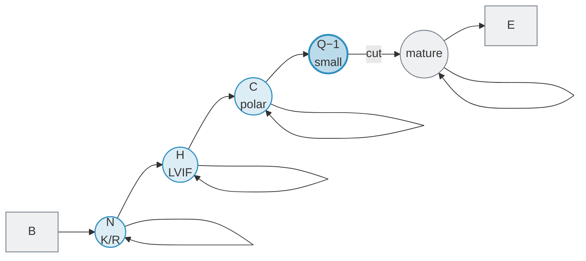
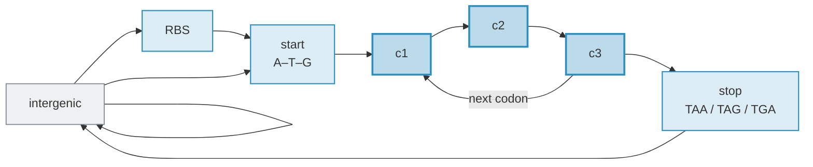
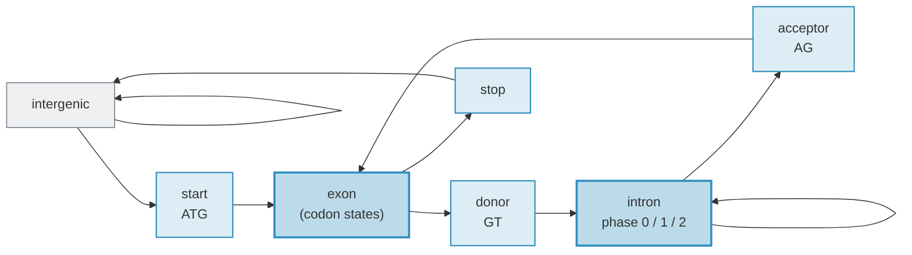

Signal peptides, genes and membrane helices are all regions with different composition that must appear in a certain order, which is exactly what an HMM topology encodes. The page shows how such a problem is turned into an HMM, using signal-peptide cleavage to go through design, training, decoding and evaluation, and then how the same recipe gives gene finders and membrane-topology predictors.

::: tip Opening

Suppose I want to predict where a signal peptide is cleaved, or where the genes are in a newly sequenced genome. In both cases the sequence consists of regions with different composition that must appear in a certain order. I will show how such a problem is turned into an HMM, using signal-peptide cleavage to go through design, training, decoding and evaluation, and then how the same recipe gives gene finders and membrane-topology predictors.

:::

## The Recipe: Turn a Biological Question into an HMM {#from-biology-to-a-model}

::: steps

1. What is observed: nucleotides or amino acids.
2. Which regions should be labelled → **states**.
3. Which orders are biologically allowed → **topology**.
4. Train.
5. Decode a new sequence.
6. Evaluate on the biological target.

:::

An HMM combines weak local evidence into a coherent complete annotation. ==Training learns parameters within the chosen architecture; it does not automatically discover the correct biology.==

## Signal Peptides: Predict the Cleavage Boundary {#signal-peptides-and-the-cleavage-boundary}

Secreted proteins begin with a signal peptide of about 25 residues that directs them to the secretory pathway and is then cut off by signal peptidase. The task is to predict whether a protein has one and exactly where the cut is.

**Simple model**: $B \to S \to Q \to M \to E$, with self-loops in the signal ($S$) and mature-protein ($M$) states; $Q$ marks the cleavage-associated residue. The physical cut lies between residues, so the label convention must be defined.

::: table align="center" title="Refined signal-peptide states"

| Refined state | Biological region | Emission preference |
| :--- | :--- | :--- |
| $N$ | N-terminal region | Positively charged, K/R-rich |
| $H$ | Hydrophobic core | Hydrophobic amino acids |
| $C$ | C-terminal signal region | Polar / cleavage-associated composition |
| $Q_{-1}$, $Q$ | Positions near the cut | Position-specific cleavage preferences |
| $M$ | Mature protein | Typical protein composition |

:::

The refined topology is $B \to N \to H \to C \to Q_{-1} \to Q \to M \to E$. Region loops allow variable lengths; dedicated boundary states learn a local motif, like a small weight matrix inside the HMM. Several internal states may share the same coarse output label. In the exercise, region-specific emissions and the pre-cleavage state improved exact cut prediction, but greater complexity is not automatically better: more states mean more parameters to estimate.

Signal-peptide topology. N, H and C share the label "signal peptide"; the dedicated state before the cut captures the local cleavage motif.

## Train, Then Decode {#training-and-decoding}

**`trainanhmm`**: model specification + training sequences → estimated model.

- Fully known state paths: count transitions and emissions, add pseudocounts, normalise.
- Coarse labels (signal / mature) may leave internal states unresolved. Unknown paths: Baum–Welch uses expected counts over paths; Viterbi training alternates best-path decoding and hard-count updates. Initialisation matters; local optima are possible.

**`decodeanhmm`**: trained model + sequence → predicted path/labels and posterior probabilities. Decoding does not re-estimate model parameters.

$$
z^* = \arg\max_z P(z \mid x) \quad (\text{Viterbi}), \qquad \hat z_i = \arg\max_k P(z_i = k \mid x) \quad (\text{posterior}).
$$

Viterbi returns a globally most probable legal path. In this signal-peptide topology every legal path contains $Q$, so ==Viterbi must predict a cut==. Posterior decoding chooses each position independently: the cut probability may be spread across neighbouring positions (say 21, 22 and 23) and never be the largest at any one of them, so it can omit $Q$ or violate allowed transitions. A boundary can certainly exist while its location remains uncertain. For a shared label, sum the posteriors over all states carrying that label.

**Which to report**: Viterbi when one coherent annotation is needed (a cleavage site, a gene structure); posteriors to show how reliable each label is.

## Evaluate the Biological Target {#evaluation}

A **confusion matrix** has rows = actual and columns = predicted; the diagonal is correct, and off-diagonal entries identify over- or underprediction and confused labels. For a target class:

$$
\text{recall} = \frac{TP}{TP + FN}, \qquad \text{precision} = \frac{TP}{TP + FP}.
$$

Residue accuracy and exact cleavage-site accuracy per protein differ: one misplaced cut can coexist with nearly perfect residue accuracy. Rare boundary labels make overall accuracy misleading, so report the fraction of proteins with the exact site correct.

Evaluate on held-out data. **Five-fold cross-validation**: train on four subsets, test on the fifth, repeat, and combine held-out results. Keep close homologues together in one fold to reduce leakage. Use separate final testing if validation was used to select model designs.

## Prokaryotic Gene Finding {#prokaryotic-gene-finding}

> **Say:** For gene finding, we keep the same HMM idea but change the states and signals. An ORF alone is insufficient because random DNA also contains ORFs.

An **open reading frame** (ORF) is a stretch without an in-frame stop; a **ribosome binding site** (RBS, Shine–Dalgarno) supports translation initiation. A gene finder combines codon usage, ORF length, RBS and start/stop signals. Schematic forward-strand architecture (modules may contain several states):

$$
\text{Intergenic} \to \text{RBS} \to \text{Start} \to (C_1 \to C_2 \to C_3)^+ \to \text{Stop} \to \text{Intergenic}.
$$

Sense-codon cycles repeat and terminate at an in-frame stop. Add an RBS/background choice and opposite-strand modules as needed.

Forward-strand prokaryotic gene model. The codon states need context-dependent emissions; a mirrored model handles the reverse strand.

**Codon usage**: score coding against a composition-matched background,

$$
s(c) = \log_2 \frac{P(c \mid \text{coding})}{P(c \mid \text{background})}.
$$

Under an independent-codon model, scores add across codons, and positive values support coding. GC enrichment alone is not sufficient evidence.

**Codon memory**: three phase states with independent single-base emissions cannot represent codon preferences (TAA is a stop, TAT a sense codon). Use context-dependent emissions or expanded states so the model remembers the earlier bases of the codon.

**Random ORF calculation**: for independent triplets with stop probability $p$,

$$
P(\text{no stop in } m \text{ codons}) = (1-p)^m, \qquad P(m \text{ non-stops then stop}) = (1-p)^m\, p.
$$

With uniform independent bases, $p = 3/64$ (standard code), so 100 codons without a stop still occur with probability about 0.8%. Composition changes $p$: stop codons are AT-rich, so GC-rich genomes have longer random ORFs. A preceding start is not included in this calculation. Long ORFs support coding but are insufficient alone. Viterbi decodes the integrated model (e.g. GeneMark).

## Eukaryotic Genes: Connect Exons and Introns {#eukaryotic-genes}

Introns interrupt the coding sequence; repeats and variable GC content complicate background models. The model includes coding exons, donor sites, introns and acceptor sites:

$$
\text{Exon} \to \text{Donor} \to \text{Intron} \to \text{Acceptor} \to \text{Exon}.
$$

Repeated introns and intronless genes are allowed. Start and stop modules delimit the CDS; promoter, transcription start, UTR and poly-A modules can describe the full transcript. Transcription start ≠ translation start; stop codon ≠ transcript end.

Splice-site scores (PSSMs, neural networks or HMM modules) supply local evidence; the full model selects a coherent structure. **Intron phase** 0, 1 or 2 must be tracked, because introns can lie between codons or after one or two bases of a codon; separate phase paths preserve the reading frame when exons are joined. Examples: HMMgene, GENSCAN.

Core eukaryotic gene model. Separate intron states per phase keep the reading frame when exons are joined.

::: table align="center" title="Prokaryotic versus eukaryotic gene finding"

| | Prokaryotes | Eukaryotes |
| :--- | :--- | :--- |
| Gene structure | Continuous ORF | Exons interrupted by introns |
| Extra hidden states | Intergenic, RBS, start, codon loop, stop | Donor, acceptor, introns with phase 0/1/2, UTRs, promoter, poly-A |
| Gene density | Dense | Sparse |
| Composition | Fairly homogeneous GC | Variable GC, many repeats |
| ORF length as evidence | Informative | Nearly useless |
| Length modelling | Geometric often acceptable | Explicit lengths (GHMM) help |

:::

## Generalised HMMs: Explicit Region Lengths {#generalised-hmms}

Ordinary self-loops imply geometric lengths: a state's chance of leaving does not depend on how long it has stayed. A **generalised HMM** instead samples a length and emits a whole segment. GENSCAN combines explicit lengths with gene signals and strand structure. Testing candidate lengths increases the DP cost.

## Membrane Topology and Limits {#membrane-topology}

**Membrane topology**: amino-acid emissions distinguish hydrophobic transmembrane helices from inside/outside loops; a schematic path is inside → TM → outside → TM → inside. Each helix flips the membrane side; the positive-inside bias supplies additional emission evidence. Multiple helix states or explicit lengths constrain the helix span. Hydrophobic signal peptides can resemble helices and require cleavage or context evidence.

Main limits across applications: the chosen topology, limited sequence memory, training bias towards known genes or proteins, and boundaries that are less certain than regions.

::: tip Whiteboard route

Define observations/states → draw the signal-peptide topology → explain the missing posterior cut → draw the coding cycle and exon–intron path → geometric versus explicit lengths.

:::

## Ten-Minute Presentation {#presentation}

### Full Script {#full-script}

::: details Full spoken script

**The recipe.** Applying an HMM to a biological problem always follows the same steps. First, what do I observe: nucleotides or amino acids. Second, which regions do I want to label: these become the states. Third, in which order can the regions occur: this becomes the topology, the allowed transitions. Fourth, I train the probabilities on known examples. Fifth, I decode a new sequence. Sixth, I evaluate on the thing I actually care about biologically. I will go through these steps with signal peptides and then show how the same recipe gives gene finders.

**Signal peptides: the problem.** Secreted proteins begin with a signal peptide that directs them to the secretory pathway and is then cut off. I want to predict whether a protein has one and exactly where the cut is. A signal peptide has three regions: a positively charged start, the n-region; a hydrophobic core, the h-region; and a more polar c-region with a characteristic pattern just before the cleavage site.

**Signal peptides: the design.** The simplest model has a signal state with a self-loop, a state for the cleavage position, and a mature-protein state with a self-loop. That already works to some degree. A better model follows the biology: separate states for the n-, h- and c-regions, each with its own amino-acid preferences and its own self-loop so the length can vary, then dedicated states for the positions right before the cut, which learn the local motif like a small weight matrix inside the HMM, and then the mature protein. In the exercise this refinement improved the prediction of the exact cleavage site. But more states also mean more parameters, so more complexity is only better if the data can support it.

**Train, then decode.** With the course tools I train with `trainanhmm`, which takes the model structure and labelled sequences and estimates the probabilities, and I predict with `decodeanhmm`, which takes the trained model and a new sequence and returns the labels. When my labels only say signal or mature, the path through the n-, h- and c-states is not determined, so training has to use Baum–Welch or Viterbi training for the unresolved part.

**Reading the decoding output.** Here the difference between the two decoders becomes practical. In this topology every legal path passes through the cleavage state once, so Viterbi always predicts exactly one cut. Posterior decoding looks at each position separately; if the model is unsure whether the cut is at position 21, 22 or 23, the cleavage probability is spread over these positions and may never be the largest label at any of them, so the output can contain no cut at all. This does not mean there is no cleavage site; it means its location is uncertain. So for the site I use Viterbi, and I look at the posterior to see how sharp the prediction is.

**Evaluating on the biological target.** I must measure what I care about. If I count correctly labelled residues, a model that puts the cut two positions off is still about ninety-nine percent correct, although biologically it failed. So I count the fraction of proteins with the cleavage site predicted exactly, and for the question of whether a protein has a signal peptide at all I use sensitivity and precision. I evaluate on proteins that were not used for training, with cross-validation, and I keep close homologues in the same fold, otherwise the test is too easy.

**Prokaryotic gene finding.** Now the same recipe on DNA. An open reading frame alone is not a gene, because random DNA contains many ORFs. If stop codons occurred at random, three out of sixty-four triplets, the chance that a stretch of $m$ codons contains no stop is $(61/64)^m$, which is still about one percent for a hundred codons. So a gene finder combines several weak signals: codon usage that looks like the organism's real genes, sufficient length, a start codon, and a ribosome binding site a few bases upstream. The model has an intergenic state, a small module for the ribosome binding site and start codon, a loop of three states for the three codon positions, and a stop codon. Because codon preferences depend on the whole triplet, the codon positions need emissions that depend on the previous bases, or the codon is modelled as a unit. Genes on the other strand get a mirrored copy of the model.

**Eukaryotic gene finding.** Eukaryotic genes add introns. The model gets states for exons, donor splice sites, introns and acceptor splice sites, in a loop so that a gene can have any number of introns. The splice-site states are essentially weight matrices embedded in the model: each gives local evidence, and the HMM chooses the combination of sites that forms a consistent gene. One extra thing must be tracked: an intron can interrupt a codon after zero, one or two bases, the intron phase, and the next exon must continue the reading frame, so the model keeps three parallel intron paths. Since exons have a typical length and not a geometric one, programs like GENSCAN use a generalised HMM in which a state emits a whole segment with an explicit length distribution.

**Other applications and limits.** The same approach predicts membrane protein topology, with states for helices, inside loops and outside loops that must alternate. In all these applications the limits are the same: the model can only find what its topology allows, its memory is short, the training set biases it towards known kinds of genes or proteins, and boundaries are less certain than regions.

:::

## Key Terms {#key-terms}

::: table align="center" title="Key terms"

| English | 中文与要点 |
| :--- | :--- |
| topology (allowed transitions) | 拓扑结构：允许的状态转移，编码生物学顺序 |
| signal peptide, cleavage site | 信号肽、切割位点；n / h / c 区 |
| training / decoding | 训练（估计参数）/ 解码（预测标签） |
| open reading frame (ORF) | 开放阅读框：无框内终止密码子的区段 |
| ribosome binding site (RBS) | 核糖体结合位点 |
| codon usage | 密码子使用偏好 |
| donor / acceptor splice site | 供体 / 受体剪接位点 |
| intron phase | 内含子相位（0、1、2） |
| generalised HMM | 广义 HMM：状态带显式长度分布 |
| cross-validation, homology leakage | 交叉验证、同源泄漏 |

:::

## Follow-up Questions {#follow-up-questions}

::: note How to use these questions

Questions marked ★ were raised in the revision sessions on 27 and 29 October. Answer directly first, then justify with the model, then name an assumption or limitation. Each answer is collapsed so the list can be used for self-testing.

:::

::: collapse

- How do you decide which states an HMM should have?

  From the biology: one state or group of states for each kind of region with its own composition, and extra states where position-specific signals exist, such as around a cleavage or splice site. The allowed transitions encode the order in which regions can occur. Then I check on held-out data whether the added detail actually improves the prediction I care about.

- Posterior decoding of a protein shows no cleavage state. Does the protein lack a signal peptide?

  Not necessarily. The cleavage probability may be spread over several neighbouring positions so that it is never the most probable label at any single one. I would look at the posterior probability of the signal states and at the Viterbi path, which must contain exactly one cut in this topology.

- ★ Posterior decoding can return illegal paths and only part of a gene; Viterbi gives the full gene. Explain.

  Posterior decoding takes the most probable state independently at each base, ignoring whether consecutive labels are connected by allowed transitions. The label string can therefore contain impossible combinations (an exon without a start codon, a frame shift between exons, an intron without donor or acceptor) or only fragments of a gene. Viterbi maximises over complete paths through the topology, so it returns one consistent gene structure with proper splice sites and phases.

- Why is per-residue accuracy a bad measure here?

  Because almost all residues are easy and the important event, the exact boundary, is one position. A prediction that misses the cleavage site by a few residues still has very high residue accuracy. I report the fraction of proteins with the exact site correct.

- Why is finding ORFs not enough to find genes in bacteria?

  Long ORFs arise by chance, especially in GC-rich genomes where stop codons, which are AT-rich, are rare; and ORFs overlap on the six reading frames. Real genes additionally show the organism's codon usage and have a ribosome binding site before the start, and an HMM weighs all of this together.

- Why can three states with independent emissions not model codons properly?

  Because the meaning of a base depends on the others in the triplet: TAA is a stop but TAT is tyrosine, and codon preferences are properties of whole codons. The emission of the third position must depend on the first two, or the model must have states that remember them.

- ★ First-order versus higher-order Markov chains in the gene-finding context?

  A first-order chain makes each base depend only on the previous base (dinucleotide statistics). Coding sequence has codon structure and codon-pair preferences, so gene finders use higher-order emissions (order 2 for codons, often order 5 for hexamers) with separate distributions per codon position. Higher order captures more biology but needs many more parameters ($3 \cdot 4^k$ per state) and training data; too high an order overfits.

- What is intron phase and why does the model need it?

  The number of codon bases, zero, one or two, that precede the intron within the interrupted codon. After the intron the exon must continue at the right codon position, otherwise the frame is lost, so the model has separate intron paths for each phase.

- ★ What is the difference between prokaryotic and eukaryotic genes, and how does it change the HMM?

  Prokaryotic genes are continuous ORFs, densely packed, with a Shine–Dalgarno RBS; the HMM needs intergenic, RBS, start, codon-loop and stop states on both strands. Eukaryotic genes are split by introns, sparse, surrounded by repeats and variable GC; the HMM needs exon, donor, acceptor and phase-specific intron states, and benefits from explicit length modelling (GHMM, GENSCAN). ORF length is nearly useless as evidence in eukaryotes.

- What does a generalised HMM add?

  An explicit length distribution for a state. An ordinary state with a self-loop has geometric lengths, which fits intergenic regions but not exons, whose lengths peak around a typical value. The price is a slower decoding algorithm, because all possible segment lengths must be considered.

:::
